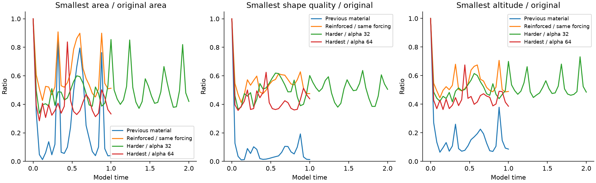
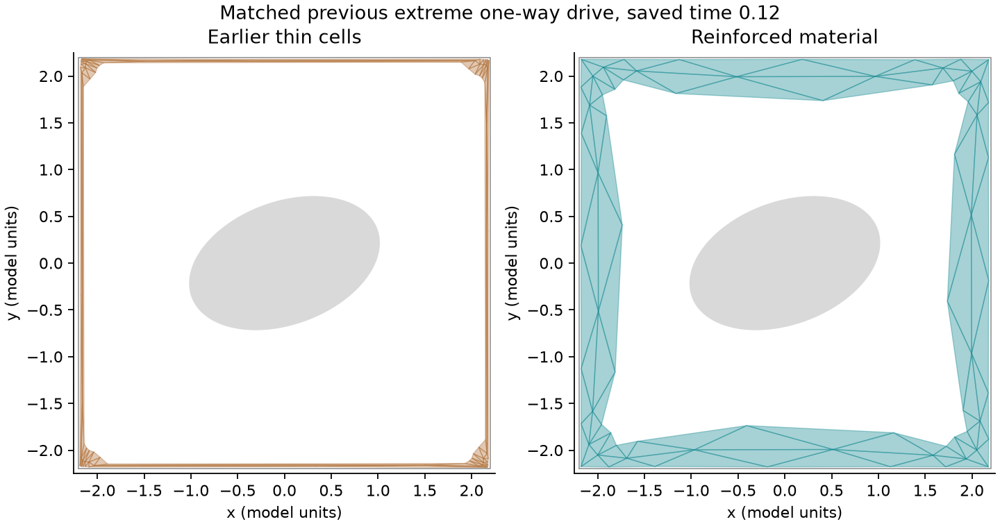
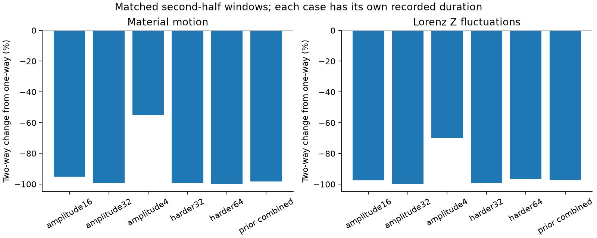
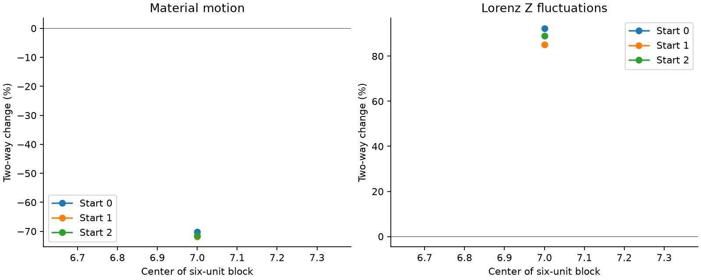
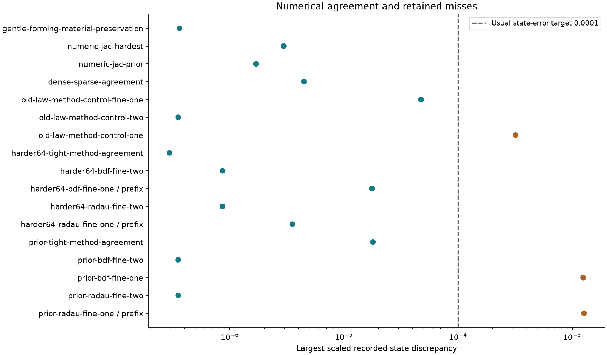

# The hug: cell protection and harder reciprocal stress

This experiment strengthens the user's abstract-clay hug against extreme cell
flattening and long, narrow triangles. It preserves the earlier contact repair
and adds two conservative material energies. The material still has yielding
bonds, changing rest lengths and fading memory. This is a **changed material
law**, not position clipping, a new rendering trick, or a claim that finer time
steps alone cure the earlier material's thinning.

[Open the computed playback and charts](report.html). Every displayed mesh is
read from a recorded numerical state. One-way forcing and two-way reaction use
the same starting state, object, square boundary and parameters within each pair.
The previous completed contact study remains at
[clay-contact-stress](../clay-contact-stress/README.md).

## Material rule and cell measurements

For a triangle, J is signed area divided by its original area. Shape quality is
q = 4 sqrt(3) area / sum of squared edge lengths. An equilateral triangle has
q = 1. Each triangle's q is normalized by its own initial q0. Relative quality
detects long, thin cells even when their area alone looks acceptable. Minimum
altitude relative to its initial altitude is recorded as an additional thickness
measurement. These ratios are not a physical thickness measurement in 3-D.

Both added energies use b(g) = -k (g-d)^2 log(g/d) for 0 < g < d, and zero for
g >= d, weighted by each triangle's reference area. For compression,
g = J - 0.25 and d = 0.65 - 0.25. For shape, g = q/q0 - 0.35 and
d = 0.65 - 0.35. Both default strengths are 100 in model units. Negative energy
gradients supply the forces; the barriers diverge toward their lower floors.
The floors and strengths are chosen prototype parameters, not measured clay
properties. Sensitivity tests vary area floors to 0.15 and 0.35, and strengths
to 25 and 400. They therefore test the consequences of those choices.

The previous whole-edge object exclusion, square-wall barriers and material
self-contact stay active. Accepted states and their straight interpolations must
pass positive-clearance and cell-geometry checks. Area minima along a straight
step are computed from the exact quadratic. Convex endpoint bounds for squared
edge lengths provide conservative lower bounds for shape and altitude. These
certificates apply to the accepted straight numerical path, **not** to an
implicit solver's dense-output polynomial or every possible 3-D collision.
No positions are clipped or triangles remeshed.

## How both directions act

The Lorenz X variable applies a signed radial force
-(alpha/10) X grad(A), where A is reference-area-weighted radial position. It can
press inward or expand the material outward. With two-way reaction, Xdot also
receives +(alpha/10) Adot / capacity. The material's reaction can therefore
change the subsequent Lorenz trajectory. The exchange port cancels exactly in
the combined weighted energy balance. Positive port work means drive to hug;
negative port work means hug to drive. Lorenz's native supply and material losses
are tracked separately. This is an abstract reciprocal coupling selected for
this experiment, not the original Lorenz convection model's coupling law.

The reaction contains an instantaneous term -D X, where
D = (alpha/10)^2 sum(reference nodal mass) / (viscosity * capacity), and a
second term from the current material energy gradient. Increasing alpha thus
strengthens the reaction quadratically; lowering viscosity or capacity also
strengthens it. The gradient term changes as the hug deforms and can return
stored energy, so this decomposition alone is not a stability proof. Very large
reductions of Lorenz fluctuations must be interpreted in light of this chosen
coupling. Matched parameters do not imply identical force histories after
feedback begins. Nominal amplitude and sampled actual drive are both reported.

Material motion uses the **integrated viscous loss** over the selected time
window, divided by viscosity, total reference mass and window duration. This
avoids missing brief bursts when states are saved every 0.04 time units. Lorenz Z
fluctuations use the saved samples, so short-window fluctuation estimates have
sampling uncertainty. Gross forward/return work uses accepted-step trapezoids;
only net work is an integrated ODE variable. Refinement discrepancies for both
gross terms are reported, rather than assumed exact.
The legacy per-run `mesh_motion_rms` is a sampled, unweighted diagnostic;
all reported paired changes use `material_motion_rms` from the integrated loss
in `data/analysis.json`.

## Completed results

<!-- RESULTS -->
50 of 56 recorded final-protocol attempts completed their requested durations; 56 attempts were declared. All completed geometry/energy audits passed: **True**. Maximum completed scaled energy-budget error is 1.605791e-05 (target 0.001). Stopped computations are listed below. Common recorded prefixes are compared only where both directions reached the stated window; they are not counted as completed requested durations. Timings depend on the machine.

The same previous extreme one-way forcing (alpha 16, rho 160, viscosity 0.15, capacity 0.01, initial Lorenz [-8,8,27], tilted ellipse, time 1) gives:

| Measurement | Earlier material | Reinforced material |
| --- | ---: | ---: |
| Smallest swept cell area / reference | 0.01079416 | 0.4268099 |
| Smallest saved shape quality / reference | 0.01060962 | 0.4131592 |
| Smallest saved altitude / reference | 0.064031 | 0.4448459 |

The shape and altitude comparison uses saved frames on the same 0.04 recording grid. Swept area is the minimum certified across all accepted straight steps. These are different measures and are not silently interchanged.





The combined stress cases double and quadruple the former maximum amplitude, increase rho to 256 and 300, and reduce viscosity to 0.075 and 0.0375. Each pair has matched parameters and starting state.

| Pair | Requested duration | Reached one-way / two-way | Smallest swept area, one-way / two-way |
| --- | ---: | --- | --- |
| prior-extreme-new | 1 | 1 / 1 | 0.42681 / 0.992161 |
| harder32 | 2 | 2 / 2 | 0.323841 / 0.992997 |
| harder64 | 1 | 1 / 1 | 0.282665 / 0.999209 |

Default barriers enforce lower domains at area ratio 0.25 and relative shape quality 0.35. Observed margins above those floors are evidence from these finite calculations; the floors themselves are chosen constraints. Compression still occurs.

| Pair / matched observed window | Material motion change with feedback | Lorenz Z fluctuation change | Surface gap at window end, one-way / two-way |
| --- | ---: | ---: | --- |
| amplitude16 / 2–4 | -95.1406% | -97.3877% | 0.6583 / 0.64722 |
| amplitude32 / 2–4 | -99.3439% | -99.8434% | 0.15386 / 0.45467 |
| amplitude4 / 2–4 | -54.8699% | -69.9517% | 1.0511 / 1.3973 |
| capacity0.0025 / 0.52–1 | -99.6110% | -97.1423% | 1.5416 / 0.48618 |
| capacity0.04 / 0.52–1 | -90.3421% | -98.1267% | 1.5416 / 1.1982 |
| circle-harder / 0.52–1 | -99.6126% | -97.6226% | 0.7518 / 0.44793 |
| harder32 / 1–2 | -99.3082% | -99.2330% | 0.026949 / 0.70038 |
| harder64 / 0.52–1 | -99.9293% | -96.8459% | 0.044463 / 0.45757 |
| lobed-harder / 0.52–1 | -99.6045% | -97.6235% | 0.71939 / 0.42185 |
| long-s0 / 7.28–14.56 (completed common prefix) | -69.5228% | +76.3956% | 1.404 / 1.2796 |
| long-s1 / 6.48–12.96 (completed common prefix) | -71.9344% | +88.4610% | 1.4281 / 0.70776 |
| long-s2 / 7.52–15.04 (completed common prefix) | -68.2873% | +67.3646% | 0.23433 / 1.205 |
| mesh48-hard / 0.12–0.2 | -99.8924% | -96.7139% | 0.08923 / 0.45294 |
| prior-extreme-new / 0.52–1 | -98.3199% | -97.2952% | 1.5416 / 0.60297 |



These comparisons measure the change when reaction is enabled. They do not mean that stronger forcing always improves contact or that the two systems received identical force histories after feedback began. Larger surface gaps mean looser surrounding contact.

Across 3 completed six-unit blocks, material motion rms changes range from -71.77955% to -70.16136%. Across 3 completed six-unit blocks, z std changes range from +85.11650% to +92.35752%. Only blocks fully reached by both directions are included. These are observed ranges across available starts and time blocks, not confidence intervals or independent identically distributed samples.



18 solver/control comparisons are recorded. The current comparisons pass their stated limits: **False**. Largest current scaled state discrepancy is 0.001268397. The usual short-state target is 0.0001; the zero-port control uses 1e-12. See the exact durations and references in `data/analysis.json`.

Retained earlier miss: `prior-extreme-new-radau-fine-one-recorded-prefix` gave 0.001268397 against target 0.0001. This comparison remains unresolved.

Retained earlier miss: `prior-extreme-new-bdf-fine-one` gave 0.001250448 against target 0.0001. This comparison remains unresolved.

Retained earlier miss: `old-law-method-control-one` gave 0.0003182815 against target 0.0001. The tighter `old-law-method-control-fine-one` supersedes it for the current check.



The base one-way trajectories must not be treated as accurate to the planned state-error target wherever refinement misses it. Geometry resistance can remain effective while the precise trajectory is insufficiently resolved. Tight-method agreement, where available, tests a stricter reference over its stated common duration.

| Prior extreme one-way numerical setting | Reached time | Minimum certified swept cell area |
| --- | ---: | ---: |
| prior-extreme-new-one | 1 | 42.68099% |
| prior-extreme-new-bdf-fine-one | 1 | 42.68078% |
| prior-extreme-new-radau-fine-one | 0.9032639 | 42.68084% |

The certified area minima agree closely even where the stricter full-state trajectory target is missed. The incomplete Radau row covers only its reached duration.

| Completed pair | Gross drive → hug work | Gross hug → drive work |
| --- | ---: | ---: |
| amplitude4 | 10.71685 | 0.4654682 |
| harder32 | 0.6486547 | 0.01153857 |
| harder64 | 0.3326208 | 0.00863911 |
| prior-extreme-new | 0.5324271 | 0.01977824 |

Work values are model units over the full recorded two-way run. Durations differ between named cases and are listed above.

The largest scaled discrepancy between base and tighter BDF gross forward/return-work quadrature is 0.0002183619. Both signs of work are integrated by accepted-step trapezoids and are approximate; net work has its own ODE state.

| Steady forming mesh / time 6 | Final imprint | Final surface gap RMS |
| --- | ---: | ---: |
| 24 angles | 0.2170698 | 0.0524114 |
| 48 angles | 0.215784 | 0.04885311 |
| 72 angles | 0.2146463 | 0.0485549 |

| Mesh comparison / matched time | Imprint difference relative to finer result | Surface gap difference relative to finer result |
| --- | ---: | ---: |
| steady-mesh24 → steady-mesh48 / 6 | 0.59588% | 7.2837% |
| steady-mesh48 → steady-mesh72 / 6 | 0.53004% | 0.61415% |
| prior-extreme-new-one → mesh48-hard-one / 0.2 | 2.266% | 60.234% |
| prior-extreme-new-two → mesh48-hard-two / 0.2 | 6.5436% | 1.046% |

These measure mesh dependence of observables, not pointwise equality of differently sized meshes. Two refinements in gentle forming and short forced comparisons do not establish a converged continuum law. The shape barrier depends on the triangulation.
Raw coarse/fine observable values accompany these ratios in `data/analysis.json`; relative differences in a small imprint need not mean a large absolute material change.

A substantial limit appears under one-way forcing: at time 0.2, the coarse surface gap is 0.03548311 and the finer gap is 0.08923026, a 60.234% discrepancy relative to the finer value. The strongly forced surface fit is **not mesh-converged**, despite positive, protected cells.

Yielding forming/release control: imprint after forming 0.2170699, after twelve release units 0.1270378. Release removes the inward preload while retaining the fixed object. It begins from the complete saved forming state, including its Lorenz coordinates. Ongoing deformation can continue yielding, so this is not an isolated exponential memory-decay measurement.
The recorded imprint decreases by 41.48% during release.

Elastic forming/release control: imprint after forming 0, after twelve release units 0. Release removes the inward preload while retaining the fixed object. It begins from the complete saved forming state, including its Lorenz coordinates. Ongoing deformation can continue yielding, so this is not an isolated exponential memory-decay measurement.

| Changed material choice / same prior extreme | Smallest swept area ratio | Smallest swept quality ratio |
| --- | ---: | ---: |
| strength25 | 0.31712 | 0.362141 |
| strength400 | 0.526178 | 0.493954 |
| floor0.15 | 0.389264 | 0.410555 |
| floor0.35 | 0.465939 | 0.413922 |

**Incomplete attempts:**

- harder64-bdf-fine-one: reached 0.8928222 of 1; Declared wall-time budget exceeded.
- harder64-radau-fine-one: reached 0.2394664 of 1; Declared wall-time budget exceeded.
- long-s0-one: reached 14.59253 of 24; Declared wall-time budget exceeded.
- long-s1-one: reached 12.98021 of 24; Declared wall-time budget exceeded.
- long-s2-one: reached 15.07726 of 24; Declared wall-time budget exceeded.
- prior-extreme-new-radau-fine-one: reached 0.9032639 of 1; Declared wall-time budget exceeded.

The raw states, all-run ledger, per-run audits and source/file hashes accompany this report. These are numerical tests of an abstract constitutive choice; they do not validate physical clay against published measurements.
<!-- /RESULTS -->

## Reproduce

Requires Python 3.12. The exact tested library versions are in
`requirements-lock.txt`. The preparation command below creates a new directory
with code and historical inputs, excluding completed experiment recordings.
It refuses to replace an existing destination. Running directly in the published
package resumes compatible recordings instead of recomputing them.
The earlier model files `clay_hug.py` and `contact_hug.py` are retained verbatim.

```powershell
python prepare_rerun.py ../clay-cell-rerun
cd ../clay-cell-rerun
python -m venv .venv
.venv\Scripts\python -m pip install -r requirements-lock.txt
.venv\Scripts\python validate_cells.py
.venv\Scripts\python run_experiments.py
.venv\Scripts\python independent_checks.py
.venv\Scripts\python run_solver_upgrade.py
.venv\Scripts\python analyze_results.py
.venv\Scripts\python write_results.py
.venv\Scripts\python build_report.py
```

Named runs resume only when their source hashes match. The main runner records
its full protocol and source hashes before computation. Its optional `--part 0
--parts 2` and `--part 1 --parts 2` split independent configurations between two
processes. These processes are computation workers, not independent physical
replicates. Starting-state replicates are explicitly named `long-s0`, `long-s1`,
and `long-s2`. Source hashes, parameters, requested/reached time, actual steps,
failure records and computation costs accompany every NPZ recording.

The default integrator is implicit BDF; tighter BDF and Radau comparisons use
the same equations. A supplied Jacobian combines numerical spatial derivatives
with exact rest-length, reciprocal-port and work blocks. It is stored sparsely,
and spatial probes with disjoint dependencies are grouped. All boundary nodes
are conservatively allowed to self-contact. The full matrix is checked against
the earlier ungrouped construction, including activated self-contact. Earlier
completed dense-solver rows are retained with the exact source under
`solver-versions/dense-jac`; their forces and continuous equations are unchanged.
`run_solver_upgrade.py` reproduces the storage-agreement and tighter historical
thin-cell controls. Short independent
Radau calculations use SciPy's own numerical Jacobian. Analytic force/work and
Jacobian directional checks precede the runs. An operational limit of 2 million
RHS calls, 50000 accepted steps or 900 seconds per run stops and preserves a
partial recording. Timings vary by machine; hitting a limit is incomplete work,
not a passing stability result. Initial solver pilots and their source versions
remain under `initial-attempts` and are excluded from the final protocol.

`test_playback.cjs` requires Node, Playwright and Chrome. Set `PLAYWRIGHT_MODULE`
to the installed Playwright package, then run it against `report.html` or a
sandboxed preview. The report works offline without fetching measurements.
`checksums.json` covers all published deliverable files except itself.

## Limits and uncertainty

This dimensionless 2-D material already surrounds a fixed circle, ellipse or
lobed object. It is not a calibrated wet-clay model, a slab wrapping around a
new object, a moving rigid body, or a 3-D material. There is no friction,
fracture, remeshing, pore-fluid simulation or quantum calculation. Resisting
thin cells can also resist physical deformation; forming and release controls
check that the revised material still molds and retains a fading imprint.

Stronger barriers change force and feedback, so a visibly smoother mesh alone
does not establish better physical prediction. No published clay measurements
were fitted or reproduced in this study. Comparisons use historical numerical
recordings, analytic identities, solver agreement and mesh/parameter changes.
Positive geometry limits are enforced by the chosen material law and numerical
acceptance rule, not discovered universal limits of clay.

Finite blocks from three initial states provide an observed range, not a
statistical confidence interval or a universal damping guarantee. Strong signed
forcing can move the hug toward the square and away from the object; reduced
motion must not be called improved molding without checking surface gap.
Finer meshes remain approximations. A short agreement test cannot establish
long-time pointwise convergence of chaotic trajectories or unlimited stability.
Neither the Lorenz ODE nor this overdamped mesh solves Navier–Stokes. The square
is a numerical container with a repulsive wall; it is not a proof device for the
Clay Millennium problem.

The shape barrier is also dependent on triangulation and the initial triangle
quality. Mesh refinement tests that dependence; no continuum material law or
mesh-independent constitutive calibration is established here.

## Primary references

- [Lorenz (1963), Deterministic Nonperiodic Flow](https://journals.ametsoc.org/view/journals/atsc/20/2/1520-0469_1963_020_0130_dnf_2_0_co_2.xml): established drive equations; the hug's port is an added modeling choice.
- [SciPy BDF documentation](https://docs.scipy.org/doc/scipy/reference/generated/scipy.integrate.BDF.html): variable-order implicit integration and error settings.
- [SciPy Radau documentation](https://docs.scipy.org/doc/scipy/reference/generated/scipy.integrate.Radau.html): independent implicit integration and error settings.
- [Li et al. (2020), Incremental Potential Contact](https://ipc-sim.github.io/): barrier-based contact as a general approach. This custom overdamped solver does not implement the full IPC method.
