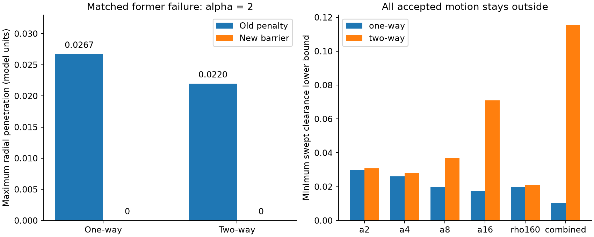
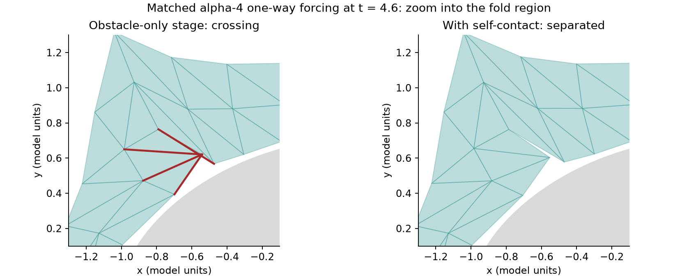
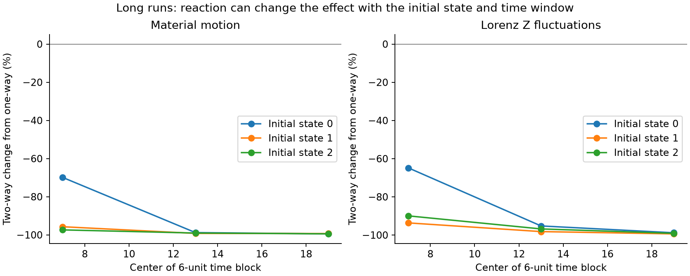
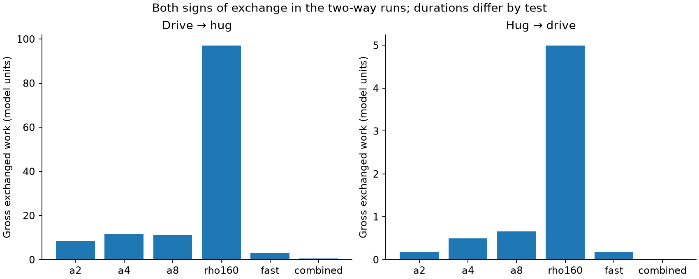
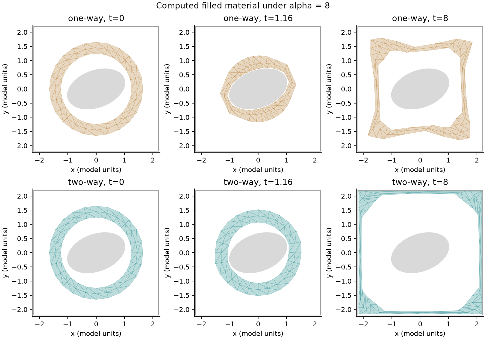
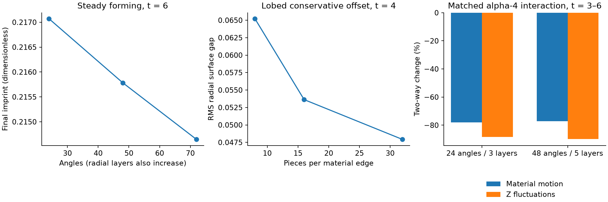

# The hug: repaired contact and harder reciprocal Lorenz tests

[Open the report and recorded molding](report.html). [Earlier material model and failures](../clay-hug/README.md).

This version addresses the object's overlap under strong forcing. The hug remains a filled, yielding 2-D material around a fixed rigid object. Its bond rest lengths change under load and relax afterward, producing a fading imprint. “Breathable” describes easy molding; this material has no latched opening rule.

## What changed

The earlier quadratic contact penalty permits penetration at finite force. Increasing its stiffness alone cannot impose a strict boundary. This version replaces it with a localized logarithmic barrier, uses constraints on **every material edge**, adds barriers at the square walls and between the material's own boundaries, and rejects invalid integration trials. Positions are never clipped after solving.

For a positive clearance lower bound `g`, activation distance `d = 0.04`, and barrier strength `k`, the contact energy is `b(g) = -k (g-d)^2 log(g/d)` when `0 < g < d`, and zero otherwise. Nonpositive gaps are outside the solver domain. The energy derivative supplies the force. This creates a small artificial stand-off distance, rather than exact zero-gap contact. Default `k = 10000` is a dimensionless modeling choice. The former penalty's strength and the barrier's strength are not physically interchangeable.

For circles and ellipses, each edge's bound comes from minimizing the squared transformed radius analytically along the complete segment. For an ellipse, `g = min(a,b) (sqrt(q_min)-1)` is a conservative distance lower bound. Its positive sign certifies that the segment stays outside the ellipse. Its derivative uses the minimizing point; at endpoints the clamped minimizer is used.

Each edge barrier is weighted by the sum of one third of its adjacent reference triangle areas. Lobed subdivision divides this weight equally across the subsegments. Wall energies use nodal reference-area weights. These are chosen discretization weights, not measured clay contact parameters.

For the three-lobed object, the radial gap has gradient norm at most `sqrt(1 + (0.594/0.702)^2) < 1.32` outside its minimum-radius disk. Each edge is divided into `s` subsegments and each midpoint gap is reduced by `1.32 * edge_length / (2*s)`. An exact segment-to-center minimum-radius guard establishes the domain of that bound. This conservative offset decreases as `s` increases; the subdivision sweep measures its effect. A first-crossing argument also establishes the bound along accepted motion: a path entering the minimum-radius disk must first reach nonpositive object gap, which the positive swept certificate excludes.

## Time integration and geometric certificate

The solver compares a full RK4 trial with two half trials and accepts the two half steps only when its local error estimate passes. All RK stages must stay in the barrier domain with positive rest lengths and noninverted cells. Rejected trials are retried with a smaller step. Recording times are reached directly, without interpolating the saved states.

For each accepted half step, whole-edge clearance at its two endpoints is reduced by a Lipschitz bound times half the maximum endpoint displacement. A positive result certifies every straight interpolation between those states. Circle/ellipse clearance is 1-Lipschitz in endpoint positions; the lobed certificate uses `1.32*(1+1/s)`. Signed triangle area during interpolation is quadratic in time; its minimum is checked analytically. Square-wall constraints are convex, so positive endpoint wall clearances imply positive interpolated clearances.

The certified numerical path is the piecewise straight path between accepted states. This is not a guarantee for an arbitrary RK dense-output polynomial, an exact continuous solution, other shapes, or unlimited forcing. Trial stages can fail and are discarded. Maximum attempted steps are not the actual accepted steps. Acceptance counts, domain rejections, minimum steps, and minimum swept clearance are saved per configuration.

Self-contact uses the exact distance from every inner/outer boundary vertex to every nonincident boundary segment. Its barrier has width 0.02, strength 10000 and the vertex's reference-area weight. The force acts on the vertex and with opposite barycentric forces on the segment endpoints; total self-contact force is zero. Boundary crossing trials are explicitly rejected. A swept certificate subtracts half of `vertex_displacement + max(segment_endpoint_displacements)` from the smaller endpoint distance, for every pair. A positive certificate excludes first contact/crossing along the straight accepted path. Positive swept triangle orientation is also required. Every saved frame is independently checked for proper crossing of **all** nonadjacent material edges, including internal edges.

## Both directions of influence

The Lorenz drive applies `-(alpha/10) X grad(A)` to the material, with `A = sum(reference_node_area * radius)`. Material velocity gives `A_dot`. In a two-way run, the reaction changes the Lorenz equation by `X_dot += (alpha/10) A_dot / C`. One-way controls use the identical material forcing rule but omit this reaction. Default reservoir capacity `C = 0.01` is a chosen model parameter and is swept.

Port power into the material is `P = -(alpha/10) X A_dot`. The reservoir receives `-P` in two-way mode, so exchange cancels from the combined energy balance. Material viscous and internal losses remain dissipative. Lorenz native forcing and dissipation remain present: this is not a closed physical fluid system.

The bookkeeping reservoir energy is `E_L = C*(X^2+Y^2+Z^2)/2`; its native power is `C*((10+rho)*X*Y - 10*X^2 - Y^2 - (8/3)*Z^2)`. `X` is treated as an abstract drive coordinate. The coupling is not a derived physical back-reaction law for a convection experiment.

The integrated net port work is a state variable computed with RK4. Separate positive and negative gross work estimates use trapezoidal integration at every accepted half step; their refinement errors are reported. Material RMS motion comes from differences in the integrated viscous loss divided by viscosity, total reference area and elapsed time. This avoids missing short motion spikes in saved snapshots. Lorenz RMS/variance still use output samples; 0.04/0.01 sampling comparisons are checked in the independent recordings. A chaotic trajectory difference alone is not evidence of a physical mechanism: zero-coupling controls, explicit reaction work, matched initial states, short solver comparisons, mesh checks, and longer blocks provide separate checks.

## Actually completed results

<!-- RESULTS -->
49 final-protocol configurations plus two finer-mesh continuations completed (51 recorded tests). The continuations extend the same finer trajectories from time 4 to 6 and are not independent initial-state replicates. All have zero measured object and wall overlap, positive swept whole-edge clearance, positive swept self-clearance, positive swept cell area, and passing saved-frame edge-crossing checks. The smallest swept object lower bound is 0.0101661 model units; the smallest swept self-clearance bound is 0.0135766. The largest scaled energy-balance error across material, Lorenz and combined checks is 8.50815e-05, below the 0.001 target.

Over the same first 8 model-time units, the old alpha-2 failures had maximum radial penetration 0.026715 (one-way) and 0.0219615 (two-way). Both are zero in the upgraded contact model. This is a changed contact law, not a claim that the old solution was corrected by time refinement alone. The intermediate obstacle-only barrier stage still had self-crossing in 11 of 34 completed configurations; its recordings and failed audits remain under `obstacle-only`.

The stress sweep reaches alpha 16 (four times the former alpha-4 stress amplitude), rho 160, viscosity 0.15, contact strength 100000, varied reservoir capacities, three object shapes and three initial states. Matched sustained runs reach time 24. The most extreme combined alpha-16/rho-160/viscosity-0.15 test runs to time 1; other short stiff/fast tests reach time 2, and paired amplitude/object tests reach time 4–8. Longer runs use alpha 4. Durations reflect the computational cost of enforcing contact, and are not claims about unlimited-time behavior. All settings are explicit in `data/protocol.json`.

In the alpha-8, initial-state-1 comparison over time 4–8, two-way reaction changes material motion by -93.334% and Lorenz Z fluctuations by -77.653%. Across nine 6-unit blocks from three sustained runs, motion changes range from -99.479% to -69.894%, and Z fluctuation changes range from -99.393% to -64.809%. These are observed finite-window ranges, not confidence intervals or universal damping guarantees. Material motion is reference-area-weighted RMS derived from the integrated viscous loss, rather than sampled velocity snapshots that could miss brief motion.

Reduced motion does not mean tighter molding. Signed Lorenz forcing can push the material outward toward the square. In the alpha-8 pair, final RMS radial surface gaps are 0.8366 (one-way) and 1.5431 (two-way), much larger than the contact activation width. The playback shows this expansion as well as the transient approach to the object.

All independent and refinement checks pass; the largest reported short state discrepancy is 9.72191e-07 on the scaled state metric (target 0.0001). The zero-port one/two control is identical. Whole raw states, independent solver recordings, all per-run audits, mesh/subdivision comparisons and the retained earlier attempts are included. See `data/analysis.json`, `data/solver-checks.json` and the report for exact values.

In steady forming at time 6, the 48-to-72-angle change is 0.527% in final imprint and 0.610% in RMS surface gap. For matched alpha-4 forcing over time 3–6, two-way material-motion changes are -77.940% on the 24-angle mesh and -77.095% on the 48-angle mesh; Z-fluctuation changes are -88.367% and -89.906%. The effect persists in this comparison. These checks do not establish full spatial convergence of every strongly forced trajectory.

The combined extreme one-way run is close to the cell-quality limit: its smallest swept triangle area is 1.0794% of reference area, compared with the 1% stop threshold. It needed 148168 accepted half steps and 30031 rejected trials for one model-time unit; its smallest half step was 3.87073e-07, despite allowing a maximum trial step of 0.2. It took 28.26 minutes on this machine, versus 30.81 seconds with two-way reaction. Timings are machine-dependent. The run completes without overlap, but its thin cells and computational cost are practical stress limits, not evidence of unlimited robustness.
<!-- /RESULTS -->













## Reproduce

Python 3.12 was used. Exact NumPy/SciPy/Matplotlib versions are recorded in `requirements-lock.txt`; compatible ranges are in `requirements.txt`.

Run these commands from this directory (`reports/clay-contact-stress` in the repository).

```text
python -m venv .venv
.venv\Scripts\python -m pip install -r requirements-lock.txt
.venv\Scripts\python validate_contact.py
.venv\Scripts\python run_experiments.py
.venv\Scripts\python run_sensitivity.py
.venv\Scripts\python run_mesh_extension.py
.venv\Scripts\python independent_checks.py
.venv\Scripts\python analyze_results.py
.venv\Scripts\python build_report.py
```

The runner resumes already completed named configurations. To rerun independently, use a fresh copy and clear generated results from its `data` directory, while preserving `original-overlap.json`, `original-overlap-one.npz` and `original-overlap-two.npz` as the supplied historical comparison inputs. Keep the archived `obstacle-only` folder, which contains the self-crossing regression fixture. Run validation first, then the commands above in order. Four local worker processes are used. `protocol.json` freezes configuration settings and source hashes before computation; each run also records the actual model hash. Full states and geometry are in compressed NPZ files, with times in model units. Independent solver recordings are separate. `checksums.json` records SHA-256 for all deliverable files except itself. `test_playback.cjs` requires Node, Playwright and Chrome; set `PLAYWRIGHT_MODULE` to your Playwright installation and optionally pass a sandboxed preview wrapper.

The version-1 `clay_hug.py` is retained as the material base class, and `baseline_metrics.py` supplies shared measurements. **Run the commands above**, rather than the old support module's standalone runner. `contact_hug.py` overrides contact and integration. `obstacle-only` preserves 34 completed intermediate configurations and their audits: 11 have self-crossing despite staying outside the object. That stage was stopped before its remaining planned configurations completed. Its nested `data/initial-attempts` and `data/low-barrier-attempts` retain the earlier recording-time roundoff failure, weak-barrier energy miss and their sources. The final alpha-4 one-way configuration reuses the validated six-unit pilot; it is counted once.

## Limits and uncertainty

This is a dimensionless 2-D annular prototype already surrounding an object. It is not a slab wrapping itself around a new object, calibrated wet clay, a 3-D material, or Navier–Stokes flow. There is no friction, fracture, moving rigid body, pore fluid, or quantum calculation. Positive contact clearance establishes numerical exclusion in this model; it does not validate real clay's constitutive behavior.

The stronger barriers also change the modeled contact response, so old/new trajectory differences are not purely a solver improvement. Mesh refinement, barrier activation widths and strengths, and lobed subdivision affect the result. Self-contact is limited to this 2-D annular mesh and its inner/outer boundaries; it is not a general 3-D collision algorithm. The certificate concerns the accepted straight numerical path. Tiny cell area or clearance guards can stop a computation; a stop must remain a failed run.

The independent DOP853 checks test the same equations and therefore validate numerical agreement, not physical accuracy. Three Lorenz initial states and finite block ranges do not establish a statistical confidence interval, an invariant distribution, universal stabilization, or global existence. A finest grid is still an approximation. No claim about the Clay Navier–Stokes problem follows from these tests.

## Primary references

- [Lorenz, Deterministic Nonperiodic Flow (1963)](https://journals.ametsoc.org/view/journals/atsc/20/2/1520-0469_1963_020_0130_dnf_2_0_co_2.xml): the established deterministic convection model used as the abstract drive. The added material port is our chosen coupling, not part of the original convection equations.

- [Li et al., Incremental Potential Contact (2020)](https://ipc-sim.github.io/file/IPC-paper-fullRes.pdf): barrier contact and geometric feasibility as a general numerical approach. This custom overdamped solver does **not** implement the full IPC algorithm, its Newton solver, friction law or general continuous collision detection.
- [SciPy solve_ivp documentation](https://docs.scipy.org/doc/scipy/reference/generated/scipy.integrate.solve_ivp.html): the independent DOP853 method and tolerances.

No experimental clay measurements were used in this repair. The comparisons here are against the earlier numerical contact failures, analytic gradient/work identities, independent integration, and refinement—not published measurements of physical clay.
