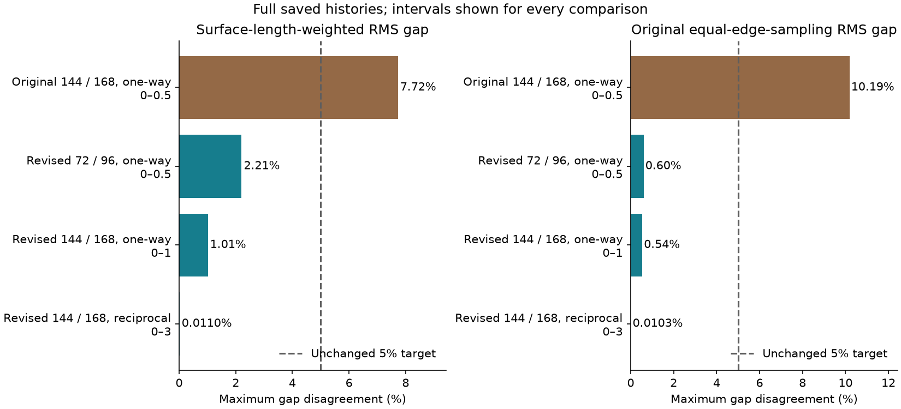
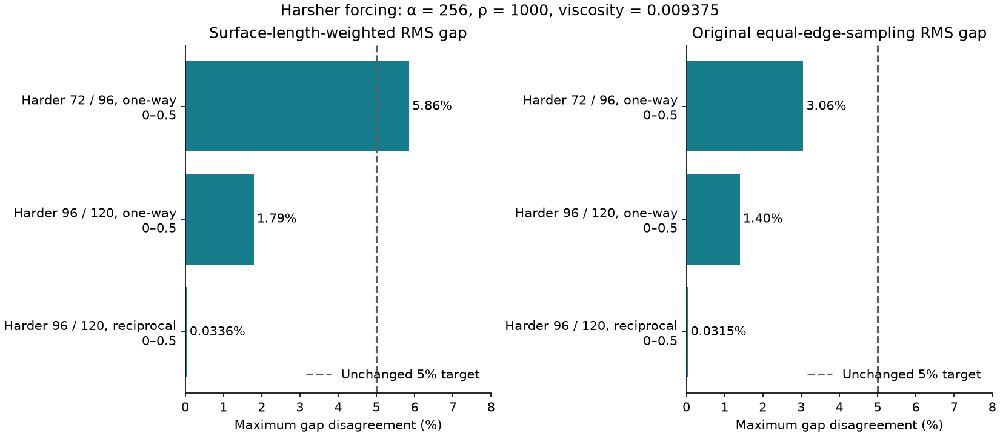
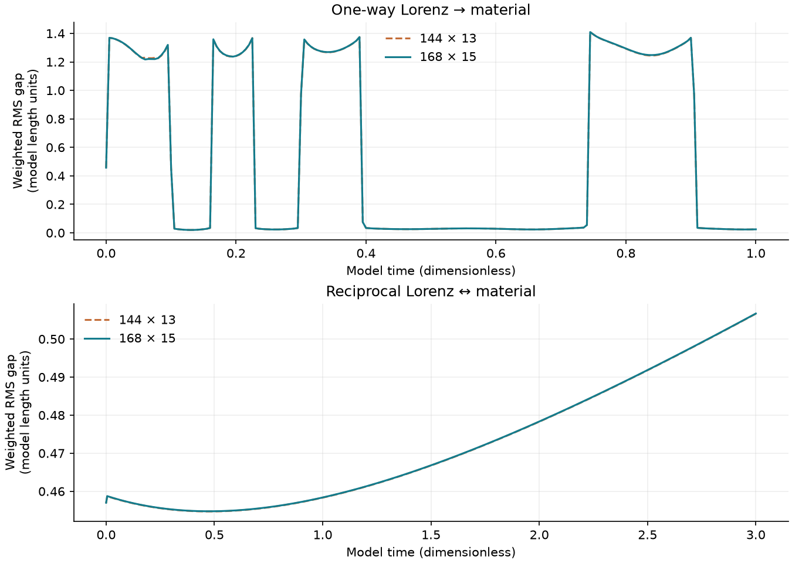
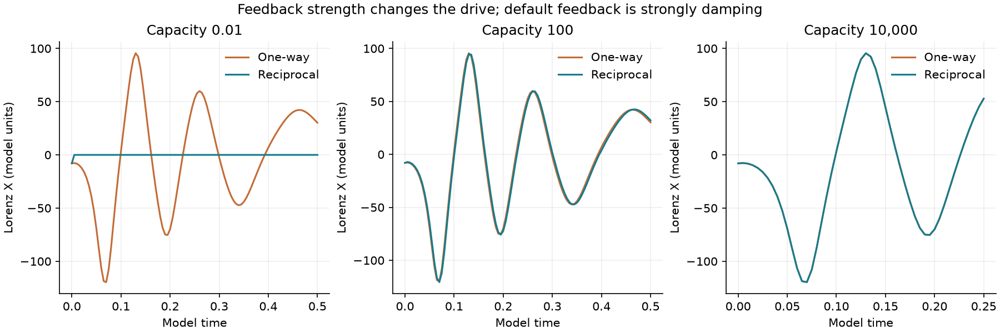

# Hug: gap refinement and longer Lorenz stress tests

This follow-up preserves the published model and tests a separate proposed material revision. The revision adds a fixed reference-gradient jump energy to resist deformation concentrated into smaller and smaller regions. **It changes the constitutive model; it is not a correction that makes the old model exact.**

The nominal test uses coupling α = 128, Lorenz ρ = 500, viscosity 0.01875, preload 0.35, initial Lorenz state (−8, 8, 27), the same tilted ellipse and square boundary, and the same area and shape floors. All quantities are dimensionless.

[Raw-array release and restoration catalog](data-release.json). Numerical arrays are distributed as a verified GitHub release archive; code, summaries and the viewer remain in this source folder. Restore arrays before running the analysis or verification commands below.

## Measured mesh differences

Both statistics use the unchanged denominator max(0.01, |fine gap|), the unchanged 5% target, and all common saved times (normally every 0.005). No gap rescaling, clipping, fitted correction or remeshing was used. A passed gap test alone does not establish convergence of imprint or all state variables.

The measured gap is radial separation from the ellipse, not exact closest-point distance. The weighted RMS integrates its square along the current inner boundary with 32-point Gauss quadrature per edge. The original statistic retains 17 equally spaced samples per edge (including endpoints). The conservative whole-edge clearance used for collision protection is a separate quantity. Reported maxima are over saved times, not certified maxima over continuous time.

| Model / coupling | Meshes | Common interval | Weighted gap max | Original gap max | Full gap check |
|---|---|---|---:|---:|---|
| Original 144 / 168, one-way | 144×13 / 168×15 | 0–0.5 | 7.7247% | 10.1851% | Unresolved |
| Revised 72 / 96, one-way | 72×7 / 96×9 | 0–0.5 | 2.2053% | 0.6007% | Pass |
| Revised 144 / 168, one-way | 144×13 / 168×15 | 0–1 | 1.0132% | 0.5366% | Pass |
| Revised 144 / 168, reciprocal | 144×13 / 168×15 | 0–3 | 0.0110% | 0.0103% | Pass |
| Harder 72 / 96, one-way | 72×7 / 96×9 | 0–0.5 | 5.8561% | 3.0577% | Unresolved |
| Harder 96 / 120, one-way | 96×9 / 120×11 | 0–0.5 | 1.7925% | 1.3965% | Pass |
| Harder 96 / 120, reciprocal | 96×9 / 120×11 | 0–0.5 | 0.0336% | 0.0315% | Pass |

Imprint differs by at most **0.853%** on the revised 144/168 comparison through time 1.0. On 72/96 through 0.5 it still differs by **7.301%**, although both gap statistics pass.

Under the harsher forcing, the 96/120 imprint difference is still **6.159%**. Passing the gap target does not remove this remaining uncertainty in plastic memory.







## What changed and why

The original squeeze diagnostic shows active same-boundary self-contact terms, many between nearby material neighbors, around the previous error peaks at time 0.125–0.130. This is evidence of a difficult localized deformation/contact regime, not proof that any one force term alone caused the old disagreement. Strict BDF and independent Radau restarts test time error separately; every stopped attempt remains in the archive.

The proposed reference energy is E_reg = (μ ℓ² / 2) Σ_e (L_e / d_e) ||F_left − F_right||². Here L_e is an interior edge length in the reference mesh, d_e is the normal distance between adjacent reference triangle centroids, and F is each triangle’s deformation gradient. The fixed material length ℓ = 0.1 is one quarter of the initial annulus thickness 0.4; it was declared before examining the revised mesh results. Additional ℓ = 0.05 and 0.2 runs expose sensitivity to this new modeling choice. The positive energy vanishes for every affine deformation and has an exact constant sparse Hessian. Plastic rest lengths and their fading memory retain the original evolution law. This term is elastic and can alter how the imprint relaxes.

The numerical backend eliminates diagonal internal-variable rows and the small Lorenz border by exact Schur complements. Independent full sparse real/complex solves check the result. This backend improvement leaves the equations unchanged. A half-unit segmented reference drive preserves every value on the published first interval exactly when extending the one-way simulation. Independent DOP853/Radau reference calculations check input precision.

## Actual runs

32 of 32 new attempts completed their requested intervals. All new recorded histories passed geometry: **True**; separate material/Lorenz/combined energy audits passed: **True**. The energy target is 0.1%. Stopped attempts are reported with their actual endpoints, never as completed tests.

| Recording | Mesh | Direction | Actual / requested end | Energy error max | Status |
|---|---|---|---|---:|---|
| [peak144-tight](baseline/data/peak144-tight.json) | 144×13 | one-way | 0.14 / 0.14 | 0.010299% | Complete |
| [peak168-tight](baseline/data/peak168-tight.json) | 168×15 | one-way | 0.14 / 0.14 | 0.00081166% | Complete |
| [original168-long-one](numerical/data/original168-long-one.json) | 168×15 | one-way | 1 / 1 | 0.00081166% | Complete |
| [original168-long-two](numerical/data/original168-long-two.json) | 168×15 | reciprocal | 3 / 3 | 0.00035992% | Complete |
| [peak144-radau](numerical/data/peak144-radau.json) | 144×13 | one-way | 0.14 / 0.14 | 0.010299% | Complete |
| [finest-original-radau](solver/data/finest-original-radau.json) | 168×15 | one-way | 0.4 / 0.4 | 0.00022125% | Complete |
| [finest-weighted-radau](solver/data/finest-weighted-radau.json) | 168×15 | one-way | 0.065 / 0.065 | 0.00014035% | Complete |
| [harder120-one](solver/data/harder120-one.json) | 120×11 | one-way | 0.5 / 0.5 | 0.0051414% | Complete |
| [harder120-two](solver/data/harder120-two.json) | 120×11 | reciprocal | 0.5 / 0.5 | 0.00017195% | Complete |
| [harder72-one-tight](solver/data/harder72-one-tight.json) | 72×7 | one-way | 0.5 / 0.5 | 1.1348e-06% | Complete |
| [harder72-one](solver/data/harder72-one.json) | 72×7 | one-way | 0.5 / 0.5 | 0.0024392% | Complete |
| [harder72-two](solver/data/harder72-two.json) | 72×7 | reciprocal | 0.5 / 0.5 | 0.00014095% | Complete |
| [harder96-one](solver/data/harder96-one.json) | 96×9 | one-way | 0.5 / 0.5 | 0.0046731% | Complete |
| [harder96-two](solver/data/harder96-two.json) | 96×9 | reciprocal | 0.5 / 0.5 | 0.00015855% | Complete |
| [length050-72-one](solver/data/length050-72-one.json) | 72×7 | one-way | 0.5 / 0.5 | 0.001616% | Complete |
| [length100-144-one](solver/data/length100-144-one.json) | 144×13 | one-way | 1 / 1 | 0.0015407% | Complete |
| [length100-144-two](solver/data/length100-144-two.json) | 144×13 | reciprocal | 3 / 3 | 0.00021519% | Complete |
| [length100-168-one](solver/data/length100-168-one.json) | 168×15 | one-way | 1 / 1 | 0.00025181% | Complete |
| [length100-168-two](solver/data/length100-168-two.json) | 168×15 | reciprocal | 3 / 3 | 0.00024377% | Complete |
| [length100-72-one-tight](solver/data/length100-72-one-tight.json) | 72×7 | one-way | 0.5 / 0.5 | 6.0316e-07% | Complete |
| [length100-72-one](solver/data/length100-72-one.json) | 72×7 | one-way | 0.5 / 0.5 | 0.00036682% | Complete |
| [length100-72-two](solver/data/length100-72-two.json) | 72×7 | reciprocal | 0.5 / 0.5 | 0.00013289% | Complete |
| [length100-96-one](solver/data/length100-96-one.json) | 96×9 | one-way | 0.5 / 0.5 | 0.00063777% | Complete |
| [length100-96-two](solver/data/length100-96-two.json) | 96×9 | reciprocal | 0.5 / 0.5 | 0.0001547% | Complete |
| [length200-72-one](solver/data/length200-72-one.json) | 72×7 | one-way | 0.5 / 0.5 | 0.00043486% | Complete |
| [middle72-one](solver/data/middle72-one.json) | 72×7 | one-way | 0.5 / 0.5 | 0.0017569% | Complete |
| [middle72-two](solver/data/middle72-two.json) | 72×7 | reciprocal | 0.5 / 0.5 | 0.0015023% | Complete |
| [weak72-one](solver/data/weak72-one.json) | 72×7 | one-way | 0.25 / 0.25 | 0.00065835% | Complete |
| [weak72-perturb-two](solver/data/weak72-perturb-two.json) | 72×7 | reciprocal | 0.25 / 0.25 | 0.0010911% | Complete |
| [weak72-two-tight](solver/data/weak72-two-tight.json) | 72×7 | reciprocal | 0.25 / 0.25 | 3.9968e-07% | Complete |
| [weak72-two-tighter](solver/data/weak72-two-tighter.json) | 72×7 | reciprocal | 0.25 / 0.25 | 7.464e-08% | Complete |
| [weak72-two](solver/data/weak72-two.json) | 72×7 | reciprocal | 0.25 / 0.25 | 0.00090963% | Complete |

## Accuracy and uncertainty

Numerical uncertainty is represented by mesh differences, independent time-method/tolerance comparisons, recomputed energy balance, positive clearances and certified straight paths between accepted states. These are deterministic error indicators, not statistical confidence intervals. See [analysis.json](analysis.json), [exact execution settings](data/executed-protocol.json), [factor checks](data/factor-check.json), [affine/gradient/reference checks](data/regularization-check.json), and [all saved-state audits](data/audits/).

| Independent time comparison | Interval checked | Scaled full-state difference | Outcome |
|---|---|---:|---|
| shared144-one / peak144-tight | 0.1–0.14 | 0.00186525% | Pass |
| shared144-one / peak144-radau | 0.1–0.14 | 0.00185042% | Pass |
| extend168-one / peak168-tight | 0.1–0.14 | 0.000518704% | Pass |
| peak144-tight / peak144-radau | 0.1–0.14 | 1.48244e-05% | Pass |
| harder72-one / harder72-one-tight | 0–0.5 | 0.00389085% | Pass |
| length100-72-one / length100-72-one-tight | 0–0.5 | 0.000843952% | Pass |
| weak72-two / weak72-two-tight | 0–0.25 | 0.0189504% | Unresolved |
| weak72-two-tight / weak72-two-tighter | 0–0.25 | 6.56766e-06% | Pass |
| length100-168-one / finest-weighted-radau | 0.055–0.065 | 0.000250024% | Pass |
| length100-168-one / finest-original-radau | 0.39–0.4 | 3.24923e-05% | Pass |

The looser C = 10,000 BDF/Radau comparison fails the 0.01% scaled-state target. The higher-precision Radau pair (rtol 2e−8 / 2e−9) is checked separately, and the viewer uses the tighter recording. The original looser result remains in the table.

| Sensitivity (changes, not error bars) | Comparison | Max weighted gap change | Max imprint change |
|---|---|---:|---:|
| material length | length050-72-one / length100-72-one | 32.25% | 8.698% |
| material length | length100-72-one / length200-72-one | 71.85% | 18.59% |
| initial perturbation 1e-8 | weak72-two / weak72-perturb-two | 0.09001% | 0.0005973% |
| changed constitutive model | original168-long-one / length100-168-one | 51.8% | 27.31% |

The material-length sweep changes the equations, so its differences must not be treated as numerical error or used to infer which length is physically correct. The small initial-perturbation test uses the looser integrator; its observed change is comparable to that configuration’s numerical uncertainty and does not isolate physical sensitivity.

A short checkpoint comparison tests only the stated interval and retains the parent’s accumulated uncertainty. It cannot validate earlier evolution or a later full run. The original-model peak controls assess time error locally; they do not repair the old 7.72% / 10.19% spatial gap difference. Agreement in gap also does not imply agreement in imprint: the revised 72/96 imprint comparison must be read from analysis.json.

## Both directions of influence

The Lorenz state drives radial material loading. The reciprocal rule adds λ A_dot / C to X_dot, with λ = α/10, A = Σ_i m_i |x_i| and capacity C. Material port power is −λ X A_dot; the Lorenz port receives the opposite power. Material deformation, plastic dissipation and its changing motion therefore affect the drive through this explicitly chosen scalar coupling. Native Lorenz power is tracked separately; the combined system is not assumed to conserve energy.

The default C = 0.01 causes very strong damping of X. Intermediate C = 100 and larger-capacity C = 10,000 tests explore moving-drive feedback. Nearby initial conditions test finite-horizon sensitivity; they do not establish a Lyapunov exponent or long-term statistical convergence. The harsher tests double α and ρ and halve viscosity. Their mesh accuracy must not be inferred from the nominal forcing tests.



## Reproduce

Use Python 3.12 and the pinned requirements. Every recording includes source SHA-256 hashes, all parameters, solver tolerances, budgets, actual endpoint, work counters and raw states. Solvers refuse to overwrite an attempt. BLAS libraries use one thread. [baseline.json](baseline.json) identifies the immutable previous GitHub commit; baseline sources and data are preserved locally. Checkpoint prefixes preserve exact raw states and explicitly retain the original full-run audit scope.

```sh
python -m pip install -r requirements.txt
python restore_data.py
python restore_data.py --verify-only
python verify.py
python check_factor.py
python check_regularization.py
python check_derivatives.py
python check_quadrature.py
python run.py my-new-case --n 168 --layers 15 --end 1 --seconds 10800
python run.py my-two-way-case --n 168 --layers 15 --end 3 --two --seconds 3600
python replay.py solver/data/harder72-two.json /absolute/path/to/a-new-empty-location
```

The replay command creates a result-free copy and checks every saved array for bitwise equality. It requires a destination that does not yet exist. Failed/resource-limited runs can complete to different endpoints on different hardware; their declared resource caps are not physical failure thresholds. Replaying the first one-way interval requires substantial compute time.

The check commands preserve the stored publication evidence by default; `--write` explicitly replaces a check’s evidence file in a new build. To regenerate analysis, figures or the report, use a separate copy and run `python analyze.py` and `python build_report.py`. A rebuilt report needs its browser check and a new manifest; it is not the immutable original publication. Study-local Git attributes preserve the audited line endings. Bitwise replay was verified on the recorded runtime; other numerical libraries may require tolerance comparisons.

## Scope

This is a two-dimensional abstract yielding spring material with a proposed nonlocal elastic regularization, fixed obstacle and square boundary. It has not been calibrated against clay measurements. Lorenz is an adopted reduced dynamical drive, not a solved Navier–Stokes flow or a quantum calculation. These tests do not prove regularity of Navier–Stokes, establish real-clay accuracy, or demonstrate nuclear quantum effects. The original model’s unresolved results remain visible rather than being replaced by the revised model’s results.

[Open the standalone saved-state viewer](report.html). The viewer selects actual saved states; graphics are downsampled and rounded for display only. Numerical analysis uses complete double-precision raw recordings.
