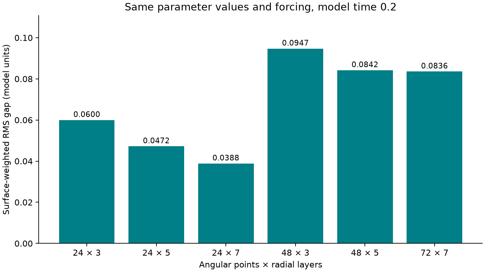
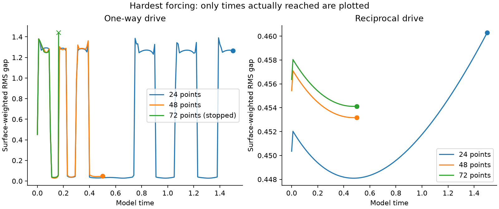

# The hug: coarse-start refinement and longer Lorenz forcing

This extends the [mesh-accuracy study](../clay-mesh-accuracy/README.md). The fixed 24-point mesh still has a substantial spatial error. The repair is an executable **coarse-start refinement process**: compute at 24 × 3, check against 48 × 5, and if necessary check 48 × 5 against 72 × 7. Return the actual finer solution only when the comparison passes. It does not multiply the coarse gap by a fitted correction or label a finer internal mesh as 24 points.

The physical equations, contact energies, plastic rest lengths and Lorenz coupling are unchanged. This remains a dimensionless 2-D abstract material initially surrounding an object, not a calibration to measured clay, a 3-D wrapping simulation, quantum water evidence, or a Navier–Stokes theorem.

## What the refinement check establishes

Both the current-surface-length-weighted RMS gap and the original equal-edge-sampling statistic must agree within **5% at every shared recorded time**. The denominator has a 0.01 model-unit floor. Both angular points and radial layers must increase. Parameters, initial states and requested intervals must match. Both runs must finish, retain positive certified clearances and deformation bounds, and meet the 0.1% combined energy-budget target. Otherwise the program returns no accepted solution. The current resource cap is 72 × 7.

This is global mesh refinement from the same starting state at each level. There is no interpolation of plastic memory between meshes, no moving refinement during an integration, and no claim of a rigorous exact-solution error bound. Agreement of these gap statistics does not establish accuracy of every material observable or every longer chaotic trajectory. The selected mesh size is always reported.

## Longer stress protocol

All long runs use coupling alpha = **128**, Lorenz rho = **500**, viscosity = **0.01875**, preload = **0.35**, the same centered tilted ellipse, and the same square boundary. These parameters are held fixed between directions and meshes. The initial Lorenz state of the parent runs is (−8, 8, 27).

| Mesh | Previously reached | New requested end | Directions | Budget per extension |
|---|---:|---:|---|---:|
| 24 × 3 | 0.5 | 1.5 | One-way and reciprocal | 2,400 seconds |
| 48 × 5 | 0.1 | 0.5 | One-way and reciprocal | 2,400 seconds |
| 72 × 7 | 0.1 | 0.5 | One-way and reciprocal | 2,400 seconds |

The extensions start from immutable published checkpoints. They retain the exact clock, Lorenz variables, positions, plastic rest lengths and accumulated work. Raw parent files and their original sources are included. Energy residuals across an extension subtract the initial accumulated work; full-history audits include the parent interval. A requested end is not a completed result: the table below reports what each attempt actually reached.

The reciprocal term also introduces strong, parameter-dependent damping into the Lorenz X equation. Large reductions in motion therefore partly reflect the chosen coupling law. Less motion can leave the material farther from the object; it is not automatically better molding.

The normal settings remain BDF, relative tolerance 2e-9, absolute tolerance 2e-11, maximum step 0.01, and saved spacing 0.01. Accepted paths retain the same conservative geometry checks. The extension step budget is 200,000 and the RHS budget is 4,000,000. Independent Radau controls run on 24 × 3 over [0.5, 0.6] with tolerance 2e-10. A separate 48 × 5 Radau probe requests [0.1, 0.12] at tolerance 2e-9 with a 900-second budget. A partial control cannot establish accuracy beyond its shared independently computed interval.

The angular/radial diagnosis holds the standard forcing (alpha 16, rho 160, viscosity 0.15) fixed and tests 24 × 5, 24 × 7, and 48 × 3 to time 0.2. These are resolution probes, not tuned material parameters.

The material still uses yielding edge springs. Changing mesh aspect ratio also changes the spring directions represented by the mesh. These probes therefore diagnose mesh sensitivity; they do not cleanly separate interpolation error from directional bias in the discrete material. The acceptance check uses the proportionally refined 24 × 3, 48 × 5, 72 × 7 family. A mesh-independent continuum plasticity model would require a separate constitutive change and validation.

## Contact calculation and checks

The faster contact calculation first uses bounding boxes. A point outside the contact range of a segment's bounding box cannot activate that segment's barrier. Such pairs have exactly zero barrier energy and force. Potentially active distances and derivatives are computed exactly as before. Far pairs supply conservative distance lower bounds for the path certificate. Segment-crossing checks still examine every pair whose boxes overlap; no potentially crossing pair is removed by an arbitrary neighborhood radius.

`check_contact.py` compares the complete RHS against exhaustive contact on sixteen actual recorded states, including the hardest fine-mesh states. `diagnose_stiff.py` compares the coupled Jacobian to independent directional differences at the exact fine-mesh continuation starts. `solver/validate.py` checks the force derivatives and reciprocal energy identity. `test_adaptive.py` checks that failed, incomplete, mismatched, and identical-mesh evidence cannot be accepted. A fresh 24-point calculation checks the unchanged trajectory against the previous release.

## Actual results

<!-- RESULTS -->

**15 of 16 new integrations completed** their requested interval. Parent checkpoints are inherited evidence and are not counted as new runs.

### Coarse-start resolution

- `one`: accepted = True; selected mesh = [72, 7]. The selected record is `mesh72-one.json`.
- `two`: accepted = True; selected mesh = [48, 5]. The selected record is `mesh48-two.json`.
- `fresh-one`: accepted = True; selected mesh = [72, 7]. The selected record is `mesh72-one.json`.
- `fresh-two`: accepted = True; selected mesh = [48, 5]. The selected record is `mesh48-two.json`.

The 24 × 3 to 48 × 5 gap disagreement remains 28.76% for surface-length weighting (30.51% for the original statistic). The workflow therefore rejects that pair and returns the 72 × 7 solution after the 48 × 5 / 72 × 7 check: maximum disagreements 0.8077% and 2.123%, respectively. These are mesh agreements, not measured physical errors. The native fixed 24-point solution has not been made accurate.

| Resolution probe | Final surface-weighted gap | Difference from 72 × 7 at time 0.2 |
|---|---:|---:|
| axis24x5 | 0.047202396 | 43.51% |
| axis24x7 | 0.038842573 | 53.51% |
| axis48x3 | 0.094709961 | 13.35% |

### Requested and completed long tests

| Attempt | New interval starts | Reached / requested | Status |
|---|---:|---:|---|
| long24-one | 0.5 | 1.5 / 1.5 | completed |
| long24-two | 0.5 | 1.5 / 1.5 | completed |
| long48-one | 0.1 | 0.5 / 0.5 | completed |
| long48-two | 0.1 | 0.5 / 0.5 | completed |
| long72-one | 0.1 | 0.162967461 / 0.5 | Declared wall-time budget exceeded |
| long72-two | 0.1 | 0.5 / 0.5 | completed |

| Fine-mesh comparison | Shared recorded end | Surface-weighted maximum difference | Original-statistic maximum difference | Full requested mesh check passed |
|---|---:|---:|---:|---|
| long48-one / long72-one | 0.16 | 22.76% | 28.93% | False |
| long48-two / long72-two | 0.5 | 0.2078% | 0.1948% | True |

A partial fine run cannot validate the whole requested interval, even if its shared samples agree. The long 24-point trajectories test solver behavior and reciprocal sensitivity; they remain coarse and are not a substitute for a passed fine-mesh comparison.

### Independent integration controls

| Control pair | Independently recomputed interval | Scaled state difference | Control target met |
|---|---:|---:|---|
| long24-one / radau24-one | [0.5, 0.6] | 8.987e-06% | True |
| long24-two / radau24-two | [0.5, 0.6] | 1.051e-05% | True |
| long48-one / radau48-probe | [0.1, 0.12] | 1.688e-06% | True |

The state target is 0.01%, normalized componentwise by max(1, peak absolute reference component) and excluding the four work bookkeeping variables. Shared parent samples are excluded from these independent-control figures. A matched checkpoint is not counted as independent agreement.

### Effects in both directions

| Mesh and shared window | Material motion change with feedback | Lorenz Z fluctuation change with feedback |
|---|---:|---:|
| 24 points [0, 1.5] | -98.53% | -94.77% |
| 24 points [0.5, 1.5] | -99.98% | -97.42% |
| 48 points [0, 0.5] | -98.3% | -97.13% |
| 48 points [0.1, 0.5] | -100% | -96.21% |
| 72 points [0, 0.16] | -97.63% | -99.12% |
| 72 points [0.1, 0.16] | -99.99% | -99.48% |

Material motion RMS comes from integrated viscous dissipation, and Lorenz fluctuation is the time-weighted standard deviation of saved Z values. Initial transients, mesh error and the chosen reciprocal coupling affect these numbers. They do not prove chaos suppression or better physical clay behavior.

### Geometry, energy and limits

All saved histories passed the fresh geometry audit: **True**. All energy budgets met their target: **True**. Minimum certified area ratio: **0.256357**; deformation quality: **0.351504**; relative cell altitude: **0.25919**. Maximum scaled full-history energy residual: **3.94999e-07**.
- `long72-one` stopped at 0.162967461: Declared wall-time budget exceeded. Its states and failure record are retained.

No crossing was detected in accepted recorded states or certified straight paths. This is not a guarantee about implicit dense-output curves, arbitrary geometries, or untested forcing. The underlying material remains a research model, with no measured-clay calibration or physical uncertainty distribution.





<!-- END RESULTS -->

## Reproduce

Use Python 3.12 and `requirements.txt`. To inspect saved evidence without rerunning the integrations:

```text
python analyze.py
python test_adaptive.py
python verify_package.py
```

To reproduce the new calculations in a fresh directory:

```text
python prepare_rerun.py ../hug-long-rerun
cd ../hug-long-rerun
python -m pip install -r requirements.txt
python reproduce.py
python solver/validate.py
python check_contact.py
python diagnose_stiff.py
python test_adaptive.py
python analyze.py
python build_report.py
```

`reproduce.py --only long24-one long24-two` selects attempts. It replays the published continuations by default; `--from-zero` requests a fresh integration from the original initial state and records a different attempt name. Wall-time cutoffs depend on the machine. No existing attempt is overwritten. The source hashes, parent hashes and exact settings are in each result and in `data/executed-protocol.json`.

For a new coarse-start calculation, run `python adaptive_mesh.py new-case` (one-way) or add `--two`. The result names the actual accepted mesh or reports that no available level met the check. `--alpha`, `--rho`, `--viscosity`, `--end` and `--seconds` configure the case. Saved evidence can be assessed with `--evidence path24.json path48.json path72.json`; this mode does not perform new integrations.

The report and playback use recorded states. Browser checks require Node.js, Playwright and Chrome; run `node test_playback.cjs`. After a complete regeneration, `python verify_package.py --write-manifest` checks the evidence and writes the new checksum manifest. Parent recordings and original sources are unchanged from commit `fb5e18e33fb48cd1928c556c45903735bbc86b3b`.
