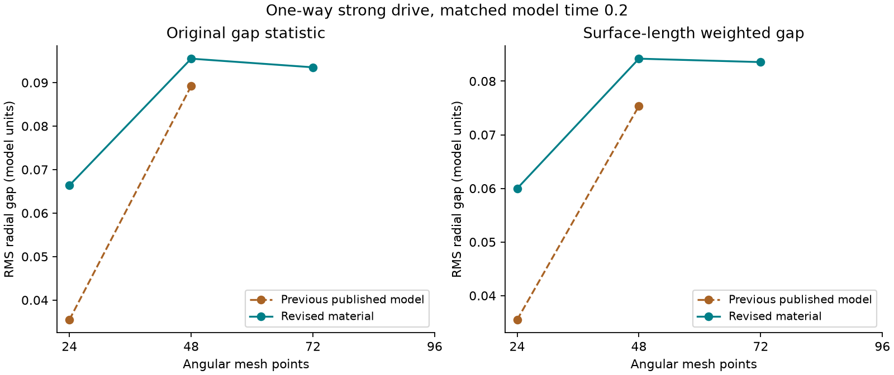
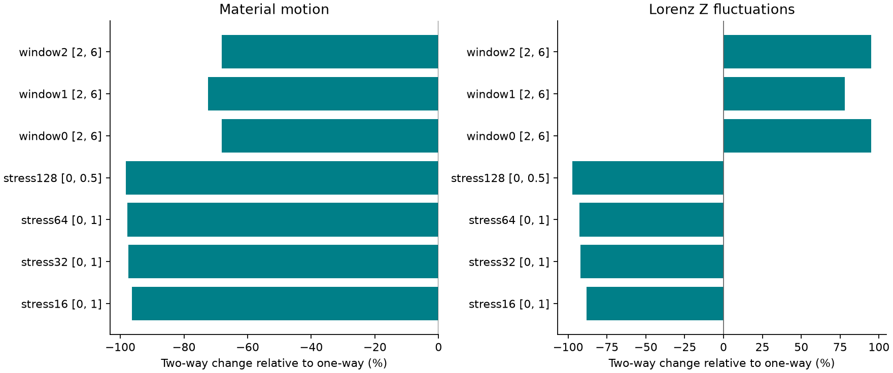

# The hug: mesh dependence and numerical accuracy

This study revises the dimensionless two-dimensional hug material and repeats the Lorenz coupling tests. It follows the [cell-protection study](../clay-cell-stress/README.md); that study and its raw results remain unchanged.

The material begins as a filled annulus around a fixed object inside a square. It can yield and retain a changing rest shape. The experiment does not yet model wrapping a separate slab around an object, friction, fracture, three-dimensional clay, or measured clay properties. These runs are not evidence about quantum water or a proof about Navier–Stokes.

## What changed

The earlier object force used the smallest clearance of each mesh edge, weighted by neighboring material area. Refining a mesh changed which parts of the interior received that force. The revised force is the gradient of a boundary energy: the same barrier density integrated over the reference inner surface using Gaussian quadrature. The entire-edge clearance calculation remains a separate domain guard. For an ellipse, the energy uses radial gap, not exact nearest distance.

The earlier distortion barrier acted on triangle quality divided by its original value. The replacement acts on the material deformation gradient, `F`, with `Q = 2 det(F) / trace(FᵀF)`. This equals one for an undistorted rotation or uniform dilation. It falls toward zero as a material element becomes excessively stretched in one direction. A uniform affine deformation now has the same protection energy per reference area on every tested mesh. This changes the chosen constitutive model; it is not a cosmetic repair or a claim that the previous physical model was experimentally wrong.

The area barrier remains: area ratio must exceed 0.25; deformation quality must exceed 0.35. Both barriers activate below 0.65, with strength 100. Forces come from differentiating energies. Positions are not clipped into place. Existing yielding edge springs, the fading-rest-shape rule, square-wall barriers and self-contact are retained. Those parts remain modeling approximations; convergence on the reported meshes is not a theorem for arbitrary refinements.

The main integrator now defaults to relative tolerance `2e-9` and absolute tolerance `2e-11`, instead of the previous `2e-7` and `2e-9`. Contact integration uses 32 Gaussian points per inner edge. The normal entry point starts at 48 angular points and 5 layers, and `run_verified.py` requires a 72-point comparison as well as a separate time-integration check. The force derivative calculation assembles material stiffness and batches local contact derivatives. Full-system numerical derivatives remain an independent control. All stages must remain in the energy domain; each accepted straight path has conservative clearance and deformation bounds. These bounds do not certify an implicit dense-output polynomial.

## Measurements and controls

Both the original gap statistic (equal samples per inner edge) and a separately integrated, current-arclength-weighted RMS radial gap are reported. A changed statistic cannot by itself count as a repair. Mesh comparisons use the same physical parameters, initial Lorenz state and exact recorded time. The meshes are 24 × 3, 48 × 5, and 72 × 7 angular points × radial layers. Initial circular boundaries are polygonal approximations, so some geometric error remains at finite resolution.

Time accuracy is checked on the same spatial mesh with BDF and tighter Radau integration. Comparisons omit the four work bookkeeping variables and normalize each physical component by `max(1, largest absolute reference component)`. The short-trajectory target is `1e-4`; the gap refinement target is 5%; the energy-balance target is `1e-3`. These are acceptance criteria for these numerical tests, not uncertainties of real clay. Partial runs are compared only over their shared recorded times and are explicitly marked incomplete.

The reciprocal port is unchanged. With `λ = alpha/10` and `A = Σ reference nodal area × radius`, the material receives force `−λ X ∇A`. Reciprocal runs add `+λ Adot / capacity` to the Lorenz X equation. The exchanged powers cancel exactly in the combined continuous energy balance. One-way runs leave Lorenz unchanged; two-way runs let the material alter it. Feedback also introduces a parameter-dependent damping term in X, so reduced material motion alone is not proof of a universal stabilizing mechanism. Lorenz fluctuations and molding gap are measured separately.

The stress levels change several parameters together; they are not a sweep of amplitude alone. Every row is tested both one-way and reciprocally. All quantities are dimensionless.

| Test | Coupling strength alpha | Lorenz rho | Material viscosity | Requested end | Meshes |
|---|---:|---:|---:|---:|---|
| Standard gap refinement | 16 | 160 | 0.15 | 0.2 | 24 × 3, 48 × 5, 72 × 7 |
| Stress 16 and time controls | 16 | 160 | 0.15 | 1 | 24 × 3 |
| Stress 32 | 32 | 256 | 0.075 | 1 | 24 × 3 |
| Stress 64 | 64 | 300 | 0.0375 | 1 | 24 × 3 |
| Stress 128 | 128 | 500 | 0.01875 | 0.5 | 24 × 3 |
| Hardest gap refinement | 128 | 500 | 0.01875 | 0.1 | 48 × 5, 72 × 7 |
| Sustained starting-state tests | 8 | 80 | 0.75 | 6 | 24 × 3 |

The normal stress start is Lorenz state (−8, 8, 27). The three sustained starts are listed with their results below. Zero-coupling controls use alpha = 0 and run to time 2. Exact settings for every executed attempt are in `data/executed-protocol.json`. The finer hardest-drive checks cover a shorter interval than the coarse stress runs; their accuracy finding must not be extended automatically to the longer interval.

## Results from completed calculations

<!-- RESULTS -->

The released solver recorded **29 attempts**, of which **29 completed** their requested interval. Including earlier repair pilots and the rejected alternative, this package records 78 attempts, with 76 completed. Counts refer to integrations, not independent physical experiments.

### Gap agreement

| Drive and refinement | Original gap statistic: endpoint change | Surface-weighted endpoint change |
|---|---:|---:|
| mesh one: 24 to 48 points, t=0.2 | 30.51% | 28.76% |
| mesh one: 48 to 72 points, t=0.2 | 2.123% | 0.7652% |
| mesh two: 24 to 48 points, t=0.2 | 1.046% | 1.117% |
| mesh two: 48 to 72 points, t=0.2 | 0.1939% | 0.2069% |
| hard one: 48 to 72 points, t=0.1 | 1.425% | 0.7465% |
| hard two: 48 to 72 points, t=0.1 | 0.1936% | 0.2066% |

The earlier published 24-to-48-point discrepancy was about 60.2% with the original gap statistic (52.9% with surface-length weighting). The revised material changes the physical law; these numbers are not a pure integrator comparison. A larger gap is not an improvement in molding. Smaller changes under refinement are evidence of numerical agreement.

- **gate-final-coarse-preview**: does not meet the declared check. Shared recorded interval ends at 0.2; maximum scaled gap difference 28.76%. Both requested runs complete: True.
- **gate-final-hard-one**: meets the declared check. Shared recorded interval ends at 0.1; maximum scaled gap difference 2.07%. Both requested runs complete: True.
- **gate-final-hard-two**: meets the declared check. Shared recorded interval ends at 0.1; maximum scaled gap difference 0.2067%. Both requested runs complete: True.
- **gate-final-one**: meets the declared check. Shared recorded interval ends at 0.2; maximum scaled gap difference 0.8077%. Both requested runs complete: True.
- **gate-final-two**: meets the declared check. Shared recorded interval ends at 0.2; maximum scaled gap difference 0.2069%. Both requested runs complete: True.

The released default starts at **48 angular points and 5 layers**, with a **72-point, 7-layer check**. The 24-point grid remains an explicitly coarse preview and a stress/control grid. Agreement at the tested saved times is not a rigorous exact-solution error bound or proof for every mesh, forcing, or longer interval. The gap gate uses a 0.01 model-unit denominator floor; that floor is inactive in the reported standard gap comparison.

### Time integration and contact sampling

| Final comparison | Shared interval ends | Largest scaled state difference | Target met |
|---|---:|---:|---|
| stress16-one / accurate16-one | 1 | 0.001565% | True |
| stress16-two / accurate16-two | 1 | 7.22e-07% | True |
| mesh24-one / quad64-one | 0.2 | 0.0002147% | True |
| zero-one / zero-two | 2 | 0% | True |

The 8-to-16-point contact quadrature comparison failed the 0.01% trajectory target. The 16-to-32 comparison met it; the released default uses 32 points and is checked against 64. The earlier broad and local numerical derivative calculations also agree over their shared interval. Material stiffness is assembled explicitly; obstacle-normal and local self-contact derivatives retain small finite differences and are independently checked against full-system derivatives.

### Effects in both directions

| Final paired test and window | Material motion change with feedback | Lorenz Z fluctuation change with feedback |
|---|---:|---:|
| stress16 [0, 1] | -96.352% | -88.196% |
| stress32 [0, 1] | -97.435% | -92.042% |
| stress64 [0, 1] | -97.817% | -92.610% |
| stress128 [0, 0.5] | -98.321% | -97.127% |
| window0 [2, 6] | -68.156% | +95.036% |
| window1 [2, 6] | -72.386% | +77.968% |
| window2 [2, 6] | -68.158% | +95.046% |

Motion RMS is obtained from integrated viscous dissipation. Z fluctuation is the standard deviation over the stated saved time window. The three sustained tests use starts (1,1,1), (-8,8,27), and (1.000001,1,1); their spread is a sensitivity observation, not a confidence interval. Reduced motion can accompany a larger object gap. These are finite-window effects of this chosen coupling, not proof that chaos has been removed.

Across completed released-model runs, the smallest certified area ratio was **0.256284**, the smallest deformation-quality bound **0.351132**, and the smallest altitude/reference-altitude bound **0.28429**. No recorded or certified-path object, wall, or material crossing was detected. The largest scaled energy-budget error was **3.3297e-07**.

### Failures and remaining limits

- `pilot/revised48` reached 0.167363563 of 0.2: Declared wall-time budget exceeded.
- `resolved/mesh72-one` reached 0.109973508 of 0.2: Restart step below minimum.
- A proposed fixed-reference-neighborhood self-contact exclusion was rejected. Its 72-point mesh approached a surface crossing and stopped near time 0.109974, even while cells retained positive area. The released solver keeps the original self-contact protection.
- The `production/` and `resolved/` folders retain that rejected experiment and its numerical variants. They are historical folder names, not release recommendations. The released implementation is `solver/`.
- The largest forcing sweeps on the 24-point grid test geometry, solver behavior and reciprocal sensitivity. They do not establish mesh accuracy for every quantity. Only the explicitly matched finer-grid tests establish the stated gap agreement.
- Long chaotic trajectories have not been shown pointwise converged. No measured clay calibration, material uncertainty distribution, friction, fracture, arbitrary remeshing, three-dimensional validation, or Navier–Stokes theorem is supplied.





<!-- END RESULTS -->

## Reproduction

Use Python 3.12 with the versions recorded in `requirements.txt`. The released source is in `solver/`. Top-level simulation sources, `model/`, and `refined/` retain earlier numerical implementations and sampling settings. The `production/` and `resolved/` folders retain the rejected self-contact-neighborhood experiment. Each attempt identifies its actual source hashes; the folder names alone do not indicate acceptance.

```text
python prepare_rerun.py ../hug-rerun
cd ../hug-rerun
python -m pip install -r requirements.txt
python solver/validate.py
python solver/check_jacobian.py
python solver/diagnose.py
python reproduce_completed.py
python analyze.py
python finalize_checks.py
python write_results.py
python build_report.py
```

Existing result files are never silently reused or overwritten. `data/executed-protocol.json` lists the released-model integrations actually attempted, including stopped attempts. `reproduce_completed.py --only mesh48-one mesh72-one` selects a subset; `--part 0 --parts 4` partitions independent cases across four separately launched processes. Each saved attempt includes its exact parameters, source hashes, solver settings, wall-time and evaluation budgets, completed time, failure reason if any, actual states, and energy diagnostics. Wall-time cutoffs can differ on another machine. The broader case library is in `solver/suite.py`; its available cases should not be confused with the completed-run list.

For a new forcing configuration, `python run_verified.py new-test --alpha 16 --rho 160 --viscosity .15 --end .2` runs both directions on two meshes and compares a second integrator. It exits unsuccessfully if a required comparison is incomplete or misses its target. For playback checks, install Node.js, Playwright and Chrome, then run `node test_playback.cjs`. `PLAYWRIGHT_MODULE` can name a bundled Playwright module. `verify_package.py --write-manifest` writes the checksum manifest after regeneration; the default verification also requires a current browser-check record.

The `historical/` snapshots are extracted at time 0.2 from the previous published study; `historical/comparison.json` records its immutable commit and original raw-file hashes. They are comparisons, not new integrations. `checksums.json` identifies all delivered files.

## Method references

The surface-integral interpretation of contact follows the [Physics-Based Simulation book's boundary barrier discussion](https://phys-sim-book.github.io/governing-equations/boundary-conditions-and-frictional-contact/barrier_potential.html). The barrier and guarded-path approach is informed by [Li et al., Incremental Potential Contact (2020)](https://ipc-sim.github.io/). This custom overdamped solver is not the IPC implementation and does not inherit its guarantees. Its particular material law and Lorenz coupling are choices in this abstract hug experiment.
