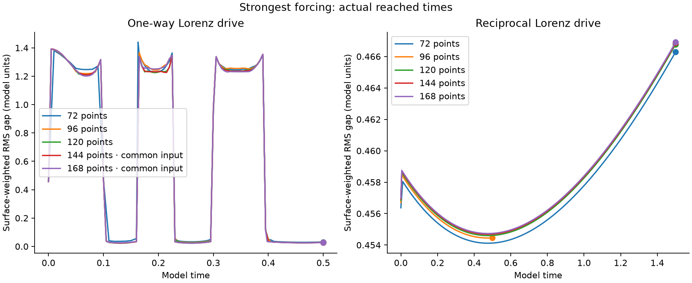
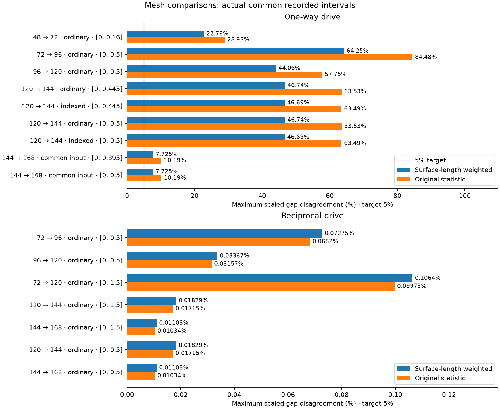
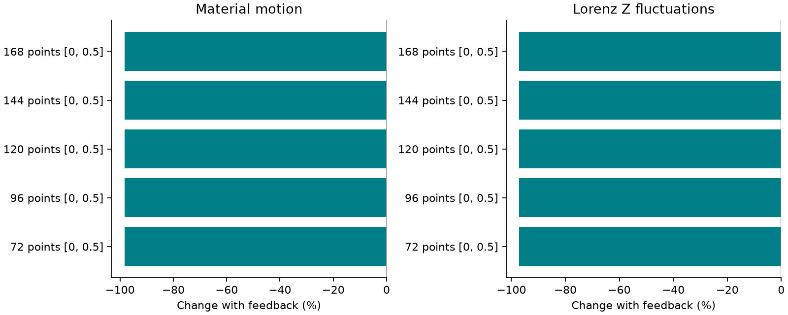

# The hug: resolving strong-forcing gaps and extending the finest mesh

This extends the [long Lorenz stress study](../clay-long-stress/README.md). The previous 48 × 5 / 72 × 7 comparison differed by **22.76%** in the surface-length-weighted RMS gap at model time 0.13. This report retains those original inputs and compares successively finer **72 × 7, 96 × 9 and 120 × 11** meshes under the same strongest published forcing.

The material energies, yielding bonds, fading plastic rest lengths, contact barriers and work-balanced reciprocal coupling are retained. The numerical correction assembles local derivative blocks as sparse matrices instead of allocating full mostly-empty matrices. Direct comparisons against the archived dense assembly and independent directional derivatives check this change. Finer meshes are real integrations; no fitted gap correction is used.

An additional 144 × 13 level uses conservative spatial queries for self-contact. Point-to-segment contact implies midpoint distance at most the segment's half-length plus the contact width; crossing segments have midpoint distance at most the sum of their half-lengths. Queries using the largest half-length therefore retain every potentially active force and crossing. Every selected distance, force and crossing test remains exact, and the original conservative full-pair distances remain in swept-path certificates. The indexed version also obtains accepted-state domain validation from its RHS evaluation instead of recalculating the same full force separately. These changes reduce redundant work and retain the physical equations. `check_indexed.py` checks complete RHS values at real hard states and a crossing with endpoints away from contact.

The longer 72 / 96 one-way comparison also exposed a numerical-drive mismatch above the 0.01% target. The final matched-input test therefore uses 144 × 13 and 168 × 15 with a common independently computed Lorenz signal: DOP853, tolerance 1e-12 / 1e-14 and maximum step 0.002. Its independent Radau check covers 1,001 times through 0.5. One-way Lorenz motion is independent of the material in the original equations, so computing it separately retains those equations. Only the material and four work counters are integrated in this branch; saved records combine their accepted states with the independently solved Lorenz state. No material position, rest length or work counter is projected. Work counters have no influence on physical variables, permitting an exact triangular linear solve. The reciprocal 168-point case retains the full coupled equations. These runs separate forcing accuracy from spatial error rather than interpreting a mismatched input as mesh convergence.

## Protocol and acceptance

The centered tilted ellipse, square boundary ±2.2, preload 0.35, coupling alpha 128, Lorenz rho 500, viscosity 0.01875 and original Lorenz state (−8, 8, 27) are held fixed. One-way runs let Lorenz drive the material. Reciprocal runs also return material work to the Lorenz X equation. That coupling adds strong parameter-dependent damping; smaller motion does not by itself establish better molding.

The 72-point one-way continuation starts at its exact previous stopping time, 0.1629674609474502, and requests 0.5. Its 72-point reciprocal continuation starts at 0.5 and requests 1.5. Fresh 96-, 120- and 144-point integrations restart from the original geometry, plastic rest lengths and Lorenz state and request 0.5 in both directions. The indexed version also repeats the 120-point one-way calculation as a full-interval numerical control. The completed 120- and 144-point reciprocal checkpoints then continue from 0.5 to requested time 1.5. State, clock and accumulated work are preserved exactly when continuing a checkpoint. The common-input one-way tests request 0.5 on 144 × 13 and 168 × 15. A fresh reciprocal 168 × 15 calculation requests 1.5; its shorter independently completed 0.5 run is retained separately.

Default numerical settings here are BDF, relative tolerance **2e-7**, absolute tolerance **2e-9**, maximum step **0.005**, and recorded spacing **0.005**. The tolerance differs from the previous 2e-9 setting and is checked independently, rather than assumed sufficient. The 72-point continuation also has a Radau control from the same checkpoint to 0.17 at 2e-8. A fresh 96-point reciprocal calculation uses 2e-9 over its full requested interval. A fresh common-input 168-point Radau control at 2e-8 requests 0.04 with a 1,800-second computation limit. The expensive fine one-way runs have separate 10,800-second limits. Each attempt records its actual settings, resource budget and reached time. A short control cannot certify accuracy at later times.

The ordinary 144 × 13 one-way run reached its wall-time limit at 0.44789390831775866. Its exact accepted state, original clock and accumulated work were saved as an immutable local checkpoint. A separate continuation requests 0.5 with a further 1,800-second allowance; the stopped original attempt remains in the results. RHS counters count solver callbacks; extra force evaluations for Jacobians, output diagnostics and independent audits are not all included. Integration budgets do not include subsequent report generation and independent validation.

The `shared-resume` source version adds checkpoint continuation to the common-input branch. It retains the same physical equations and input signal and rejects a checkpoint unless its Lorenz state exactly matches that signal at the original clock. Material positions, plastic rest lengths and all four work counters are preserved exactly. Its input horizon is at least 0.5, so short continuation controls use the same signal as the longer test. A losslessly extracted actual state at 0.495 from the completed 144-point run independently continues to 0.5; the maximum scaled physical-state difference is 3.04e-8. The source recording, extraction hashes and full original audit scope are retained. This tail check only tests 0.495–0.5.

The common-input 168 × 15 run reached its original wall-time allowance at 0.3978498494335685. Its immutable checkpoint then continued to 0.5 in 640.89 seconds, with a separately declared 3,600-second allowance. A tighter 2e-8 / 2e-10 calculation starts from the same checkpoint and independently reaches 0.405. The raw arrays retain all inherited states and exact work; controls only compare the independently integrated tail. The finest reciprocal calculation independently completed 0–1.5. Both stopped attempts and their completed continuations remain visible.

The mesh target remains **5%** for both surface-length-weighted and original equal-edge-sampling RMS gaps at every common recorded time, with a 0.01 model-unit denominator floor. A full-interval pass requires equal forcing, equal original starting conditions, equal requested end times, completion, geometry checks and energy checks. For one-way runs, the independently integrated Lorenz drive must also agree within **0.01%** under componentwise state scaling; otherwise a difference in numerical forcing could contaminate the spatial comparison. Reciprocal runs are expected to have different drive histories when their material responses differ. The report distinguishes the old unresolved pair from newly checked finer pairs. Agreement between two meshes is evidence of numerical agreement, not an exact-error bound.

Combined, material and Lorenz energy balances are independently recomputed from raw states and accumulated work; the target is 0.1%. Recorded geometry is rechecked with exhaustive self-contact distances and crossing guards. Accepted-step straight paths must keep positive clearances, cell area ratio above 0.25, and deformation quality above 0.35. This guard does not certify every implicit dense-output curve. Minima between recorded times are those certified by the step audit.

## Actual results

<!-- RESULTS -->

**24 of 26 new integrations completed** their requested interval. Inherited parent histories are not counted as new integrations.

| Attempt | Mesh | Reached / requested | Status |
|---|---:|---:|---|
| control72-radau | 72 × 7 | 0.17 / 0.17 | completed |
| control96-two-tight | 96 × 9 | 0.5 / 0.5 | completed |
| extend120-two | 120 × 11 | 1.5 / 1.5 | completed |
| extend72-one | 72 × 7 | 0.5 / 0.5 | completed |
| extend72-two | 72 × 7 | 1.5 / 1.5 | completed |
| fine120-one | 120 × 11 | 0.5 / 0.5 | completed |
| fine120-two | 120 × 11 | 0.5 / 0.5 | completed |
| fine96-one | 96 × 9 | 0.5 / 0.5 | completed |
| fine96-two | 96 × 9 | 0.5 / 0.5 | completed |
| workflow-smoke-24x3 | 24 × 3 | 0.01 / 0.01 | completed |
| workflow-smoke-48x5 | 48 × 5 | 0.01 / 0.01 | completed |
| extend144-one | 144 × 13 | 0.5 / 0.5 | completed |
| extend144-two | 144 × 13 | 1.5 / 1.5 | completed |
| fine144-one | 144 × 13 | 0.447893908 / 0.5 | Declared wall-time budget exceeded |
| fine144-two | 144 × 13 | 0.5 / 0.5 | completed |
| indexed120-one | 120 × 11 | 0.5 / 0.5 | completed |
| control168-shared-radau | 168 × 15 | 0.04 / 0.04 | completed |
| matched-smoke-24x3 | 24 × 3 | 1e-05 / 1e-05 | completed |
| matched-smoke-48x5 | 48 × 5 | 1e-05 / 1e-05 | completed |
| shared144-one | 144 × 13 | 0.5 / 0.5 | completed |
| shared168-long-two | 168 × 15 | 1.5 / 1.5 | completed |
| shared168-one | 168 × 15 | 0.397849849 / 0.5 | Declared wall-time budget exceeded |
| shared168-two | 168 × 15 | 0.5 / 0.5 | completed |
| control168-resume-tight | 168 × 15 | 0.405 / 0.405 | completed |
| extend168-one | 168 × 15 | 0.5 / 0.5 | completed |
| resume-check-144-one | 144 × 13 | 0.5 / 0.5 | completed |

### Mesh accuracy

| Comparison | Common saved interval | Maximum surface-weighted gap difference | Maximum original gap difference | Full interval mesh check |
|---|---:|---:|---:|---|
| long48-one / long72-one | [0, 0.16] | 22.763% | 28.928% | False |
| extend72-one / fine96-one | [0, 0.5] | 64.254% | 84.483% | False |
| long72-two / fine96-two | [0, 0.5] | 0.072747% | 0.068203% | True |
| fine96-one / fine120-one | [0, 0.5] | 44.06% | 57.749% | False |
| fine96-two / fine120-two | [0, 0.5] | 0.033672% | 0.031571% | True |
| extend72-two / extend120-two | [0, 1.5] | 0.10639% | 0.099753% | True |
| extend120-two / extend144-two | [0, 1.5] | 0.01829% | 0.017149% | True |
| extend144-two / shared168-long-two | [0, 1.5] | 0.011028% | 0.01034% | True |
| fine120-one / fine144-one | [0, 0.445] | 46.736% | 63.53% | False |
| indexed120-one / fine144-one | [0, 0.445] | 46.688% | 63.486% | False |
| fine120-one / extend144-one | [0, 0.5] | 46.736% | 63.53% | False |
| indexed120-one / extend144-one | [0, 0.5] | 46.688% | 63.486% | False |
| fine120-two / fine144-two | [0, 0.5] | 0.01829% | 0.017149% | True |
| shared144-one / shared168-one | [0, 0.395] | 7.7247% | 10.185% | False |
| shared144-one / extend168-one | [0, 0.5] | 7.7247% | 10.185% | False |
| fine144-two / shared168-two | [0, 0.5] | 0.011028% | 0.01034% | True |

The original 48 / 72 disagreement is retained as historical evidence. A newly refined pair only passes when both full runs finish and both gap metrics remain below the same 5% target. Shorter or stopped histories cannot validate a longer requested interval. One-way drive histories also need 0.01% agreement.

| One-way comparison | Maximum scaled Lorenz-drive difference | Drive target met |
|---|---:|---|
| long48-one / long72-one | 9.32e-05% | True |
| extend72-one / fine96-one | 0.014937% | False |
| fine96-one / fine120-one | 0.037993% | False |
| fine120-one / fine144-one | 0.038771% | False |
| indexed120-one / fine144-one | 0.066836% | False |
| fine120-one / extend144-one | 0.038771% | False |
| indexed120-one / extend144-one | 0.066836% | False |
| shared144-one / shared168-one | 0% | True |
| shared144-one / extend168-one | 4.1585e-14% | True |

### Independent numerical accuracy

| Control | Independently recomputed interval | Maximum scaled physical-state difference | 0.01% target |
|---|---:|---:|---|
| extend72-one / control72-radau | [0.162967461, 0.17] | 0.0011645% | True |
| fine96-two / control96-two-tight | [0, 0.5] | 5.4618e-05% | True |
| fine120-one / indexed120-one | [0, 0.5] | 0.99827% | False |
| fine144-one / shared144-one | [0, 0.445] | 2.6883% | False |
| extend144-one / shared144-one | [0, 0.5] | 2.6883% | False |
| shared168-one / control168-shared-radau | [0, 0.04] | 0.00052199% | True |
| shared144-one / resume-check-144-one | [0.495, 0.5] | 3.0428e-06% | True |
| extend168-one / control168-resume-tight | [0.397849849, 0.405] | 9.7821e-05% | True |

State normalization is componentwise max(1, peak absolute reference component), excluding the four work bookkeeping variables. Inherited parent prefixes are excluded. Controls include a different time integrator, tighter tolerances, an equivalent force assembly and the independent-input formulation. They are not all isolated time-step experiments. A stopped comparison or a short control cannot certify a later interval.

### Both directions of influence

| Mesh and common end | Material motion change with feedback | Lorenz Z fluctuation change with feedback |
|---|---:|---:|
| 72 points, 0.5 | -98.302% | -97.127% |
| 96 points, 0.5 | -98.306% | -97.128% |
| 120 points, 0.5 | -98.311% | -97.127% |
| 144 points, 0.5 | -98.313% | -97.127% |
| 168 points, 0.5 | -98.317% | -97.128% |

Material motion RMS comes from accumulated viscous dissipation divided by viscosity, reference area and duration. Lorenz Z fluctuations use time-weighted saved samples. The chosen feedback law introduces strong damping; these changes do not establish general chaos suppression.

### Geometry and energy

All geometry audits passed: **True**. All material, Lorenz and combined energy audits passed: **True**. Maximum scaled full-history balance residual: **0.00010494**. Minimum certified area ratio **0.255789**, deformation quality **0.350005**, relative cell altitude **0.241027**.







<!-- END RESULTS -->

## Reproduce

Use Python 3.12 and the pinned dependencies in `requirements.txt`.

The recorded Windows runtime used 24 NumPy BLAS threads and one SciPy BLAS thread for `run_case.py`, because NumPy initialized before the experiment set its thread environment. Workflow, indexed runs and derivative checks initialize both libraries with one thread. `data/environment.json` records direct runtime queries. The replay driver starts a separate process for each protocol with its recorded NumPy setting and original solver version; SciPy initializes with one thread. This controls the original import-order difference rather than silently assuming every run used one thread.

```text
python check_sparse.py
python solver/validate.py
python analyze.py
python verify_package.py
```

For new integrations in a result-free copy:

```text
python prepare_rerun.py ../resolved-hug-rerun
cd ../resolved-hug-rerun
python -m pip install -r requirements.txt
python reproduce.py
python analyze.py
python build_report.py
```

`python reproduce.py --only fine96-two` selects a recorded protocol. Continuations use the included original immutable checkpoint and exact work history. Machine-dependent wall-time limits can change the stopping point of incomplete attempts. `run_case.py` supports fresh cases, explicit parameters, numerical controls and `--parent` continuations; attempts cannot overwrite earlier outputs.

`python run_refinement.py new-case` starts at 72 × 7 and computes successive real meshes up to 120 × 11 until a full comparison passes; `--two` enables reciprocal coupling. The result names the actual selected finer mesh, or returns a failure at the declared cap. `--evidence` checks existing complete histories without performing another integration. The end-to-end driver smoke test uses alpha 0, rho 28, viscosity 1.5 and time 0.01 on 24 × 3 / 48 × 5; it checks the workflow and is not hardest-forcing evidence.

`python run_matched_refinement.py new-matched-case` uses the common-input one-way solver at 144 × 13 and 168 × 15 under the strongest fixed parameters. It selects an actual finer recording only after the same full-interval checks pass, and exits with an unresolved decision at the declared cap otherwise. `--evidence` evaluates supplied recording paths, and `--seconds` changes a new run's computation allowance. It never adjusts the gap, acceptance threshold or physical constants to manufacture agreement. The included `data/*-matched-decision.json` records the decision for the actually completed finest input-matched tests.

The matched workflow also completed a short end-to-end test on 24 × 3 and 48 × 5 at the strongest parameter values through time 0.00001. This validates execution and selection, not long-time material accuracy. Clean replays reproduced every raw array for this one-way workflow case, the reciprocal 168 × 15 run through 0.5, and the 144-point continuation tail; `data/reproduction-check.json` records those checks. Replay selects the exact solver version by its complete recorded source hashes. The recorded data include independent high-load derivative and contact-quadrature probes.

## Scope and limitations

This is a dimensionless 2-D abstract material initially surrounding an object. It has not been calibrated against measured clay. The material still uses yielding edge springs, so mesh aspect and diagonal directions can affect its constitutive response. Refinement follows a proportional family; agreement of gap statistics does not prove accuracy of every internal strain, every chaotic trajectory, a 3-D wrapping process, or a Navier–Stokes theorem. No quantum effect is claimed by these Lorenz tests.

The object metric is radial gap for the ellipse, not exact nearest-point distance. A small final gap difference does not erase a larger discrepancy during squeezing or yielding: the acceptance check compares gaps at the same recorded times throughout the interval. Passing energy and contact checks alone does not prove accurate trajectories. Numerical-repeat differences can involve input integration, roundoff, solver tolerances and different adaptive steps; these tests do not assign a unique cause to each failed repeat. Charts and playback show only computed states and reached times. Independent controls exclude inherited checkpoint prefixes from their accuracy claims.

Parent checkpoints and source versions are preserved from commit `fbf4ab15bc1e0875929955e5f1720748464768b6`; the earlier checkpoint sources are included separately. Every source and raw-data file is covered by the final checksum manifest.

The 120-point local continuation initially inherited a model-baseline commit label in its checkpoint-origin metadata. This editorial attribution was corrected to its actual local recording; the original metadata and before/after hashes are preserved in `history/` and `data/provenance-correction.json`. Raw states, clocks, work, solver sources and numerical results were unchanged.
