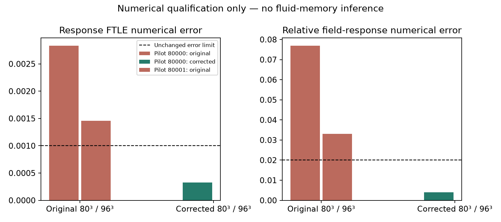

# Fluid memory extension — in progress

Request ID: `2300ecd1-d208-4695-9b39-62b93d705892`.

This is a progress snapshot, not a completed physical result. It extends the [previous fluid-memory study](../fluid-memory-erasure/) with equal-work probes, different writer/probe locations, two moderate forced lower-viscosity regimes and a separately implemented CPU solver.

## Completed and checked

The initial twelve accelerated pilot configurations were run. Five additional numerical qualification configurations were run. The lower-viscosity regime failed its original grid-comparison limits, so production was withheld. Original implementations and failed numerical outcomes are preserved.

A concrete reset-control bug was diagnosed: FFT wave numbers carried tiny non-integer rounding errors on some grids. At exactly parallel integer vectors, normalizing an almost-zero cross product amplified rounding noise instead of selecting the defined alternate vector. The corrected solver uses exact integer waves and an exact strict truncation criterion. Corrected spinups are repeated, rather than silently reused as equivalent.

Nine corrected solver/construction tests pass, including two regression checks for that degeneracy. Four inference controls pass, including invariance to observation-point labels and history names. The accelerated and direct observation methods agree to rounding precision at 32³, 64³, 80³ and 96³.

The first corrected lower-viscosity pilot comparison at 80³ versus 96³ passes all unchanged numerical gates. Its FTLE-response RMSE is 0.000325846 (limit 0.001), and its maximum relative field-response error is 0.00401533 (limit 0.02). The corresponding original 80³/96³ errors were 0.00283361 and 0.0769357. The second corrected pilot and the rest of the repeated qualification matrix are still pending in this snapshot.

An earlier independent CPU calibration completed the full 0.4-unit response window for all 56 branches of one initial smooth pilot, with response FTLE RMSE about 1.08e-9. This is a numerical calibration, not a fresh-flow statistical result.

## Running or planned; no result claimed yet

The corrected controller repeats the complete pilot matrix, and proceeds only if it qualifies. The production plan includes eight fresh smooth-flow seeds, four fresh forced-flow seeds paired across two viscosities, three layouts, two grids, half-step controls, four scrambles, matched intact translations and identical-state resets. Added common impulses impose the same shape, RMS strength and energy increment across all histories and arms within a comparison. Forcing-off controls test the contribution of ongoing forcing feedback. Twelve independent CPU comparisons cover exact saved initial states and full response windows at two tolerances.

The declared amended production plan has 212 GPU configurations. Completion counts are checked before a completed-study report can be generated. No fresh production effect, confidence interval, robust memory carrier or persistent leader is claimed here. The full raw recordings and final statistical report have not yet been published in this snapshot.

## Scientific scope

These are actual periodic 3D incompressible Navier–Stokes simulations with positive viscosity. Passive observation points are not molecules and exert no forces. Response means probed-minus-unprobed local finite-time deformation rate; history contrast is the RMS difference between two preparations. Scrambling keeps low modes and modal powers matched. The intact-translation control checks whether a comparable spatial rearrangement can attenuate the contrast too.

A statistical difference is insufficient for a signed physical-effect claim. The saved inference safeguard requires agreement across resolutions, numerical controls, and grid uncertainty below 10% of the effect magnitude. Common-pulse conditioning and spatial extent are recorded. Forced conditions are finite-time, moderate Reynolds-number tests; a fixed spinup does not prove stationary or fully developed turbulence. Layouts, markers and resolutions are paired conditions, not independent samples.

No new Navier–Stokes physics, extra memory term, molecular water/isotope result, learning mechanism, heteroclinic network or evolutionary change follows from these numerical checks.

## Reproduction and status

`protocol.json`, numerical amendments, failed outcomes, source fingerprints and completed raw-recording metadata are included. Original raw NPZ containers remain local pending the complete release. Their SHA256 values are recorded; this snapshot does not claim they are downloadable from GitHub.

Use `python reproduce_extension.py --run` to run the corrected study (compatible NVIDIA GPU, substantial CPU time and disk space required). `--analysis-only` requires the complete verified recordings; it deliberately refuses this incomplete snapshot. `finish_pipeline.py` generates local final results only after both simulation controllers finish. External publication is a separate step.

The successful initial study remains available at commit `d049780e9291e090a9d85d1459fe0901b406dacc`; these failed or pending follow-up runs do not replace its findings or extend them to untested regimes.
