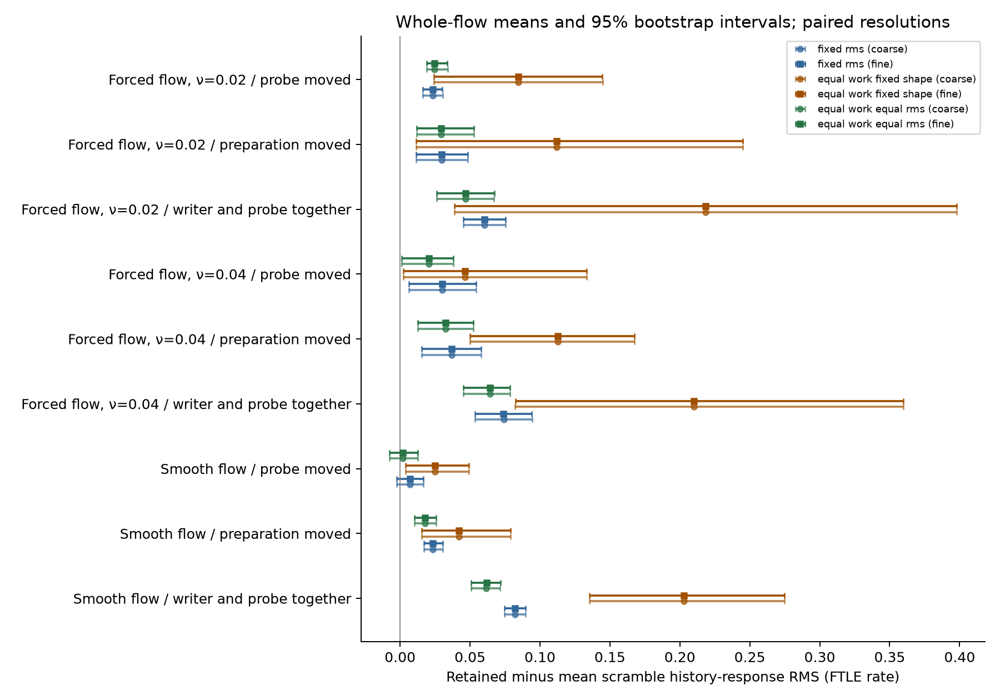
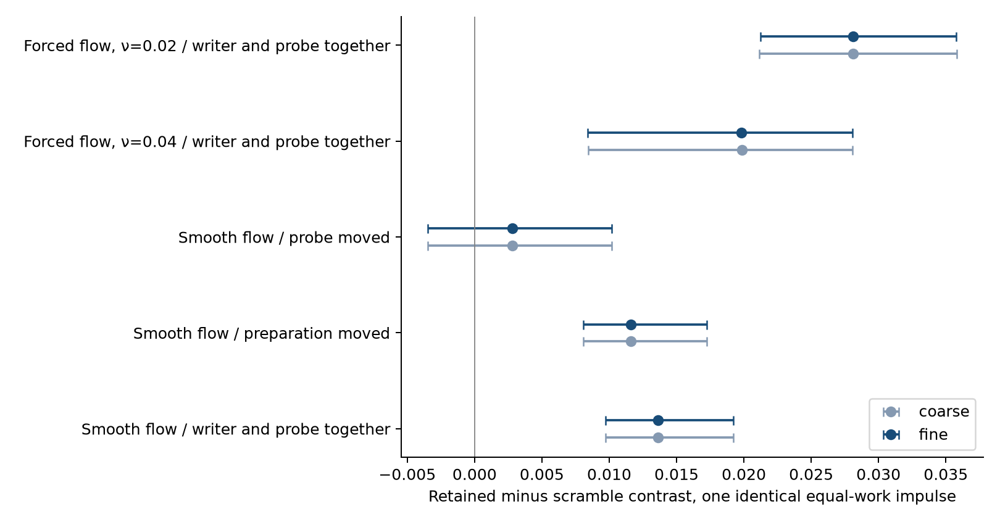
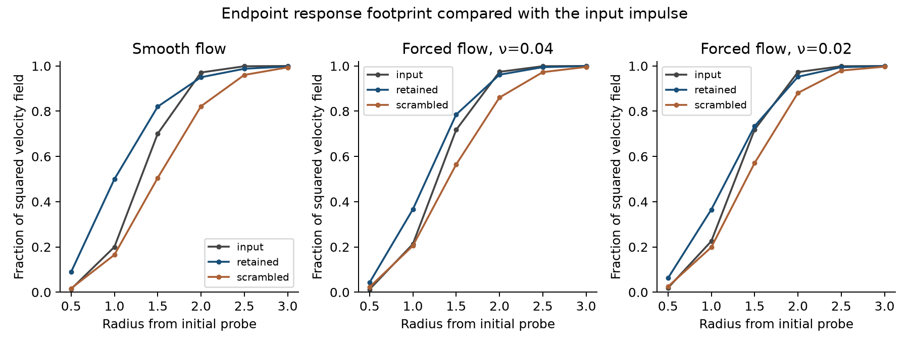
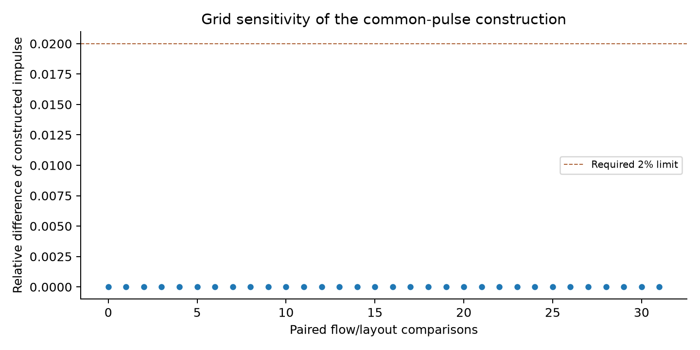
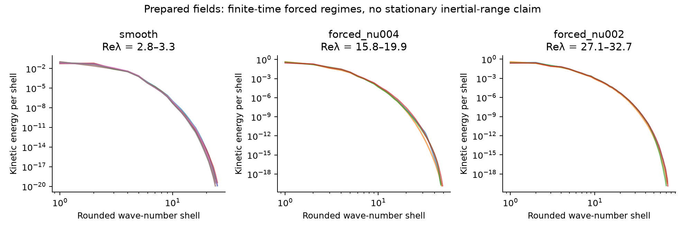

> **Publication status:** The final simulations, numerical checks, and exact raw-data restore/reanalysis are complete. Uploading all 191 raw-data parts to GitHub is still in progress. The raw-data release is not yet public; see [publication-status.json](publication-status.json).

# Fluid memory extension: equal-work probes and wider flow conditions

Request ID: `2300ecd1-d208-4695-9b39-62b93d705892`.

This completed follow-up studies history-conditioned response within ordinary periodic, incompressible, three-dimensional Navier–Stokes. Passive observation points measure local deformation. They are not molecules, and they do not influence the fluid.

The final analyses pass all required numerical checks: **True**. Earlier failed grid comparisons and unqualified contrasts are preserved and reported below.

## Has the memory question been answered?

| Question | Answer for the primary smooth, coincident condition |
|---|---|
| Can preparations leave different later responses despite matched low modes, modal powers and an identical probe? | Yes, within the tested finite window and matched coarse summaries. |
| Does disrupting coherent spatial phase structure reduce that history contrast? | Yes, coherent-phase scrambling reduces the history-response contrast under the identical impulse. |
| Have we identified a structure whose erasure has a specific effect beyond intact rearrangement? | The scrambling effect exceeds the displacement-matched intact translation in this tested condition. |
| Does this demonstrate memory beyond the complete present fluid state? | No. The preparations leave different full states; ordinary Navier–Stokes evolves those states. |
| Does this answer the original question about one heavy water molecule? | No. Fluid probes are passive observations, not molecules or isotope substitutions. |

Identical-impulse retained contrast: 0.0297515 [0.0205684, 0.0399844]; retained-minus-scramble attenuation: 0.0136469 [0.00972199, 0.0192088]; translation-minus-scramble specificity: 0.0108956 [0.00395086, 0.0174281]. These are whole-flow means with 95% bootstrap intervals, n=8. The table applies the separate resolution and numerical criteria, not confidence intervals alone.

## What was actually run

The original GPU matrix contains 212 completed configurations, plus 54 additional grid-refinement configurations and fourteen independent CPU solver comparisons. These are paired controls and numerical refinements, not independent flow samples. Eight fresh smooth-flow seeds and four fresh forced-flow seeds at each of two viscosities were used; the forced seeds are paired across viscosities. Three writer/probe layouts, three individual probe methods, four independent phase scrambles, a displacement-matched intact translation and an identical-full-state reset. Every condition has two grids; designated seeds have half steps. The production matrix also contains one common equal-work/equal-strength impulse, forcing-off readouts, translation invariance checks, and finer moderate-regime audits. Numerical pilot seeds are excluded from inference.

The CPU solver independently implements padded conservative flux divergence, full complex Fourier modes, pressure projection and adaptive DOP853. It restarts the exact saved initial states for fourteen comparisons, including tighter tolerances and full response windows at 32³, 64³, 80³ and 96³. The 128³ runs are checked by grid and half-step comparisons rather than this CPU solver. This is a second implementation by the same author, not replication by an independent laboratory. It does not repeat every spinup or every production trajectory.

Forced runs share a corrected 96³ spinup field for each seed and viscosity. Grid refinement repeats preparation and readout from that specified field; it does not independently refine the earlier spinup. The imposed preparation acts until time 0.2, matching is applied at time 0.4, and the response is observed for a further 0.4 dimensionless time units. Saved intermediate observations do not establish long retention or a longer response window.

The 128³ runs stream independent branches to fit the available GPU. Fourier coefficients retain complex128 precision, and the fluid equations and observations remain unchanged. A broad-spectrum input roundtrip and coupled-step comparison across branch batches qualify this resource change before use. Direct CPU and CUDA observations are also compared on actual 128³ start and endpoint fields.

## Operational memory measure

Two opposite localized preparation forces create different histories. At readout, the complete low Fourier modes and high modal powers are matched, but the full vector/phase fields remain different. The ten centers start at shared positions and move passively with each flow; deformation is measured along those paths. For each history, response is probed FTLE minus unprobed FTLE at corresponding centers. The history contrast is the RMS difference across these centers. Attenuation is retained contrast minus the mean of four phase-scrambled contrasts: positive values mean scrambling reduces the contrast; negative values mean it increases the contrast. These definitions test response dependence on retained state structure; they do not add memory beyond the present complete Navier–Stokes state.

The inner product is a volume average in a periodic box of side 2π, at density 1. Reported energy and impulse work are kinetic energy per unit mass; multiply by box volume for total energy. All quantities are dimensionless. Probe RMS is 0.02 and matched energy increment is 0.0002. Taylor Reynolds numbers use the usual isotropic expression as a diagnostic; isotropy is not established by that number.

Phase scrambling removes coherent spatial phase relationships, not every record of the preparations. It retains modal vector directions and applies the same random phase to both histories, preserving their cross-spectra. The intervention therefore tests spatial organization, while the identical-state reset removes all history differences by construction.

The intact-translation comparison shifts the high-mode pattern rigidly while leaving the common low modes fixed. Its size matches the mean L2 field change caused by the four scrambles, rather than a geometric shift distance. It preserves the high-mode pattern but changes its alignment with the background and probe. This differs from the separate whole-experiment translation invariance check.

A signed physical-effect claim requires confidence intervals excluding zero on both grids with the same sign, average absolute per-flow grid change below 10% of the fine-grid mean effect, and the numerical controls. Final common-pulse claims also require the constructed impulse to differ by less than 2% in relative L2 norm across grids for every flow/layout in the regime. This stricter safeguard was added before any fresh common-probe recordings or memory effects were available; common-probe-grid-safeguard.json preserves the timing and reason. Positive attenuation alone does not establish a unique history carrier: the intact-translation comparison tests whether a large spatial rearrangement can produce the same attenuation.

## Results: individual probes

| Regime / layout | Probe | Fine-grid attenuation [95% CI] | Resolution-qualified signed effect |
|---|---|---:|---|
| smooth/coincident | fixed_rms | 0.0822947 [0.0747587, 0.0897757] | True |
| smooth/coincident | equal_work_fixed_shape | 0.203012 [0.135383, 0.274709] | True |
| smooth/coincident | equal_work_equal_rms | 0.0616982 [0.0509376, 0.0716536] | True |
| smooth/writer_moved | fixed_rms | 0.02328 [0.0168296, 0.0304531] | True |
| smooth/writer_moved | equal_work_fixed_shape | 0.0421608 [0.0155328, 0.0788564] | True |
| smooth/writer_moved | equal_work_equal_rms | 0.017898 [0.0102661, 0.0259146] | True |
| smooth/probe_moved | fixed_rms | 0.00701816 [-0.00241871, 0.0166767] | False |
| smooth/probe_moved | equal_work_fixed_shape | 0.0249946 [0.0038805, 0.0490559] | True |
| smooth/probe_moved | equal_work_equal_rms | 0.00209289 [-0.00768984, 0.0127988] | False |
| forced_nu004/coincident | fixed_rms | 0.073974 [0.0537291, 0.094219] | True |
| forced_nu004/coincident | equal_work_fixed_shape | 0.210064 [0.0823576, 0.359585] | True |
| forced_nu004/coincident | equal_work_equal_rms | 0.0641258 [0.0453526, 0.0785671] | True |
| forced_nu004/writer_moved | fixed_rms | 0.0367822 [0.0154732, 0.0580912] | True |
| forced_nu004/writer_moved | equal_work_fixed_shape | 0.112601 [0.0498571, 0.167402] | True |
| forced_nu004/writer_moved | equal_work_equal_rms | 0.0324951 [0.0124746, 0.0525156] | True |
| forced_nu004/probe_moved | fixed_rms | 0.0302887 [0.00610457, 0.0544727] | True |
| forced_nu004/probe_moved | equal_work_fixed_shape | 0.0466005 [0.00225938, 0.13335] | True |
| forced_nu004/probe_moved | equal_work_equal_rms | 0.0205053 [0.000950081, 0.038147] | True |
| forced_nu002/coincident | fixed_rms | 0.0603145 [0.0454025, 0.0752266] | True |
| forced_nu002/coincident | equal_work_fixed_shape | 0.218392 [0.0389402, 0.397843] | True |
| forced_nu002/coincident | equal_work_equal_rms | 0.0467469 [0.0261677, 0.067326] | True |
| forced_nu002/writer_moved | fixed_rms | 0.0298659 [0.0114196, 0.0483122] | True |
| forced_nu002/writer_moved | equal_work_fixed_shape | 0.111776 [0.0113971, 0.24501] | True |
| forced_nu002/writer_moved | equal_work_equal_rms | 0.0292369 [0.0118761, 0.0527343] | True |
| forced_nu002/probe_moved | fixed_rms | 0.0231816 [0.0160471, 0.0303161] | True |
| forced_nu002/probe_moved | equal_work_fixed_shape | 0.0843935 [0.0241829, 0.144604] | True |
| forced_nu002/probe_moved | equal_work_equal_rms | 0.024395 [0.0189703, 0.0337736] | True |

## Results: one identical impulse for all histories and arms

| Regime / layout | Fine-grid attenuation [95% CI] | Translation-minus-scramble specificity [95% CI] | Resolution-qualified signed effect |
|---|---:|---:|---|
| smooth/coincident | 0.0136469 [0.00972199, 0.0192088] | 0.0108956 [0.00395086, 0.0174281] | True |
| smooth/writer_moved | 0.011612 [0.00809444, 0.0172317] | 0.0189369 [0.0103081, 0.0329621] | True |
| smooth/probe_moved | 0.00279543 [-0.00349518, 0.0101905] | 0.0115777 [0.00787246, 0.0158749] | False |
| forced_nu004/coincident | 0.0198125 [0.00841216, 0.0280698] | 0.0170396 [0.012846, 0.0214304] | True |
| forced_nu002/coincident | 0.0281017 [0.0212194, 0.0357875] | 0.0272678 [0.0143794, 0.0402917] | True |

## Numerical checks and implementation correction

| Check group | Failed checks |
|---|---|
| main/smooth | None |
| main/forced_nu004 | None |
| main/forced_nu002 | None |
| common/smooth | None |
| common/forced_nu004 | None |
| common/forced_nu002 | None |
| unforced/forced_nu004 | None |
| unforced/forced_nu002 | None |
| controls | None |
| refined_observation | None |
| bounded_streaming | None |

The original 48³/64³ moderate-flow comparison failed the FTLE agreement threshold in two fresh cases; the first 80³/96³ lower-viscosity pair also failed. Before inspecting fresh memory effect sizes, the entire moderate regime was promoted to 64³/96³ and the entire lower-viscosity regime to 96³/128³ for final inference, with all flow/layout comparisons and designated half steps; common-probe and forcing-off controls were refined too. The original 212-configuration matrix remains intact. Thresholds were not relaxed. The complete original results are preserved in `results/baseline-*.json`; `fresh-grid-refinement.json` records the numerical reason, timing and additional matrix.

| Original check group | Original failed checks |
|---|---|
| main/forced_nu004 | grid_ftle |
| main/forced_nu002 | grid_ftle |
| unforced/forced_nu002 | grid_ftle |

The initial implementation failed lower-viscosity grid tests. A diagnosed reset-control bug used slightly non-integer FFT wave numbers; at exactly parallel integer wave vectors, normalizing an almost-zero cross product amplified rounding noise instead of choosing the defined alternate vector. Corrected wave vectors are exact integers and the strict cutoff is computed with integer arithmetic. Original sources, failed pilots and failed qualification are preserved. New corrected spinups and all corrected pilot comparisons were run; thresholds were never relaxed. Two regression tests specifically cover this degeneracy, alongside analytic shear, independent RHS, equal-work, modal matching and direct-observation checks.

The forcing-off comparisons use the same complete readout states and impulses, then remove sustaining forcing. They involve only two independent flows per viscosity and are exploratory. Their intervals should not be interpreted as strong evidence of general forcing independence.

## Forcing-off comparisons

| Regime | Probe family / method | Off-minus-on attenuation [95% CI], n=2 |
|---|---|---:|
| forced_nu004 | individual / fixed_rms | -0.00210104 [-0.00225711, -0.00194496] |
| forced_nu004 | individual / equal_work_fixed_shape | -0.00345187 [-0.00614666, -0.000757075] |
| forced_nu004 | individual / equal_work_equal_rms | -0.00184849 [-0.001849, -0.00184798] |
| forced_nu004 | common / same_pulse | -0.00087805 [-0.00121291, -0.000543189] |
| forced_nu002 | individual / fixed_rms | -0.000183822 [-0.000360809, -6.83464e-06] |
| forced_nu002 | individual / equal_work_fixed_shape | -0.00289723 [-0.00563474, -0.000159714] |
| forced_nu002 | individual / equal_work_equal_rms | -0.000457781 [-0.000621676, -0.000293885] |
| forced_nu002 | common / same_pulse | -0.0003426 [-0.000506327, -0.000178873] |

## Where does the response extend?

For the identical impulse, the endpoint velocity response also records where the difference between the histories is concentrated. The table compares squared-field fractions outside radius 2 from the initial probe. These descriptive fractions measure both input extent and response extent; they do not impose a binary collective-memory threshold. All saved Fourier fields are evaluated on a common 128³ quadrature grid. This postprocessing is distinct from the evolution grids; only the final lower-viscosity fine runs themselves evolve at 128³.

| Regime / layout / readout forcing | Input fraction outside radius 2 [95% CI] | Retained-history response fraction outside radius 2 [95% CI] |
|---|---:|---:|
| forced_nu002/coincident/off | 0.0280743 [0.0279553, 0.0281934] | 0.0493603 [0.0483788, 0.0503418] |
| forced_nu002/coincident/on | 0.027003 [0.0257748, 0.0280743] | 0.0478412 [0.0393609, 0.0532221] |
| forced_nu004/coincident/off | 0.0265911 [0.0250615, 0.0281207] | 0.0293296 [0.0256314, 0.0330277] |
| forced_nu004/coincident/on | 0.0259218 [0.0248661, 0.0273559] | 0.038706 [0.0309868, 0.0466099] |
| smooth/coincident/none | 0.0288439 [0.0262965, 0.0320404] | 0.0498375 [0.0449916, 0.0545993] |
| smooth/probe_moved/none | 0.0216073 [0.0182299, 0.0243992] | 0.0840074 [0.0591024, 0.118483] |
| smooth/writer_moved/none | 0.027686 [0.0261292, 0.0297189] | 0.074841 [0.0617054, 0.0892253] |

Endpoint only. Input tails, advection, pressure projection and sustaining-forcing feedback can broaden the footprint. Nonlocal velocity response is not proof of persistent collective memory or a leader. Fractions use a fixed quadrature grid, not a new NS integration.

## Probe matching and remaining limits

Fixed-RMS probes use the same shape and strength but generally perform different work on different states. Equal-work/fixed-shape probes vary amplitude and can be much larger than the nominal weak probe. Individual equal-work/equal-RMS probes vary direction by state. The stricter common-pulse experiment uses one identical impulse across all histories and interventions within a comparison, chosen before future outcomes from a localized divergence-free basis and the nullspace of work constraints. Its geometry can differ across flows, layouts and grids. Complete coefficients, angles, ranks, singular values and measured spatial extent are recorded. A localized basis alone does not guarantee that the constructed combination retains the original probe’s localization.

These are moderate, finite-time forced regimes. A fixed eight-unit spinup is not proof of stationary, fully developed or high-Reynolds-number turbulence. Positive viscosity, energy budgets, incompressibility, CFL, spectral tails, endpoint Kolmogorov resolution, step/grid convergence and solver agreement are screened. Passing a screen does not prove DNS accuracy in every observable. The box size and statistical population remain limited. Bootstrap intervals resample independent flow seeds; markers, layouts and resolutions are not extra samples. Secondary intervals are unadjusted, with only four forced flows. Previous results informed this follow-up, so it is not independent confirmation of the original selection.

No persistent leader, learning, causal hierarchy, heteroclinic network, isotope effect, molecular water memory, evolutionary change or new Navier–Stokes physics follows from these tests. Complete full-state matching removes deterministic history dependence by construction; agreement of the reset histories is a consistency control, not evidence of a physical erasure mechanism.

## What remains missing

The declared follow-up tests are completed, but the broader scientific question remains bounded by their scope: stationary high-Reynolds-number turbulence and larger domains; longer retention and response windows with larger independent ensembles; external software or laboratory replication; spatial response maps across multiple times and probe locations; and carrier specificity wherever intact translations have comparable effects. The endpoint radial footprint describes extent but cannot establish persistent collective memory. Three layouts do not establish that an effect is collective throughout the box. Four forced starts and two forcing-off starts are small exploratory ensembles. Real-water molecular and quantum-isotope questions require separate methods.

## Reproduction and provenance

Install dependencies from `requirements.txt`. Download all numbered parts from the [raw-data release](https://github.com/NousVolition/My-Sources-Project-ALL/releases/tag/fluid-memory-extension-2026-10-11), then run `python restore_recordings.py --parts PATH_TO_PARTS --out .`. Run `python reproduce_extension.py --analysis-only` on restored recordings, or `python reproduce_extension.py --run` to perform the full declared study. The latter requires a supported NVIDIA GPU and substantial CPU time/disk space. Raw NPZ containers are preserved without reencoding in the release. The manifest records each container and each NPY member SHA256. Sources, protocols, numerical amendments, execution counts, raw arrays, independent results and statistical per-flow values are included. `roundtrip_extension.py` checks reconstruction from the split parts and exact regeneration of the scientific analyses, report and figures in an isolated directory; its completed proof is in `results/raw-roundtrip.json`.

`progress-snapshot.json`, if present in the repository, records the earlier incomplete publication and its historical file hashes. It is not a checksum manifest for this final study. Current raw-data checksums are in `raw-recordings.json`; final completion and source verification are in `results/verification.json`.

`--run` verifies and reuses compatible recordings, and computes missing ones. In a fresh GitHub checkout, metadata files without their NPZ recordings are preserved separately before calculations start. A fresh run does not recreate the historical failed attempts automatically; use the original release archive for byte-for-byte restoration of those records. The completed archive roundtrip repeats the analyses from the original arrays and does not rerun Navier–Stokes.

Method references: [SciPy DOP853 documentation](https://docs.scipy.org/doc/scipy/reference/generated/scipy.integrate.solve_ivp.html), [NASA grid-convergence guidance](https://www.grc.nasa.gov/www/wind/valid/tutorial/spatconv.html).
