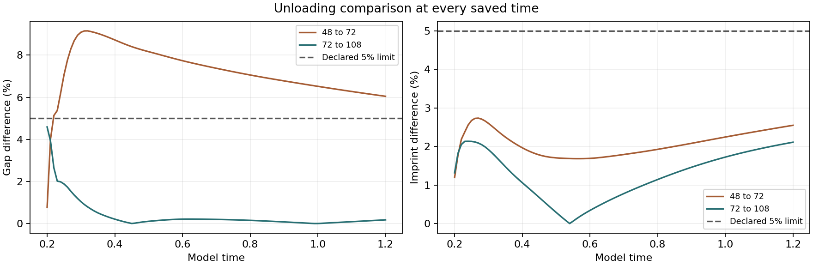
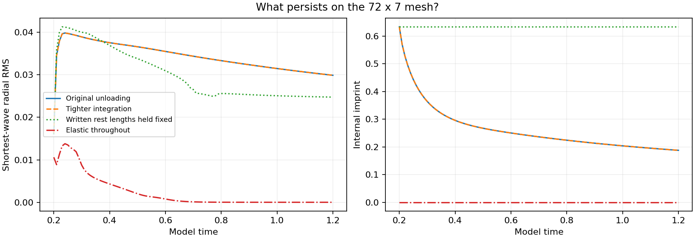
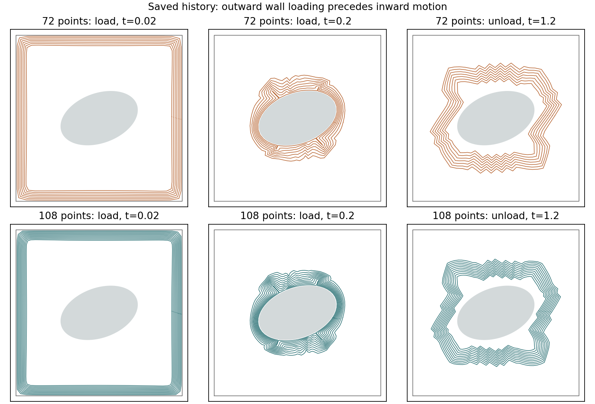
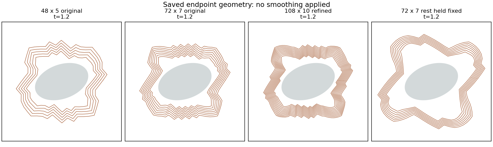
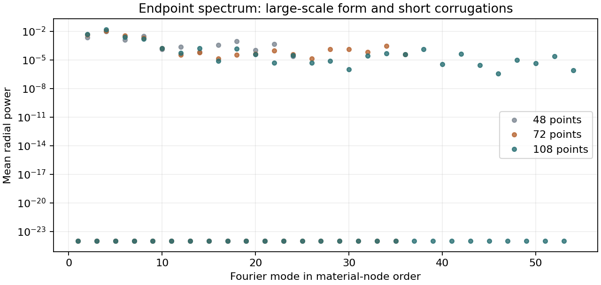
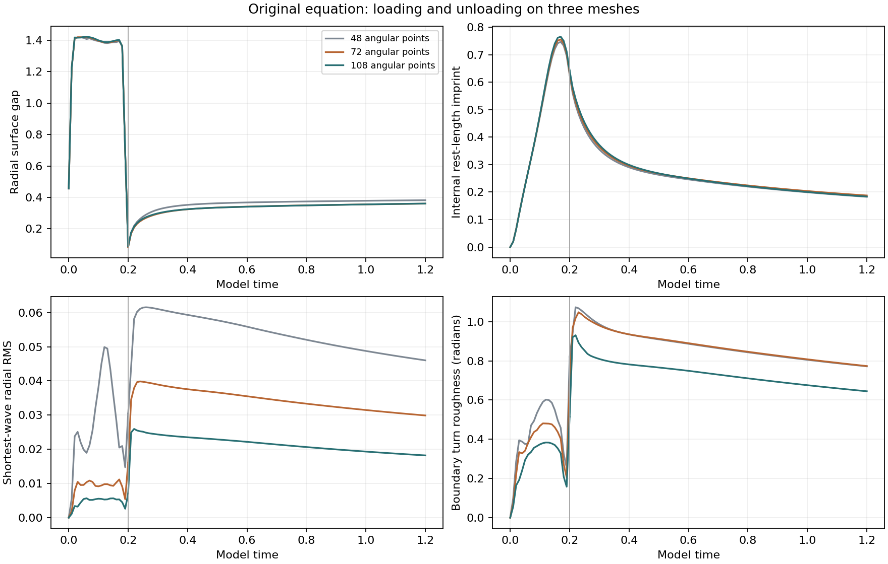

# HUG unloading: refinement and the zigzag pattern

**Completed:** four requested integrations, with no integration failures. Published October 15, 2026. This is a dimensionless molding model, not a measured clay sample.

[Full illustrated report](report.html#unloading-accuracy-summary) · [Complete offline report, source and saved results (ZIP)](https://github.com/NousVolition/My-Sources-Project-ALL/releases/download/hug-unloading-refinement-2026-10-15/hug-unloading-refinement-complete.zip) · [Release and checksums](https://github.com/NousVolition/My-Sources-Project-ALL/releases/tag/hug-unloading-refinement-2026-10-15)

GitHub displays HTML as source. For the illustrated view, extract the ZIP and open `reports/hug-molding-refinement/package/START-HERE.html`. Both the refinement and its earlier mechanism comparison are included, with their original links and files preserved.

## What changed when we refined the calculation?

| Check | Result | Meaning |
| --- | --- | --- |
| Earlier 48 × 5 versus 72 × 7 unloading gap | **Failed:** maximum difference 9.15%, above the 5% limit | This original failure remains in the record. |
| New 72 × 7 versus 108 × 10 unloading gap | **Passed:** maximum 4.59%; endpoint 0.18% | Better agreement in the overall gap over the tested interval. |
| New finer-pair unloading imprint | **Passed:** maximum difference 2.14% | The stored spring-length imprint agrees within the original 5% limit. |
| Individual zigzags | **Still mesh sensitive** | Overall gap agreement does not establish the accuracy of each tooth. |

All four new finer-pair gap/imprint comparisons pass. Across both mesh pairs, **7 of 8** pass. Relative differences are measured at saved times against the finer result, with floors of 0.01 for gap and 0.001 for imprint. The largest new gap difference is at model time 0.20, the loading endpoint inherited by unloading. No convergence order is established.



## More precise repeat: what the tiny numbers mean

We repeated unloading from the **same saved 72 × 7 starting state**, using ten times stricter solver tolerances and half the maximum time step.

| What we checked | Largest difference | Result |
| --- | --- | --- |
| Gap between the material and object | About **6.3 parts per billion** | Passed |
| Strength of the small zigzags | About **7.2 parts per billion** | Passed |
| Mesh positions and stored spring lengths | **0.029% of the allowed normalized-error limit** | Passed |

Making the unloading calculation more precise gave essentially the same result, including the zigzags. Numerical timing error **during unloading** is therefore unlikely to explain them. This compares two calculations from one saved state; it does not independently validate the earlier loading integration or remove the separate mesh limitation.



## Why do the zigzags remain?

The saved history shows the material first moving outward toward the active square wall, then inward as the Lorenz drive changes sign. Corrugations and changed preferred spring lengths are already present before release. During unloading, positions relax under the model's spring, area and contact forces.

Holding the **already-written preferred spring lengths fixed** still leaves corrugations. Continued spring-length evolution after release changes the pattern, but is not required for it to persist. This intervention preserves both the earlier deformed geometry and its written memory, so their separate contributions have not been isolated.

The model has no explicit bending or curvature penalty setting a physical wrinkle length. The strongest short-wave modes have only about 2–3 material nodes per wavelength. A compressed spring's negative transverse stiffness contribution alone does not establish instability of the full system. The wall's role has not been isolated by a boundary-control experiment.



| Angular nodes | Endpoint short-wave radial RMS | Strongest short-wave mode |
| --- | --- | --- |
| 48 | 0.0460 | 18 |
| 72 | 0.0299 | 34 |
| 108 | 0.0182 | 38 |

These shortest-wave bands change with mesh size. The common band beginning at mode 12 also changes: RMS is 0.03167 at 72 nodes and 0.02792 at 108. Spectra use material-node order, not literal polar-angle wavelengths.





At model time 1.2 the finest mesh retains **28.6% of its loaded imprint**, which is still fading. A permanent free shape or physical clay wrinkle has not been demonstrated. Locking spring lengths does not lock positions; mechanical relaxation continues.

## Bounded experiment and verification

- Four new integrations only: tighter 72 × 7 unloading, fixed-rest 72 × 7 unloading, fresh 108 × 10 loading, and its unloading.
- Loading covers model time 0–0.2; unloading covers 0.2–1.2. The refinement and tighter control retain the original equations. The fixed-rest intervention is explicitly documented.
- 34 frozen input/source anchors and 11 numerical-manifest entries match. There are 324 new saved states and 812 states including parent records in the geometry audit.
- Separate material and combined scaled energy residuals are at most 7.40 × 10⁻⁸ and 1.17 × 10⁻⁷, below the declared 0.001 limit. Preload removal is accounted for as switching work (−1.2900535413).
- Four directional Jacobian checks pass; the largest relative error is 2.10 × 10⁻⁸.
- The publication verifier checks every archived file, source/data/report manifests, saved numerical gates and report links. It runs no trajectories.



[Compact numerical summary](summary.json) · [Frozen protocol](protocol.json) · [Completed verification record](final-verification.json) · [Numerical manifest](results/manifest.json) · [Publication provenance](publication.json) · [File catalog](data-release.json)

The original protocol and audit files retain historical “local only” / `publication_authorized: false` notes. Those describe authorization when the calculation was performed; the user separately requested publication on October 15. Original bytes remain preserved in the release.

## Download and verify without rerunning simulations

The release contains all 156 original files from the refinement and its necessary parent comparison, plus a start page and a historical-link context notice. Full arrays and the detailed analysis remain in Releases to keep normal cloning small. The original numerical sources and report builders are included unchanged.

From the repository root, with Python 3.12 and the study's dependencies:

```sh
python -m pip install numpy==2.3.5 scipy==1.18.1
python tools/restore_numerical_data.py --catalog reports/hug-molding-refinement/data-release.json --destination scratch/hug-unloading-publication
python -B reports/hug-molding-refinement/verify_publication.py --restored-root scratch/hug-unloading-publication
```

The restore tool checks the ZIP's size and SHA-256, exact member inventory and every file hash before extraction. It refuses conflicting files. The verifier works on a temporary copy because the original verifier refreshes its local audit receipt. The download and all original results remain unchanged.

[All reports](../README.md) · [Related molding and reciprocal-drive studies](../README.md#moldable-hug-and-reciprocal-drive)
