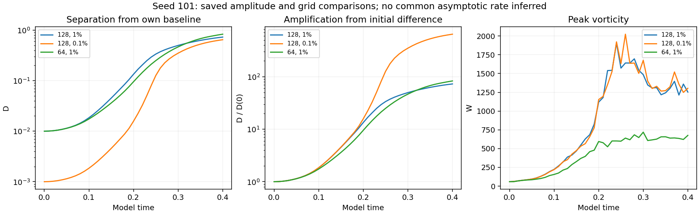
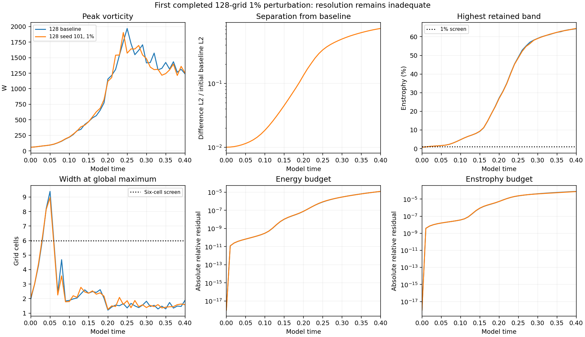
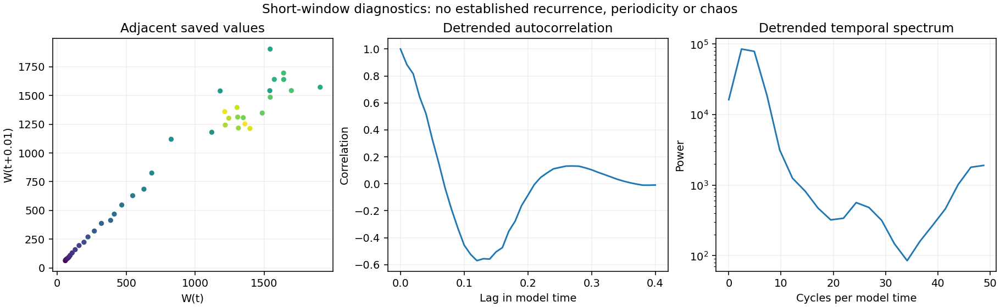

# First 128-grid 1% perturbation seed complete

Seed **101** reached **model time 0.40**. All 41 saved fields and their separation from 41 baseline fields were checked. The matrix now has **32/48 completed, verified and published results; 16 jobs remain**. The 256-grid ordinary baseline and the next existing 128-grid 1% seed, 202, are running. No simulation was restarted or added to produce this report.

The measured separation is substantial, but the peak and late field remain spatially unresolved. This result does not establish a converged physical instability or an asymptotic Lyapunov exponent.

## Separation and matched comparisons

| Measurement | 128 grid, 1% (new) | 128 grid, 0.1% | 64 grid, 1% |
| --- | ---: | ---: | ---: |
| Initial D | 0.01 | 0.001 | 0.01 |
| Final D | 0.72901608 | 0.64703759 | 0.83194947 |
| Amplification | 72.901608 | 647.03759 | 83.194947 |
| Endpoint log-growth rate | 10.722777 | 16.181011 | 11.052967 |
| Whole-window fitted log slope | 13.296467 | 20.5463 | 13.493288 |
| Final W | 1253.2776 | 1303.6435 | 676.07831 |
| Final I | 350.9661 | 356.91419 | 167.51369 |

D is the velocity-field L2 difference from the corresponding ordinary-step baseline, divided by that baseline's initial L2 norm. All three curves use seed 101; grid 64 uses its own baseline and normalization. The new 128-grid trajectory starts at **D=0.01** and ends at **0.72901608**, an amplification of **72.9016**. Its largest saved W is **1904.976757**, at **t=0.24**; endpoint W is **1253.277602**.

The tenfold initial amplitude difference between the two 128-grid runs does not yield a tenfold endpoint difference. These are finite-amplitude trajectories over one recorded transient. The endpoint rate is log(D(0.40)/D(0))/0.40; the fitted slope uses all 41 log(D) samples. Both are **finite-time separation measurements**, without renormalization. Their amplitude dependence and the resolution failures prevent an asymptotic Lyapunov interpretation. This is the first completed 128-grid 1% seed; seeds 202 and 303 remain in the existing queue.

## Accuracy, budgets and numerical limits

The spatial-resolution screen fails at **all 41 saved times**. At the endpoint, **64.4363%** of enstrophy is in the highest retained band, against a 1% screen. The global peak width is **1.5812 cells**, and the central-region width is **1.5144 cells**, against a six-cell screen.

The supplied raw strain is **not smooth across periodic joins**, and the initial maximum vorticity lies **outside the central tube**. These features were retained. The [existing 128-grid timestep control](../completed-timestep128/README.md) also fails its W-curve screen and has a 51.82% endpoint velocity difference. Its denominator differs from D's denominator. Small budget residuals cannot repair spatial or temporal error.

Maximum absolute relative energy-budget residual: **1.2302134e-05**, below the declared 0.005 hard stop. Endpoint enstrophy-budget residual: **7.661597e-05**. Maximum speed CFL: **0.057611923**. These verify consistency of the discretized run; the mathematical model and continuum interpretation remain under examination.

## Independent verification

All **41 new fields** and their differences from **41 saved baseline fields** were independently remeasured in physical space. Peak vorticity, energy, enstrophy and D match the recorded values to maximum relative error **6.43e-16**. The initial field matches the prescribed 1% perturbation with seed 101. Finite arrays, mean preservation, unchanged numerical source hashes, the CFL and energy hard stops, and monotone recorded I were checked. Endpoint widths, spectra, divergence, stretching and budget diagnostics match the frozen diagnostics. Earlier comparison records match their published Git hashes; their finite-window rates were independently recalculated.

The Heun method, supplied starting field, cube of side 6, mean, viscosity 0.001 and zero force are unchanged. Stage accumulations provide I and budget integrals; trajectories were not rerun. Large restart fields stay local, with all SHA-256 values retained in the audit.

Adjacent samples, detrended autocorrelation and the temporal spectrum describe this transient. They do not establish field recurrence, a periodic orbit or chaos. The supplied q remains a passive signed record; E is unsigned. Fitted-q and cubic-feedback studies are separate model tests, and mirror averaging is an explicit intervention.

## Files and related results

- [Measurements](measurements.json), [summary](summary.json), [analysis](analysis.json)
- [Verification and all field hashes](verification.json)
- [Audit code](verify.py): `python verify.py /path/to/matched-stretch-study`
- [Chart code](plot.py): `python plot.py` from this folder
- [Same seed at 128 grid, 0.1%](../completed-n128-seed101/README.md)
- [Same seed at 128 grid, 0.5%](../completed-n128-halfpercent-seed101/README.md)
- [Completed grid-64 1% batch](../completed-onepercent/README.md)
- [Protocol](../protocol.json), [numerical source](../numerics.py), [study index](../README.md)

Historical intake reviews and earlier batch reports retain their original dates and status. The separate vortex matrix is already complete at 48/48; its [final report](../../study/final-matrix/README.md) is unchanged.
