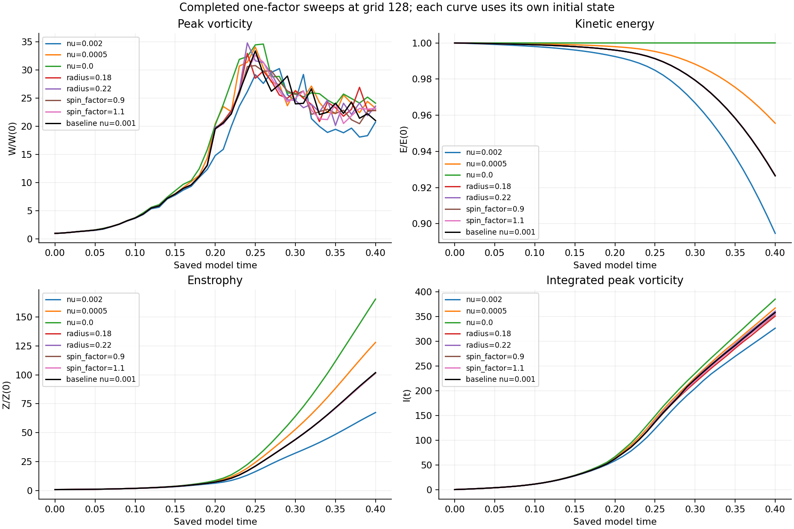
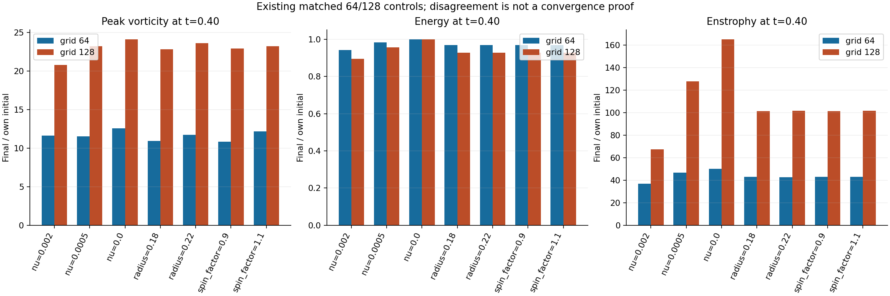
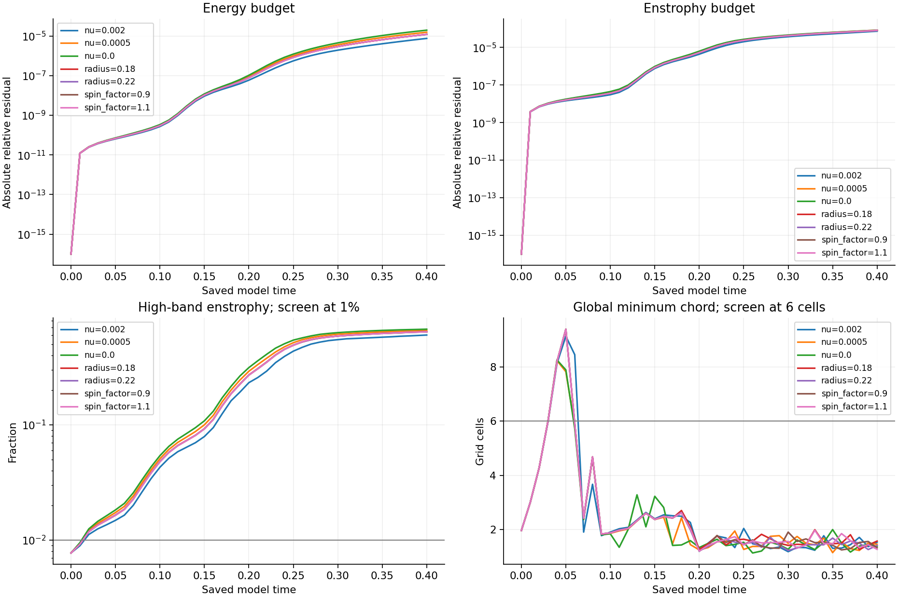
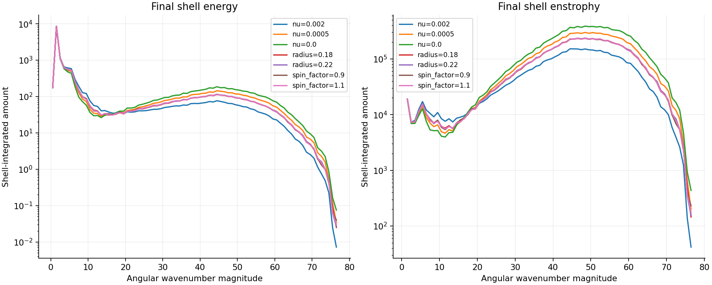
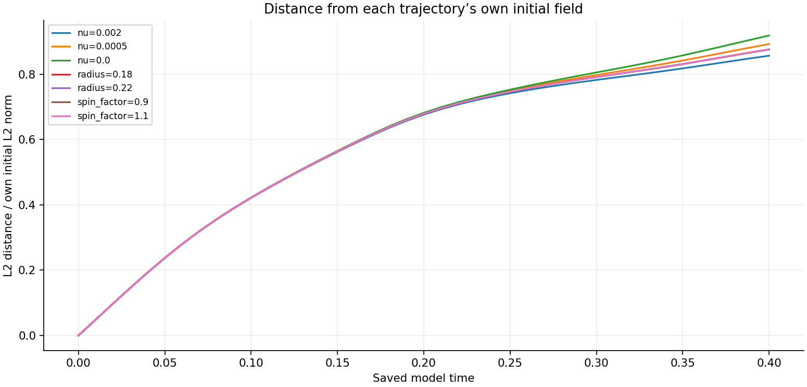

# Completed grid-128 parameter batch — October 15, 2026

[Matched-stretch reports](../README.md) · [Completed viscosity 0.01 sweep](../completed-n128-viscosity0p01/README.md)

Seven additional original-matrix runs reached **0.40** with **41 saved fields each**. All **287 fields** were independently remeasured. The frozen supplied initial-field family, per-run viscosity, mean, domain, Heun method and zero force were preserved. No new simulations or horizon extensions were introduced.

The batch contains viscosities 0.002, 0.0005 and 0; radius 0.18 and 0.22; and spin factors 0.9 and 1.1. Radius/spin cases retain viscosity 0.001. These are the already authorized one-factor changes to the supplied field, not perturbation-separation experiments. Their means and normalization are checked against each run's prescribed initial state. Each curve is divided by its own initial value; absolute quantities remain in raw diagnostics.

| Run | Preserved dt | W(0.40)/W(0) | E(0.40)/E(0) | Z(0.40)/Z(0) | Failed spatial screens |
|---|---:|---:|---:|---:|---:|
| [viscosity-n128-nu0.002](diagnostics/viscosity-n128-nu0.002.json) | 4.878049e-05 | 20.75459 | 0.8946843 | 67.44576 | 41/41 |
| [viscosity-n128-nu0.0005](diagnostics/viscosity-n128-nu0.0005.json) | 4.878049e-05 | 23.19252 | 0.9555911 | 127.9312 | 41/41 |
| [viscosity-n128-nu0.0](diagnostics/viscosity-n128-nu0.0.json) | 4.878049e-05 | 24.10471 | 1.00002 | 165.2661 | 41/41 |
| [radius-n128-v0.18](diagnostics/radius-n128-v0.18.json) | 4.878049e-05 | 22.78948 | 0.9267182 | 101.5466 | 41/41 |
| [radius-n128-v0.22](diagnostics/radius-n128-v0.22.json) | 4.878049e-05 | 23.56962 | 0.9265788 | 101.6746 | 41/41 |
| [spin_factor-n128-v0.9](diagnostics/spin_factor-n128-v0.9.json) | 4.878049e-05 | 22.88584 | 0.9266874 | 101.3681 | 41/41 |
| [spin_factor-n128-v1.1](diagnostics/spin_factor-n128-v1.1.json) | 4.878049e-05 | 23.18594 | 0.9266364 | 101.6389 | 41/41 |

## Existing controls and numerical limits

The matching completed grid-64 parameter controls and completed grid-128 baseline (viscosity 0.001) are included at identical saved times. Completed baseline half-step records and the previous viscosity-0.01 sweep are also supplied as context. Each retains its own recorded viscosity, initial field and time step. The 64/128 endpoint comparison below does not establish spatial convergence; baseline half-step checks do not establish time convergence of every parameter trajectory.

**Raw strain is nonsmooth across periodic joins, and the initial maxima lie outside the central tube.** The published spatial screens require high-band energy below 0.1%, high-band enstrophy below 1%, and minimum half-peak chord at least six cells. These are screening criteria, not proof of resolution. The table distinguishes spatial limitations from budget consistency.

| Run | Final global width, cells | Final central width, cells | Final high-band Z | Maximum absolute E budget residual | Maximum absolute Z budget residual |
|---|---:|---:|---:|---:|---:|
| nu=0.002 | 1.5344 | 1.401 | 60.32831% | 7.58e-06 | 7.33e-05 |
| nu=0.0005 | 1.4593 | 1.1975 | 66.24283% | 1.56e-05 | 8.3e-05 |
| nu=0.0 | 1.38 | 1.5163 | 67.83627% | 1.97e-05 | 8.22e-05 |
| radius=0.18 | 1.5776 | 1.5919 | 64.38472% | 1.21e-05 | 8.01e-05 |
| radius=0.22 | 1.4176 | 1.438 | 64.41611% | 1.21e-05 | 8.01e-05 |
| spin_factor=0.9 | 1.3296 | 1.49 | 64.41556% | 1.22e-05 | 8.07e-05 |
| spin_factor=1.1 | 1.2729 | 1.7774 | 64.40752% | 1.21e-05 | 8.02e-05 |

Individual budgets use recorded Heun-stage integrals, checked against saved endpoint energies and enstrophies. Independent physical-space checks cover norms, means, divergence, enstrophy production and viscous losses. All declared numerical hard stops pass; neither small residuals nor a viscosity change proves a physical stability transition. At zero viscosity the viscous terms are exactly zero; unresolved transfer to small scales remains a limitation.

The initial-return diagnostic measures distance from each trajectory's own initial velocity field. It does not establish recurrence, periodicity or a search over all state pairs. These unperturbed sweeps do not supply disturbance-growth or Lyapunov measurements.

## Verification and reproducibility

The [verifier](verify_matrix.py) runs as `python -B verify_matrix.py STUDY_DIRECTORY JOB_ID OUTPUT_JSON`. It checks all 41 saved fields per new run, the exact prescribed initial field, unchanged source/protocol hashes, mean, divergence, physical norms, stretching and losses, saved budget endpoints, spectra, widths and declared hard stops. Width and spectral remeasurement uses the frozen routine and is a consistency check, not a second discretization. Original large Fourier fields are required locally and are not embedded; their SHA-256 values are retained below.

- [viscosity-n128-nu0.002 independent verification](verification/viscosity-n128-nu0.002.json)
- [viscosity-n128-nu0.0005 independent verification](verification/viscosity-n128-nu0.0005.json)
- [viscosity-n128-nu0.0 independent verification](verification/viscosity-n128-nu0.0.json)
- [radius-n128-v0.18 independent verification](verification/radius-n128-v0.18.json)
- [radius-n128-v0.22 independent verification](verification/radius-n128-v0.22.json)
- [spin_factor-n128-v0.9 independent verification](verification/spin_factor-n128-v0.9.json)
- [spin_factor-n128-v1.1 independent verification](verification/spin_factor-n128-v1.1.json)

[Raw diagnostics](diagnostics/) include the seven new runs and existing completed controls. Existing controls are reused without rerunning or claiming a new independent full-field verification. [Analysis](analysis.json) records summary values and the current completion snapshot. [Frozen protocol](protocol.json), [numerical source](reproduction/numerics.py), [matrix controller](reproduction/run_suite.py) and [publication builder](build_completed_batch.py) retain provenance.

At this report's snapshot, the original matrix has **42/48 complete**, **2 active**, **4 queued**, and **0 recorded failures**. Active jobs: baseline-n256-base, strain_factor-n128-v0.9. This is a completed batch report; the original matrix's final report awaits its remaining jobs. Historical intake reviews remain unchanged.
