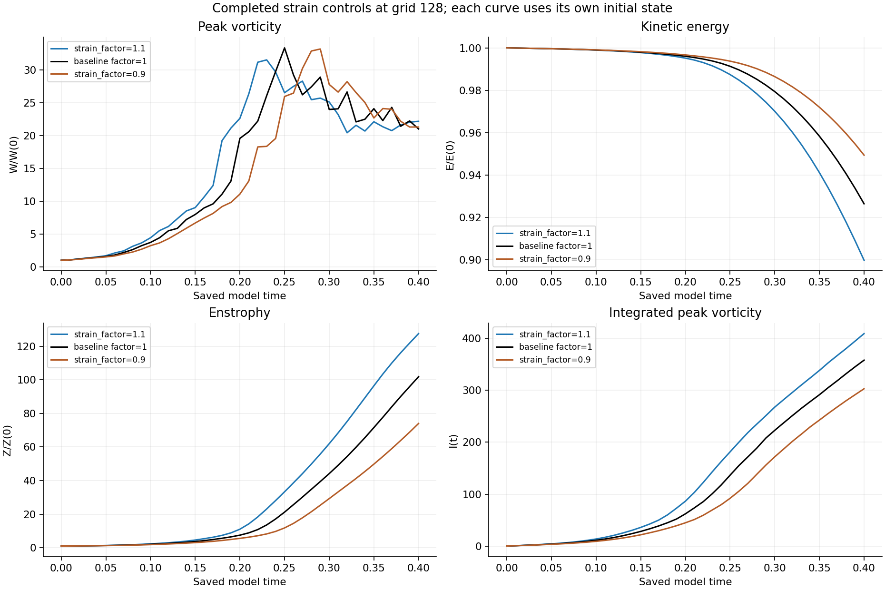
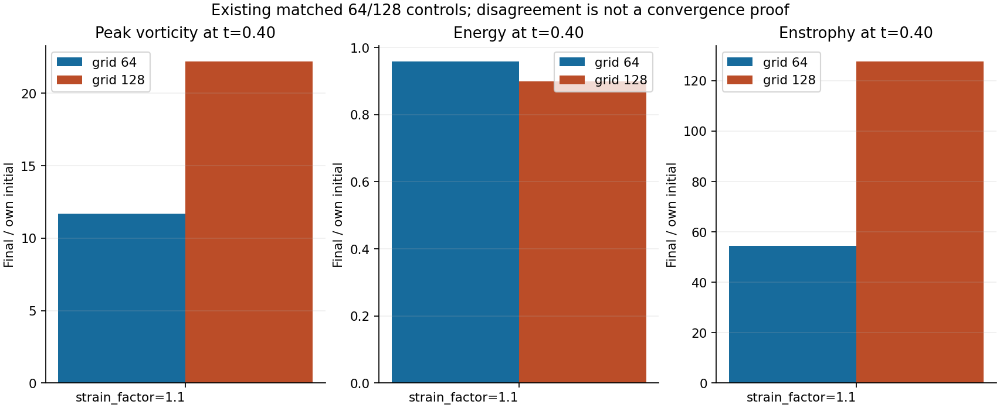
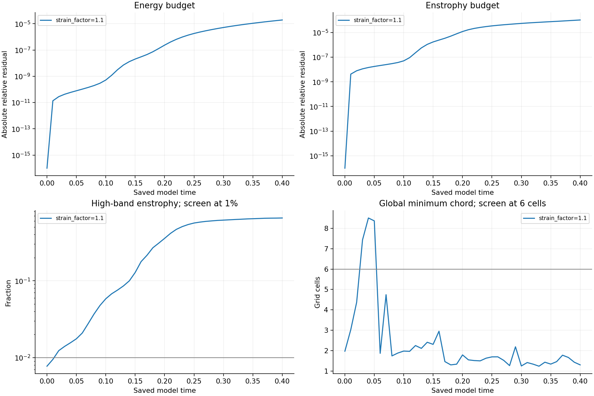
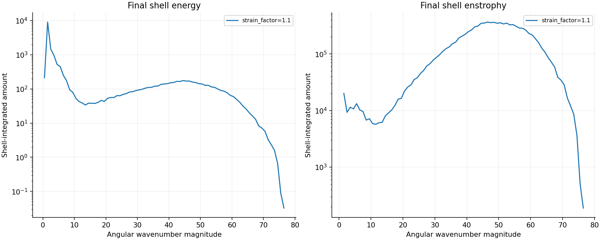
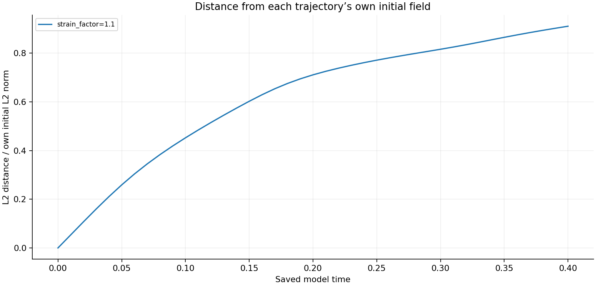

# Completed grid-128 strain factor 1.1 — October 15, 2026

[Matched-stretch reports](../README.md) · [Previous completed parameter batch](../completed-n128-parameter-batch-20261015/README.md)

The original **strain_factor-n128-v1.1** run reached **0.40** with **41 saved fields**, all independently remeasured. The frozen supplied initial-field family, per-run viscosity, mean, domain, Heun method and zero force were preserved. No new simulations or horizon extensions were introduced.

This authorized one-factor case increases the supplied raw strain factor from 1 to 1.1 and retains viscosity 0.001, domain side 6, grid 128 and zero force. It preserves its original Heun step of 0.01/225 = 4.4444444444444447e-05. The prescribed initial mean is [0.5723507792702532, 0.5723507792702532, -1.1447015585405065]; the baseline has a different prescribed initial mean because its strain factor is 1. Each trajectory conserves its own initial mean. Peak vorticity, energy and enstrophy curves are normalized by their own initial values; I(t) remains absolute. Absolute quantities remain in the raw diagnostics. This is a parameter-control experiment, not a disturbed/reference separation test.

| Run | Preserved dt | W(0.40)/W(0) | E(0.40)/E(0) | Z(0.40)/Z(0) | Failed spatial screens |
|---|---:|---:|---:|---:|---:|
| [strain_factor-n128-v1.1](diagnostics/strain_factor-n128-v1.1.json) | 4.444444e-05 | 22.18127 | 0.8998522 | 127.5637 | 41/41 |

## Existing controls and numerical limits

The matching completed strain-factor-1.1 grid-64 control, completed grid-128 baseline at strain factor 1, and completed grid-128 strain-factor-0.9 run (all viscosity 0.001) are included at identical saved times. Completed baseline grid-64 and half-step records are also supplied as context. Each retains its own recorded viscosity, initial field and time step. The 64/128 endpoint comparison below does not establish spatial convergence; baseline half-step checks do not establish time convergence of every parameter trajectory.

**Raw strain is nonsmooth across periodic joins, and the initial maxima lie outside the central tube.** The published spatial screens require high-band energy below 0.1%, high-band enstrophy below 1%, and minimum half-peak chord at least six cells. These are screening criteria, not proof of resolution. The table distinguishes spatial limitations from budget consistency.

| Run | Final global width, cells | Final central width, cells | Final high-band Z | Maximum absolute E budget residual | Maximum absolute Z budget residual |
|---|---:|---:|---:|---:|---:|
| strain_factor=1.1 | 1.2978 | 1.4051 | 65.59843% | 1.92e-05 | 0.000102 |

Individual budgets use recorded Heun-stage integrals, checked against saved endpoint energies and enstrophies. Independent physical-space checks cover norms, means, divergence, enstrophy production and viscous losses. All declared numerical hard stops pass; neither small residuals nor a viscosity change proves a physical stability transition. Unresolved transfer to small scales remains a limitation.

The initial-return diagnostic measures distance from each trajectory's own initial velocity field. It does not establish recurrence, periodicity or a search over all state pairs. This unperturbed strain sweep does not supply disturbance-growth or Lyapunov measurements.

## Verification and reproducibility

The [verifier](verify_matrix.py) runs as `python -B verify_matrix.py STUDY_DIRECTORY JOB_ID OUTPUT_JSON`. It checks all 41 saved fields per new run, the exact prescribed initial field, unchanged source/protocol hashes, mean, divergence, physical norms, stretching and losses, saved budget endpoints, spectra, widths and declared hard stops. Width and spectral remeasurement uses the frozen routine and is a consistency check, not a second discretization. Original large Fourier fields are required locally and are not embedded; their SHA-256 values are retained below.

- [strain_factor-n128-v1.1 independent verification](verification/strain_factor-n128-v1.1.json)

[Raw diagnostics](diagnostics/) include the newly completed strain run and existing completed controls. Existing controls are reused without rerunning or claiming a new independent full-field verification. [Analysis](analysis.json) records summary values and the current completion snapshot. [Frozen protocol](protocol.json), [numerical source](reproduction/numerics.py), [matrix controller](reproduction/run_suite.py) and [publication builder](build_publication.py) retain provenance.

At this report's snapshot, the original matrix has **45/48 complete**, **2 active**, **1 queued**, and **0 recorded failures**. Active jobs: baseline-n256-half, angle_degrees-n128-v-5.0. This is a completed batch report; the original matrix's final report awaits its remaining jobs. Historical intake reviews remain unchanged.
