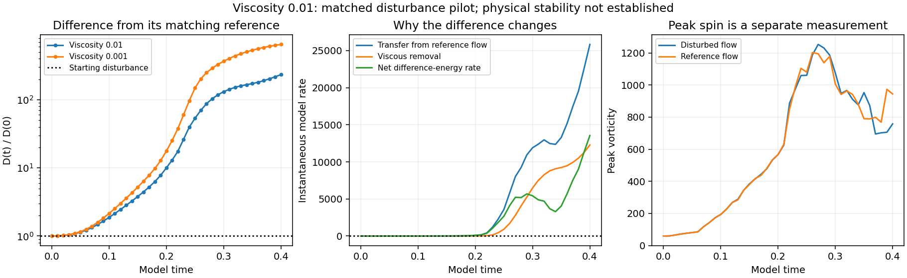
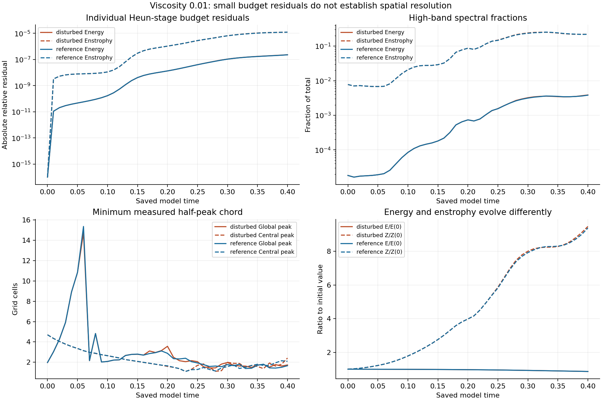
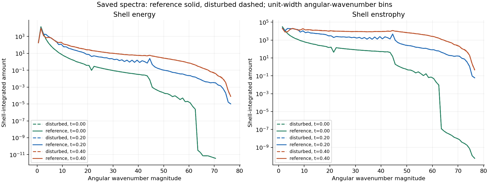
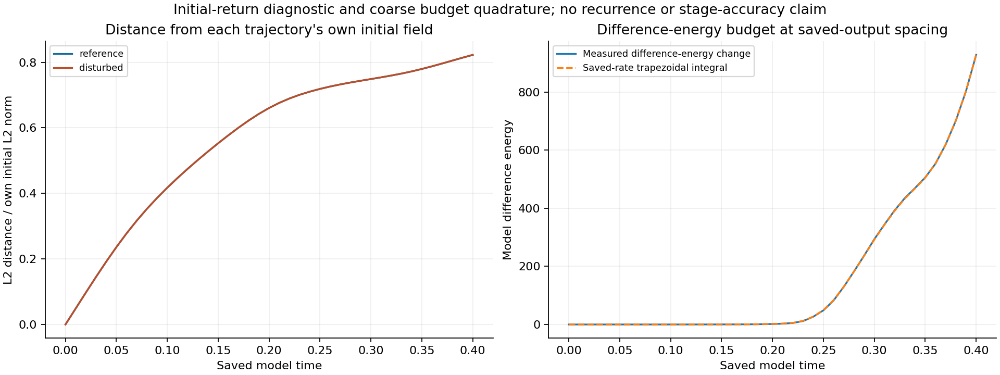

# Completed viscosity 0.01 disturbance comparison — seed 202

[Matched-stretch reports](../README.md) · [Completed undisturbed reference](../completed-n128-viscosity0p01/README.md)

The 0.1% disturbance grew to **233.79194460 times its starting L2 size** by saved model time **0.40**, or **23279.1945% above its starting size**. Its instantaneous difference-energy rate at 0.40 was **positive (+13550.91112929)**: it was still growing at that saved state. Both trajectories are complete, with all 41 paired outputs independently checked.

The matching completed viscosity 0.001 case reached **648.88856217 times its starting disturbance** at the same time. This comparison records less finite-time separation at viscosity 0.01 for this seed; it does not establish a physical stability transition, infinitesimal stability, or an asymptotic Lyapunov exponent.

## What was held fixed

Grid 128, domain side 6, the supplied initial reference field, fixed mean velocity, zero force, frozen Heun method, one FFT worker and time step 4.8780487804878051e-05 were preserved. There are 205 steps per 0.01 output interval and 41 outputs from 0 to 0.40. The disturbance is the identical 0.1%, seed-202 initial perturbation used in the lower-viscosity comparison. The completed viscosity-0.01 reference was reused; this pilot added only one disturbed trajectory.

D(t) = ||u_disturbed(t) − u_reference(t)||₂ / ||u_reference(0)||₂, with the fixed initial reference norm **184.30770667966**. D(0) = 0.001; D(0.40) = **0.233791944599**. Each lower-viscosity difference uses its own matching reference, with the same initial normalization. All comparisons below use identical saved times; both lower-viscosity trajectories are complete.

| Saved time | D(t)/D(0), ν=0.01 | D(t)/D(0), ν=0.001 | Instantaneous difference-energy rate, ν=0.01 |
|---|---:|---:|---:|
| 0.00 | 1 | 1 | -0.0022520009 |
| 0.01 | 1.0041419 | 1.0048574 | +0.030779915 |
| 0.10 | 1.878449 | 2.1490208 | +1.5375999 |
| 0.20 | 10.010106 | 17.710547 | +89.290085 |
| 0.30 | 131.50636 | 367.52153 | +5421.5424 |
| 0.40 | 233.79194 | 648.88856 | +13550.911 |

The instantaneous rate is negative at t=0 and positive at the first evolved saved output, t=0.01. No reversal time is interpolated between those outputs. Change since the start and the instantaneous sign are different measurements.

## Difference-energy transfer and budgets

For δu = u_disturbed − u_reference and Eδ = ½||δu||₂², the zero-force periodic identity is dEδ/dt = −∫δuᵢδuⱼ ∂ⱼUᵢ dx − ν||∇δu||₂². At 0.40, transfer from the reference flow is **25829.18364407**, viscous removal is **12278.27251478**, and their difference is **+13550.91112929**. Independent physical-gradient evaluation agrees with the spectral RHS difference; the maximum scaled identity error is 7.09e-13.

The individual reference and disturbed energy/enstrophy budgets use their recorded Heun-stage integrals. Final absolute relative residuals are 2.2668e-07 / 2.29817e-07 for energy and 1.2295e-05 / 1.2381e-05 for enstrophy (reference / disturbed).

A separate trapezoidal integral of the saved difference-energy rates at spacing 0.01 gives 928.287196, versus the measured difference-energy change 928.342292; their signed relative gap is 5.93491e-05. **This is coarse saved-output quadrature, not a Heun-stage difference-energy integral.** The pilot did not retain stage-by-stage difference-energy rates, so this gap is not a time-integration error estimate.

## Resolution and interpretation limits

The raw strain is **not smooth across periodic joins**, and **the initial maxima lie outside the central tube**. The reference and disturbed trajectories each fail 38 and 38 of 41 spatial screens, respectively. At 0.40 their high-band enstrophy fractions are 21.886145% and 21.957698%; global minimum half-peak widths are 1.65808 and 1.73116 cells. Central-region widths are 2.09274 and 2.40991 cells. These observations do not demonstrate resolved spatial dynamics.

This is one finite-amplitude seed at one grid and time step. No paired finer-grid or half-step control was authorized, so time and spatial convergence of this separation are unestablished. Passing finite-field, mean, divergence, CFL and energy-budget hard stops, and small budget residuals, do not cure those limitations. Peak vorticity is a separate physical diagnostic and is not used as a substitute for disturbance growth.

The initial-return diagnostic below measures distance from each trajectory's own initial velocity field. It does not establish recurrence or periodicity, and is not a search over arbitrary state pairs.

## Verification and reproducibility

[Extended verification](verification.json) independently remeasured all **41 reference and 41 disturbed fields**, with all 41 lower-viscosity difference norms also checked. [Verification code](verify_complete.py) checks the prescribed reference, exact seed-202 perturbation, fixed normalization and mean, physical L2/energy/enstrophy/peak-vorticity norms, divergence, independent stretching and viscous terms, the transfer identity, individual budget endpoints, frozen hashes, spectra and widths. The spectral/width remeasurement uses the frozen routine; it is a consistency check, not a second discretization. The [existing verifier's record](saved-field-verification.json) supplies another physical-space norm check and hashes of all paired fields. No trajectories were repeated during verification.

The extended verifier runs as `python -B verify_complete.py PILOT_DIRECTORY OUTPUT_JSON` in the study environment and requires the original saved Fourier fields and original reference paths recorded in the protocol. Large field arrays are not embedded in this report. Per-field SHA-256 values are retained in the verification records. The copied code documents the original environment and paths; copying a report folder alone is not sufficient to reproduce the simulation.

- [Disturbed raw diagnostics](result.json), [reference diagnostics](reference-result.json), [lower-viscosity disturbed diagnostics](lower-viscosity-result.json), [lower-viscosity reference diagnostics](lower-viscosity-reference-result.json)
- [Frozen protocol](protocol.json), [initial audit](initial-audit.json), [later publication authorization](publication-authorization.json)
- [Analysis summary](analysis.json), [existing report summary](summary.json), [standalone HTML report](report.html), [publication builder](build_publication.py)
- [Frozen pilot runner](reproduction/pilot/run_pair.py), [diagnostics](reproduction/pilot/diagnostics.py), [report builder](reproduction/pilot/build_report.py), [existing verifier](reproduction/pilot/verify_saved.py), [numerical source](reproduction/pilot/source/numerics.py), [original matrix controller](reproduction/original-run_suite.py)

The frozen protocol's earlier local-only publication wording is preserved byte-for-byte. The later explicit publication authorization supersedes only that restriction, without altering any numerical setting or source. Historical intake reviews remain unchanged. The original 48-job matrix and separate viscosity-0.1 comparison continue under their existing scope.
