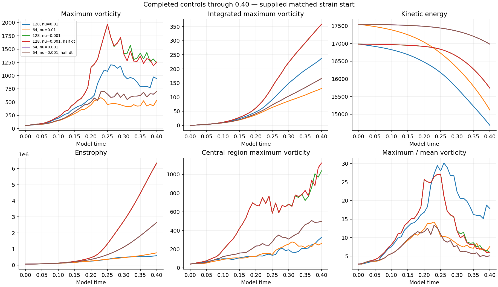
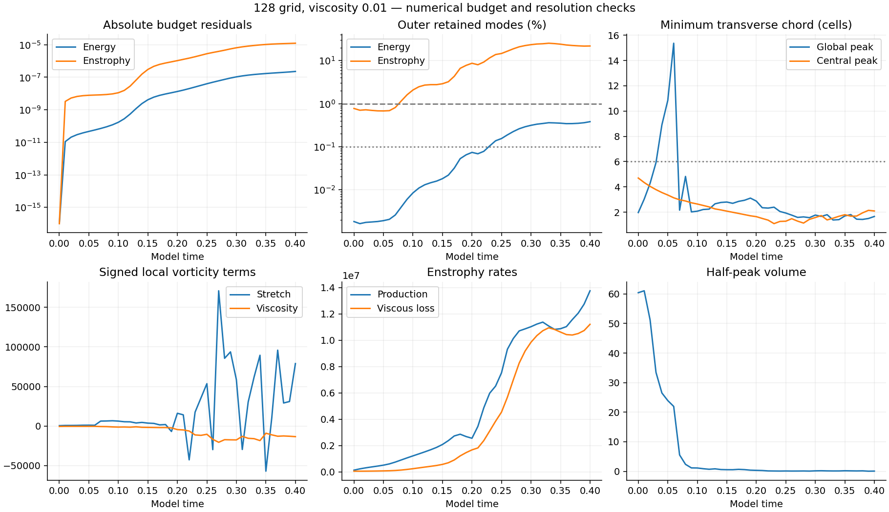
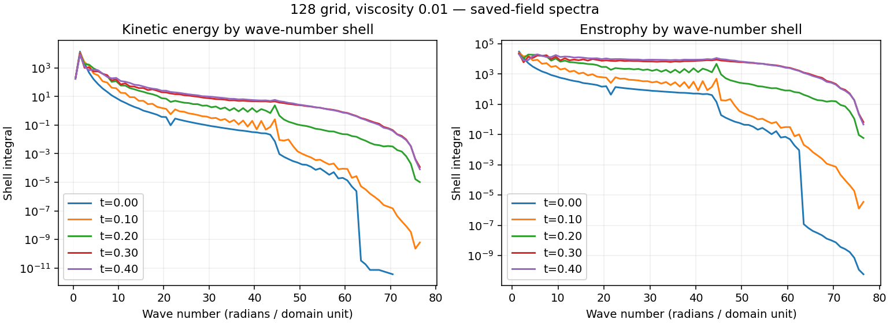
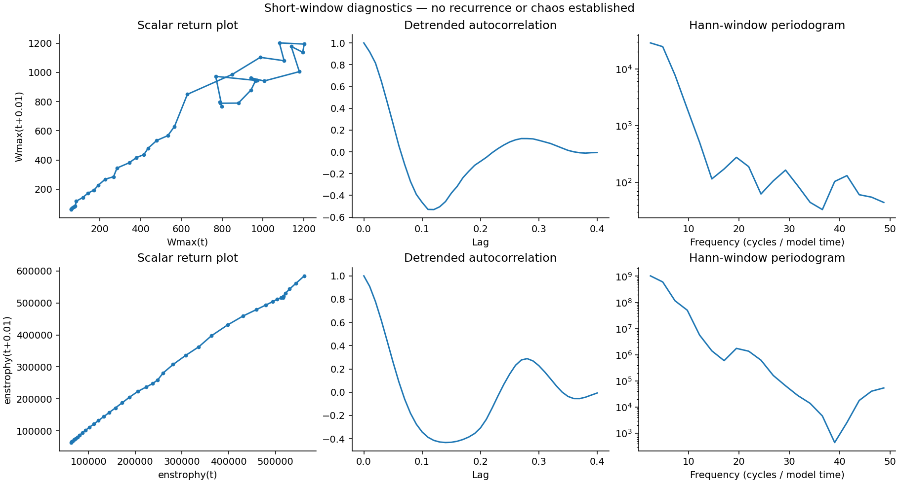

# Completed 128-grid viscosity 0.01 control

[Study index](../README.md) · [All reports](../../README.md)

The existing unperturbed viscosity-0.01 run completed all **41 saved outputs through model time 0.40**. Its sampled peak vorticity was **1202.42 at t=0.26**; final vorticity was **944.196**, and the accumulated maximum-vorticity integral was **237.291**. Final kinetic energy was **86.455%** of its initial value.

This is an unperturbed viscosity sweep. It has no disturbance-separation diagnostic. Peak-vorticity growth cannot answer whether a disturbance shrinks. The separately authorized disturbed/reference comparisons remain in progress.

## Scope and numerical controls

The supplied initial field, periodic cube of side 6, fixed discrete mean, zero force and frozen Heun integrator are retained. Grid: 128 cubed. Viscosity: 0.01. Step: 4.87804878048781e-05, with 205 substeps per 0.01 saved interval. The initial mean is [0.5203188902456848, 0.5203188902456848, -1.0406377804913696]. Per-grid discrete means differ in the sampled nonsmooth initial field and are preserved without renormalizing controls.

All comparisons below are existing completed runs at the identical 41 saved times. Each retains its own viscosity, grid, initial norm and step. The 256-grid run is unfinished and is excluded from these completed comparisons. There is no viscosity-0.01 half-step pair, and no time-convergence claim for this new result.

| Completed run | Sampled peak W | Peak time | Final W | Final I | Failed spatial screens |
| --- | ---: | ---: | ---: | ---: | ---: |
| 128, nu=0.01 | 1202.42 | 0.26 | 944.196 | 237.291 | 38/41 |
| 64, nu=0.01 | 582.855 | 0.23 | 530.561 | 130.469 | 41/41 |
| 128, nu=0.001 | 1970.47 | 0.25 | 1241.06 | 358.249 | 41/41 |
| 128, nu=0.001, half dt | 1968.02 | 0.25 | 1257.31 | 357.825 | 41/41 |
| 64, nu=0.001 | 701.79 | 0.24 | 697.892 | 165.971 | 41/41 |
| 64, nu=0.001, half dt | 701.771 | 0.24 | 698.799 | 166.001 | 41/41 |

The 64/128 viscosity-0.01 W-curve relative L2 difference is 98.752%, with the 64-grid curve as denominator. Changing viscosity changes the model being integrated; a smaller peak or smaller budget residual does not demonstrate a physical stability transition.

## Budgets, spectra and widths

The maximum absolute relative energy-budget residual is 2.2668e-07; the enstrophy-budget residual is 1.2295e-05. The declared energy hard stop is 0.005; the maximum recorded speed CFL is 0.0414176, below 0.5. No declared hard stop occurred. Saved stage integrals are preserved; this verification does not repeat integration.

The spatial screen fails at **38/41** saved outputs. At 0.40, the outer retained modes contain **0.381% of energy** and **21.89% of enstrophy**. The minimum global-peak chord spans **1.658 cells**; the central-peak chord spans **2.093 cells**. The screen requires less than 0.1% outer-band energy, less than 1% outer-band enstrophy and at least 6 cells across the global-peak chord. It is an exploratory screen, not proof of resolution.

**The raw strain is nonsmooth at periodic joins, and the initial maximum lies outside the central tube. Spatial and time convergence are unestablished.** Small budget errors check consistency of the discrete calculation; they do not repair unresolved structure or establish continuum behavior.

## Recurrence diagnostics

Return plots, linearly detrended autocorrelations and Hann-window periodograms use the saved W and enstrophy series. Forty-one samples over 0.40 cannot establish recurrence, chaos or asymptotic Lyapunov behavior. No perturbation rate is calculated for this unperturbed run.

## Verification and records

All 41 fields were independently remeasured using NumPy physical-space transforms for vorticity, energy, enstrophy, mean, divergence, stretching production and viscous losses. Spectral fractions, global and central widths and budget residuals were rechecked from saved fields with the frozen observation code. The prescribed initial field and original source fingerprints were verified. Controls in the comparison table reuse their completed saved diagnostic records; no new control trajectory was computed.

- [Raw diagnostics for the six completed comparisons](measurements.json)
- [Curve differences, summaries and recurrence arrays](analysis.json)
- [Independent verification, field hashes and spectra](verification.json)
- [Verifier](verify.py), [publication builder](build_publication.py), [spectrum plotter](plot_spectra.py)
- [Frozen protocol](protocol.json), [numerical source](source/numerics.py), [controller source](source/run_suite.py)

Run the verifier with the original study directory as its argument; the large saved fields remain locally preserved. The publication builder expects this workspace layout and records provenance, rather than serving as a standalone simulator. The frozen protocol retains its historical publication language; later explicit authorization covers this completed numerical batch without changing numerical settings.

At publication preparation, the original matched-stretch matrix has **35/48 completed jobs, 2 active jobs and 11 queued jobs**. The remaining matrix and both disturbance comparisons continue. The separate vortex matrix is already complete and published. Historical intake reviews are unchanged.
