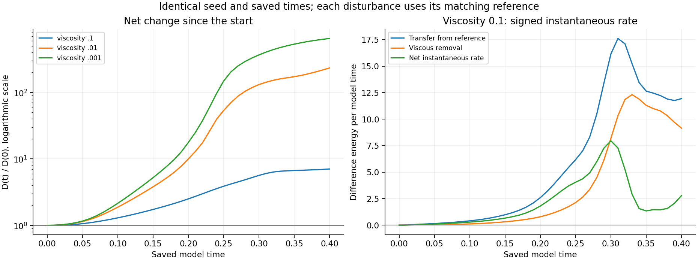
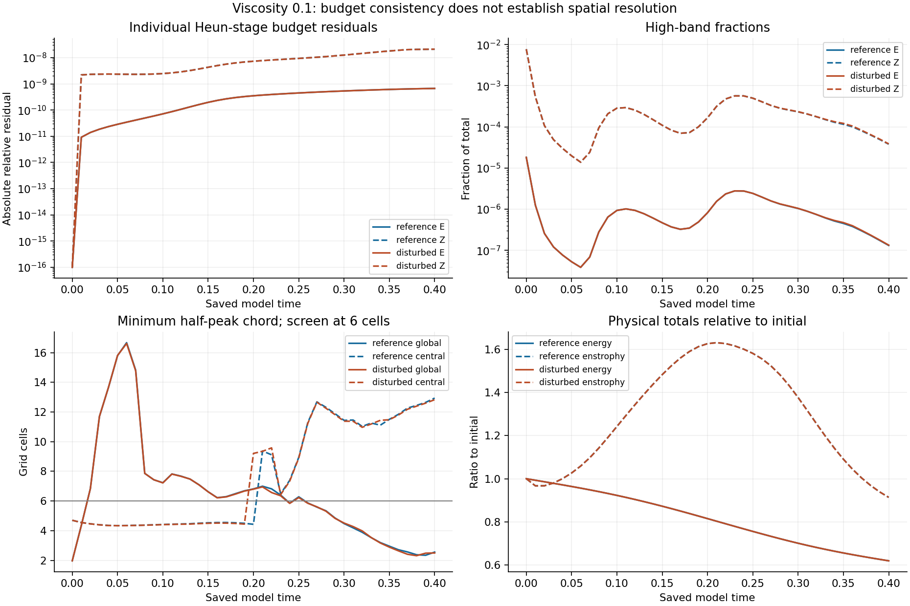
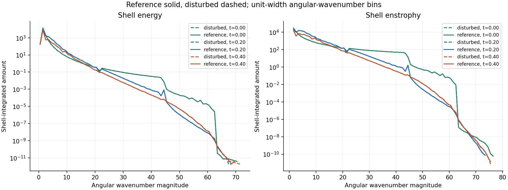
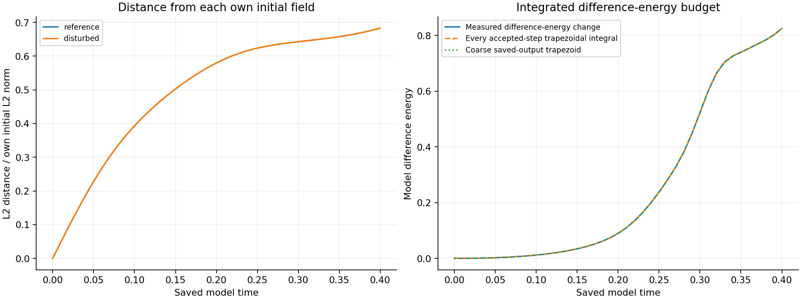

# Completed viscosity 0.1 disturbance comparison — seed 202

[Matched-stretch reports](../README.md) · [Completed viscosity 0.01 comparison](../completed-n128-viscosity0p01-disturbance-seed202/README.md)

The disturbance reached **7.042632555 times its starting L2 size** at saved model time **0.40**, or **604.263256% above its starting size**. Its instantaneous difference-energy rate was **positive (+2.784569676)** at that state. Both trajectories are complete; all **41 reference and 41 disturbed saved fields** passed independent verification.

At the requested matching time **0.20**, the disturbance ratios are **2.502129549** at viscosity 0.1, **10.010105759** at 0.01, and **17.710546768** at 0.001. The viscosity-0.1 rate at 0.20 is **+1.804708071**. It has less separation than the lower-viscosity cases, while being larger than its own starting disturbance and growing instantaneously. Both lower-viscosity comparisons are complete through 0.40.

## Matched experiment and normalization

Grid 128, domain side 6, the supplied reference initial field, fixed mean, zero force, frozen Heun method, identical 0.1% seed-202 disturbance, one FFT worker and time step **4.8780487804878051e-05** were preserved. There are 205 steps per 0.01 output interval, ending at 0.40. This authorized pair contains two trajectories at viscosity 0.1; it does not reuse a reference with a different viscosity.

D(t) = ||u_disturbed(t) − u_reference(t)||₂ / ||u_reference(0)||₂. The fixed initial reference norm is **184.30770667966**, D(0)=0.001 and D(0.40)=0.00704263255538. Each lower-viscosity comparison uses its own reference at the identical saved time and the same initial normalization. No missing times were interpolated.

| Saved time | D(t)/D(0), ν=0.1 | ν=0.01 | ν=0.001 | Instantaneous difference-energy rate, ν=0.1 |
|---|---:|---:|---:|---:|
| 0.00 | 1 | 1 | 1 | -0.0234346264 |
| 0.01 | 0.997372456 | 1.00414188 | 1.00485736 | +0.00454472946 |
| 0.02 | 1.00236646 | 1.01830267 | 1.0203033 | +0.0290999027 |
| 0.10 | 1.2962177 | 1.87844896 | 2.14902082 | +0.288284589 |
| 0.20 | 2.50212955 | 10.0101058 | 17.7105468 | +1.80470807 |
| 0.30 | 5.64089321 | 131.506359 | 367.521531 | +7.95173893 |
| 0.40 | 7.04263256 | 233.791945 | 648.888562 | +2.78456968 |

At t=0.01 the disturbance remains below its starting size while its instantaneous rate is already positive. By t=0.02 it is above its starting size. These saved observations distinguish net change from current growth; they do not locate an exact reversal between outputs. The earlier one-step preflight was not evidence of sustained shrinking.

## Transfer and budget checks

For δu=u_disturbed−U and Eδ=½||δu||₂², the zero-force periodic identity is dEδ/dt = −∫δuᵢδuⱼ∂ⱼUᵢ dx − ν||∇δu||₂². At 0.40, transfer is **11.937056989**, viscous removal is **9.152487313**, and the net rate is **+2.784569676**. Independent physical gradients agree with the spectral RHS difference; maximum scaled identity discrepancy is 7.184e-14.

The runner accumulated the difference-energy rate by **trapezoidal integration at every accepted time step**, using rates at the old and accepted new states. This is not a Heun predictor-stage integral. The final measured difference-energy change is 0.825432203634, and the recorded integral is 0.825431924968. Their residual divided by initial difference energy is **1.64069377e-05**. Saved-field verification rechecks the identity, endpoint energies, recorded integral and residual; it does not reconstruct unsaved intermediate states. Coarse quadrature at 0.01 saved spacing is shown separately and is not a time-integration error estimate.

Individual energy/enstrophy budgets retain their recorded Heun-stage integrals. Final relative energy residuals are 6.67489e-10 / 6.66787e-10, and enstrophy residuals 2.10179e-08 / 2.10051e-08 (reference / disturbed). Small residuals do not prove convergence.

## Resolution and interpretation limits

**Raw strain is nonsmooth across periodic joins, and initial maxima lie outside the central tube.** Reference / disturbed fields fail **18 / 18 of 41** spatial screens. At 0.40, minimum global half-peak chords are **2.55712 / 2.49855 cells**, below the six-cell screen; central widths are 12.9378 / 12.8318 cells. High-band enstrophy fractions are 0.003796% / 0.003863%.

This is one finite-amplitude seed, one grid and one time step. No paired finer-grid or half-step test was authorized. Spatial/time convergence is unestablished; this does not establish a physical stability threshold, infinitesimal stability or an asymptotic Lyapunov exponent. Peak vorticity is a separate diagnostic, not disturbance growth. Initial-return distances below do not establish recurrence or periodicity and do not search all state pairs.

## Verification and data

[Extended verification](verification.json) checks all 82 paired fields, prescribed initial states, exact seed normalization, means, divergence, physical norms, stretching, viscous losses, transfer identity, endpoint budgets, frozen hashes, spectra and widths. All 41 matching viscosity-0.001 norms were remeasured. Viscosity-0.01 comparisons reuse its [previous completed verification](previous-viscosity0p01-verification.json), with unchanged result hashes. The [existing verifier](saved-field-verification.json) also independently remeasured all 82 fields. No trajectory was repeated.

Spectral fractions and chord widths are remeasured using the frozen observation routine: consistency checks, not a second discretization. [Verification code](verify_pair.py) runs as `python -B verify_pair.py PILOT_DIRECTORY OUTPUT_JSON` in the original study environment; original large saved field arrays are required and are not uploaded. Per-field SHA-256 values are retained. [Publication builder](build_completed_batch.py) requires the original local paths and adjacent verification inputs.

- [Paired raw diagnostics, including reference rows](result.json), [analysis summary](analysis.json), [existing report summary](summary.json), [standalone report](report.html)
- [Viscosity 0.01 disturbed](viscosity0p01-result.json) and [reference](viscosity0p01-reference-result.json); [viscosity 0.001 disturbed](viscosity0p001-result.json) and [reference](viscosity0p001-reference-result.json)
- [Frozen protocol](protocol.json), [initial audit](initial-audit.json), [later publication authorization](publication-authorization.json)
- [Frozen runner](reproduction/pilot/run_pair.py), [diagnostics](reproduction/pilot/diagnostics.py), [report builder](reproduction/pilot/build_report.py), [original verifier](reproduction/pilot/verify_saved.py), [numerics](reproduction/pilot/source/numerics.py), [original matrix controller](reproduction/original-run_suite.py)

The frozen protocol's historical local-only restriction remains byte-for-byte intact. The later explicit authorization supersedes only publication scope. Historical intake reviews remain unchanged; the original matrix continues toward its unchanged endpoint and final report.
