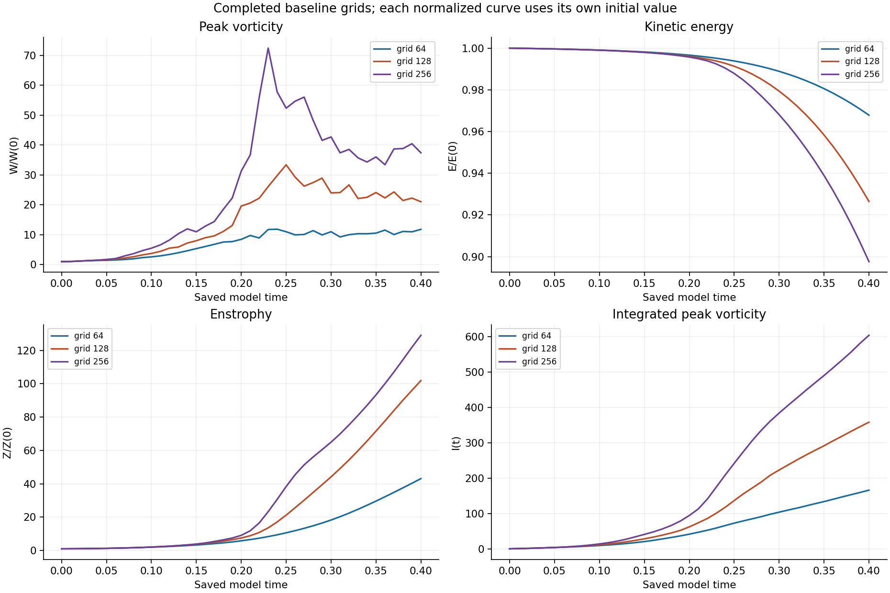
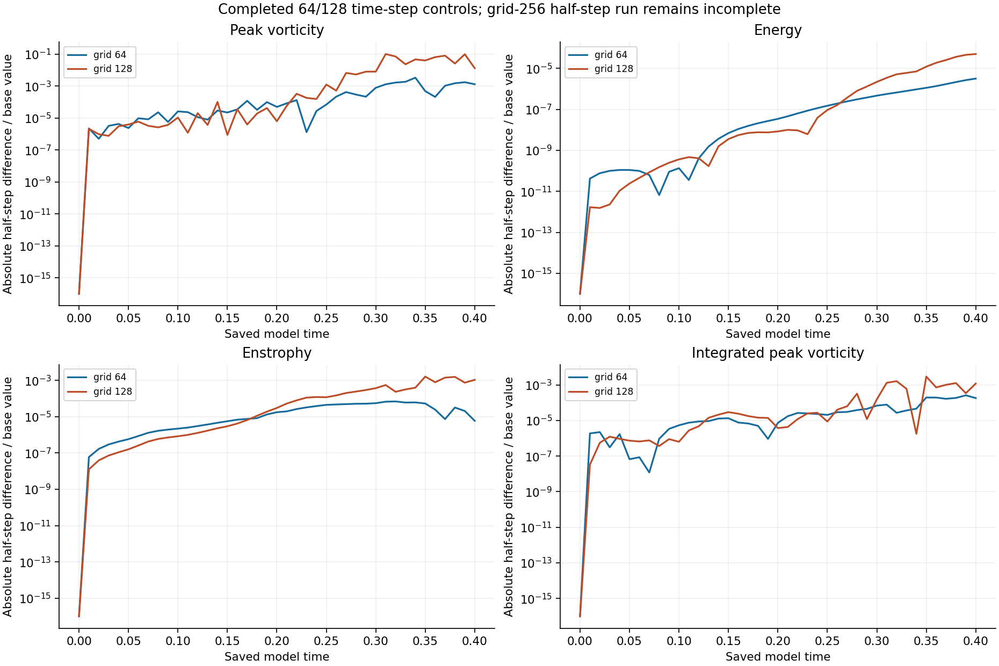
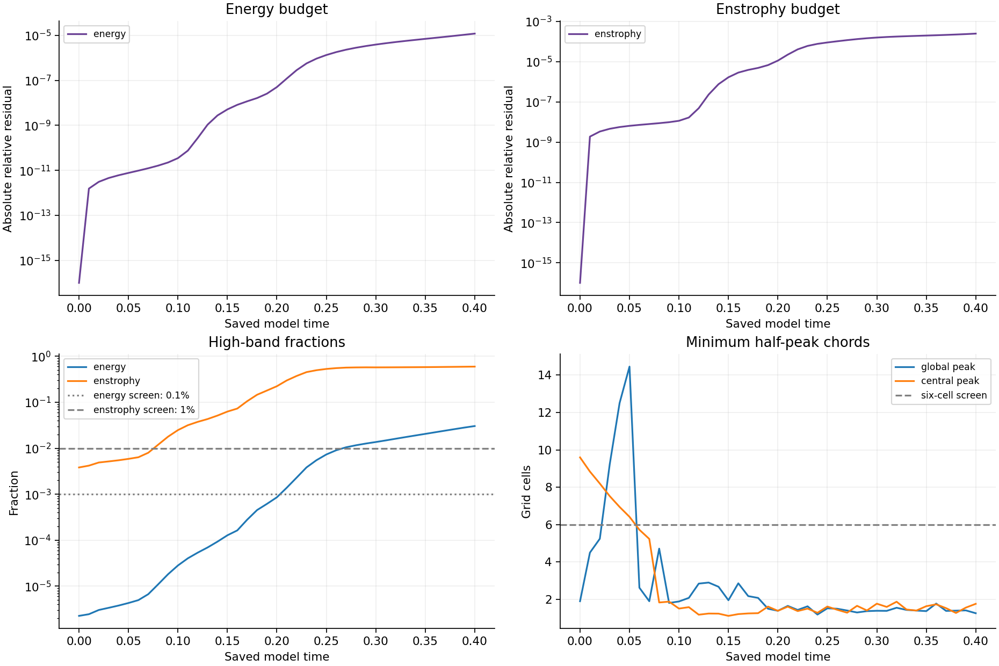
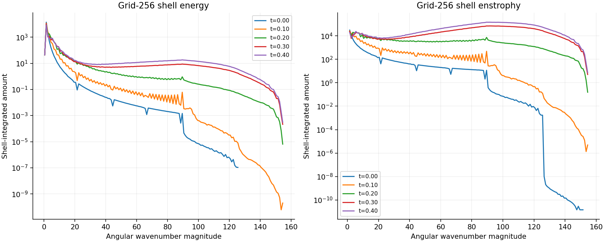
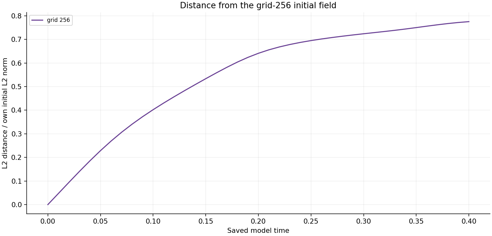

# Completed grid-256 baseline — October 15, 2026

[Matched-stretch reports](../README.md)

The original **baseline-n256-base** reached **0.40** with **41 saved fields**, all independently remeasured. The supplied initial-field formula and original grid-specific starting array, viscosity **0.001**, domain side **6**, retained mean, Heun method, zero force and endpoint were preserved. Its time step remains **0.01/409 = 2.4449877750611248e-05**. No trajectory was repeated or extended.

At 0.40, peak vorticity is **37.391 times** its starting value; energy is **0.8976241 times** its starting value, and enstrophy is **129.0064 times** its starting value. These are finite-time numerical observations. **38 of 41 spatial screens fail**, so the larger grid does not establish spatial convergence or resolved physical growth.

## Completed grid and time-step controls

All table entries are complete through 0.40 and compared at the same 41 saved times. Every normalized curve uses its own initial value; absolute values remain in the diagnostics. The grid-64 and grid-128 results and their half-step controls are reused from existing completed runs. Only the newly completed grid-256 baseline receives a new full-field audit in this publication.

| Run | Preserved dt | W(0.40)/W(0) | E(0.40)/E(0) | Z(0.40)/Z(0) | Failed spatial screens |
|---|---:|---:|---:|---:|---:|
| [baseline-n256-base](diagnostics/baseline-n256-base.json) | 2.444988e-05 | 37.391 | 0.8976241 | 129.0064 | 38/41 |
| [baseline-n64-base](diagnostics/baseline-n64-base.json) | 9.708738e-05 | 11.77281 | 0.9678578 | 43.06884 | 41/41 |
| [baseline-n64-half](diagnostics/baseline-n64-half.json) | 4.854369e-05 | 11.78811 | 0.9678548 | 43.06858 | 41/41 |
| [baseline-n128-base](diagnostics/baseline-n128-base.json) | 4.878049e-05 | 21.01958 | 0.9264773 | 101.8782 | 41/41 |
| [baseline-n128-half](diagnostics/baseline-n128-half.json) | 2.439024e-05 | 21.29476 | 0.9265234 | 101.7681 | 41/41 |

The existing **grid-256 half-step control is still running**. Its endpoint comparison is unavailable and is not inferred from the completed lower-grid controls. Grid sensitivity and time-step sensitivity are separate questions; agreement at one grid or in one quantity does not establish convergence for the other quantities.

**The supplied raw strain is nonsmooth across periodic joins, and initial maxima lie outside the central tube.** Sampling this initial-field formula on different grids gives different discrete means. Those means are preserved per run; they are not silently equalized or subtracted in these comparisons.

| Grid | Preserved initial mean velocity (x, y, z) |
|---:|---|
| 64 | 1.04056623521, 1.04056623521, -2.08113247042 |
| 128 | 0.520318890246, 0.520318890246, -1.04063778049 |
| 256 | 0.260163916687, 0.260163916687, -0.520327833374 |

## Budgets, spectra and width limits

For grid 256, the final global minimum half-peak chord is **1.2652 cells**, the central chord is **1.7675 cells**, and the high-band energy/enstrophy fractions are **3.03628% / 59.56991%**. The declared spatial screens require energy below 0.1%, enstrophy below 1%, and minimum chord at least six cells. Passing such screens would itself not prove resolution.

The maximum absolute relative energy/enstrophy budget residuals are **1.2042e-05 / 0.00025081**. Saved Heun-stage integrals are checked against endpoint budgets; physical norms, stretching production and viscous losses are independently remeasured. All declared numerical hard stops pass. Small budget residuals do not repair spatial under-resolution or prove a physical stability threshold.

The distance below uses each saved field and this run's own initial field. It is an initial-return diagnostic, not a search for recurrence among every pair of states or evidence of periodicity. This unperturbed baseline does not provide a disturbed/reference separation rate or an asymptotic Lyapunov exponent.

## Verification and provenance

[Independent verification](verification/baseline-n256-base.json) records all 41 field SHA-256 hashes, exact initial-field matching, unchanged source/protocol hashes, conserved mean, scaled divergence, physical energy/enstrophy/vorticity, stretching production, viscous losses, budget consistency, spectra, widths and hard-stop checks. Physical-space FFT measurements use NumPy independently of the simulation's SciPy transforms. Spectral/width observation remeasurement also uses the frozen routine and is a consistency check, not a second discretization. Complete original Fourier arrays are required locally and are not embedded in this report.

Run the [verifier](verify_matrix.py) as `python -B verify_matrix.py STUDY_DIRECTORY baseline-n256-base OUTPUT_JSON`. [Raw diagnostics](diagnostics/), [analysis](analysis.json), [frozen protocol](protocol.json), [numerical source](reproduction/numerics.py), [controller](reproduction/run_suite.py) and [publication builder](build_publication.py) provide provenance. No active numerical source was modified.

The original matrix snapshot is **44/48 complete**, **2 active**, **2 queued**, and **0 recorded failures**. Active: strain_factor-n128-v1.1, baseline-n256-half. Its final report awaits the remaining authorized jobs. Historical intake reviews remain unchanged.
