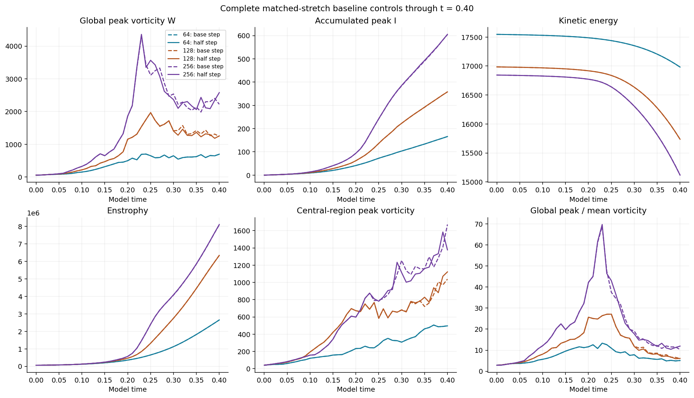
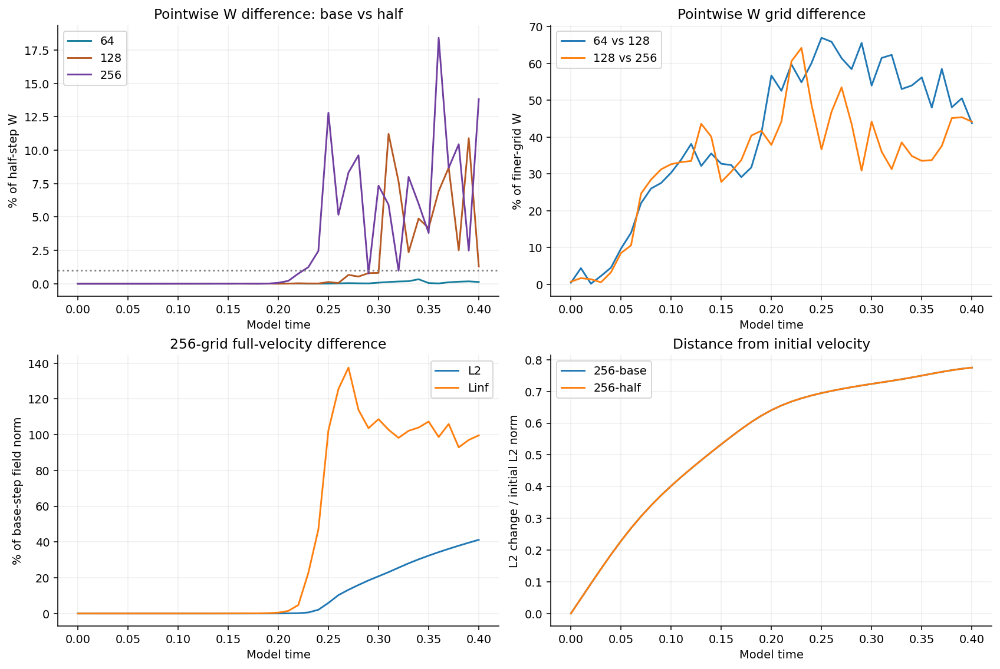
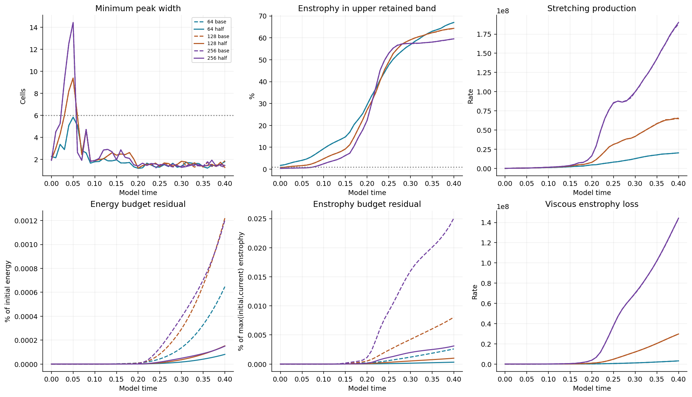
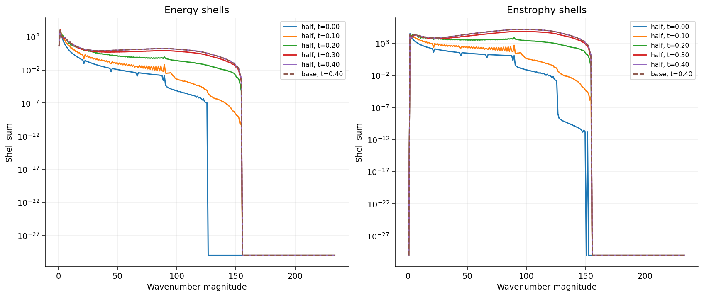
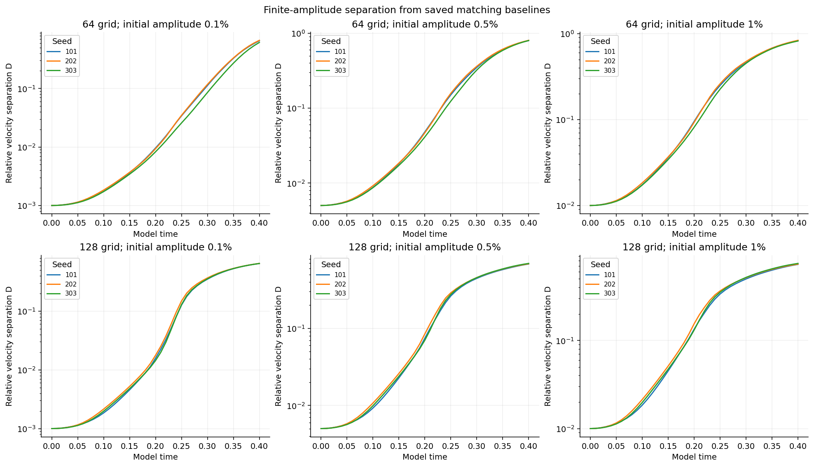
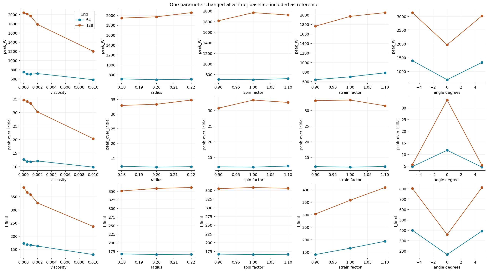
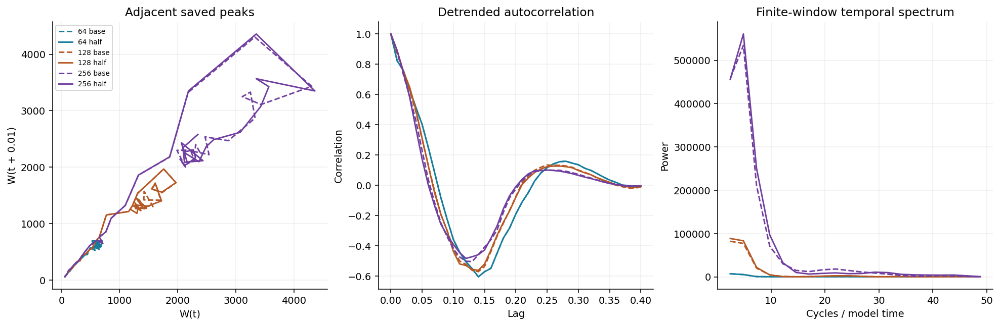

# Matched-stretch controls: final 48-run report

**Completed and verified November 2, 2026 (UTC).** All 48 original runs reached model time **0.40**, with 41 saved outputs per run. The final 256³ half-step trajectory is complete. Independent saved-field and report checks pass; **spatial convergence and the finest timestep screen do not pass**. These are verified numerical measurements with substantial resolution limits, not evidence of physical stability or a Navier–Stokes theorem.

[Study guide](../README.md) · [All 48 measurements](all-runs.csv) · [Verification and coverage](matrix-verification.json) · [Protocol](protocol.json)

## What the final control changes

The 256³ half-step run reaches a largest saved global vorticity of **4358.654502 at t=0.23**, then ends at **2579.837610**. Its accumulated peak integral is **605.264512**. The global peak grows transiently and remains far above its initial value at the endpoint. The saved-time peak is not a proven continuous-time maximum.

Halving the 256³ timestep changes the global-W curve by **7.4987%** and its endpoint by **13.8222%**. The 128³/256³ base-step W curves differ by **46.7880%**. Those failures remain visible even though energy accounting is much tighter.

The independently compared complete 256³ velocity fields differ by **41.2147% in L2 at t=0.40**, with maximum saved L2 difference **41.2147%** over the window. This field comparison is normalized by the base-step velocity; the scalar timestep table below uses the half-step curve as its reference.

## Grid and timestep sensitivity

Comparisons use the same 41 saved times without interpolation. Curve L2 means the Euclidean norm of the difference divided by the reference curve norm. Endpoint difference uses the reference endpoint. The finer grid or half timestep is the reference.

| Comparison | W curve difference | W endpoint difference | I curve difference | Energy curve difference |
| --- | ---: | ---: | ---: | ---: |
| grid-64-128 | 57.4356% | 43.7664% | 53.0065% | 4.19929% |
| grid-128-256 | 46.7880% | 44.1781% | 41.0356% | 1.72417% |
| timestep-64 | 0.1087% | 0.1298% | 0.0148% | 0.00008% |
| timestep-128 | 4.1649% | 1.2922% | 0.1152% | 0.00125% |
| timestep-256 | 7.4987% | 13.8222% | 0.3373% | 0.00424% |

The exploratory thresholds were 5% for the finest-grid curve comparison and 1% for timestep halving, with decreasing errors required under refinement. The 64-grid timestep comparison is small, but the 128- and 256-grid W timestep errors grow and exceed the screen. Neither time nor space convergence is established.

## Spatial resolution, spectra and budgets

Every run has at least one failed spatial screen. In the final half-step run, **38 of 41** observations fail. At t=0.40, **59.536%** of enstrophy is in the upper retained band, and the minimum half-peak chord at the global maximum is **1.445 cells**, below the six-cell screen.

The largest absolute energy-budget residual in that run is **1.498e-06 of initial energy**. The endpoint enstrophy-budget residual is **3.111e-05 of max(initial,current) enstrophy**. Small budget residuals establish accounting consistency, not resolved peaks, physical stability, or an asymptotic threshold.

## Perturbations and parameter changes

All 18 prescribed perturbations are complete: three fixed seeds at 0.1%, 0.5% and 1%, on grids 64 and 128. Separation D is the velocity L2 difference from the matching saved baseline divided by the initial baseline L2 norm. Both endpoint log(D(0.40)/D(0))/0.40 and least-squares log-growth rates are tabulated in [the rate table](perturbation-rates.csv). They describe finite amplitudes and a finite window, without renormalization; **they are not asymptotic Lyapunov exponents**. Resolution failures prevent a robust physical sensitivity claim.

The 24 parameter runs change one factor at a time on grids 64 and 128: viscosity, tube radius, spin, strain or strain-axis tilt. The curves below include each matching unmodified baseline as a reference. A viscosity-dependent change in these unresolved finite-time measurements does not identify a physical stability threshold.

## Recurrence diagnostics

Adjacent-observation return plots, linearly detrended autocorrelations and Hann-window temporal spectra are calculated over t=0 to 0.40. These short-window diagnostics neither establish recurrence nor demonstrate chaos. Initial-distance curves in the refinement figure are likewise finite-window measurements.

## Verification and scope

- All **1,968 saved observation records** were checked for complete time coverage, budget algebra, mean preservation and report consistency.
- The final **41 grid-256 half-step fields** were independently remeasured in physical space for W, energy, enstrophy, stretching production and viscous losses; frozen width and spectral algorithms were also rerun. All 41 full-velocity base/half pairs were compared.
- **533 fields from 13 early grid-64 runs** received new independent W/energy/enstrophy checks, plus matching-baseline perturbation distances where applicable. Prescribed starts and endpoint diagnostics were checked.
- Earlier independent evidence for the other **34 jobs** was retained and bound to unchanged result hashes. All 41 grid-256 baseline field hashes were freshly checked; other historical fields were not all reread. Hashes are integrity evidence, not numerical remeasurement.
- All 48 report summaries, five refinement comparisons, 18 finite-time rate fits, 96 recurrence transforms, spectrum shell totals and budget calculations were independently audited. The saved per-step Heun accumulations were retained; no trajectories were repeated.
- Frozen solver/protocol hashes passed. The documented historical metadata-write retry changed no numerical equation. The final controller, watcher and windowless supervisor exited normally; earlier interruptions remain preserved locally.

[Final-field evidence](verification-final-field.json) · [Early-field evidence](verification-early64.json) · [Matrix evidence](matrix-verification.json) · [Complete analysis](analysis.json) · [Final saved diagnostics](final-run.json) · [Numerics](numerics.py) · [Run protocol implementation](run_suite.py)

## Limits retained from the starting field

The supplied raw strain has nonsmooth periodic joins. Initial global maxima occur outside the central tube. Each filtered grid field is smooth, but a common smooth periodic limit has not been established. Grid-specific mean velocities were retained exactly; they differ between grids and were not silently equalized. See the [initial audit](initial-audit.json).

The original supplied starting field, Heun method, domain side 6, per-run viscosity, zero force and t=0.40 endpoint were preserved. This final report covers only the original 48-job matched-stretch matrix. Separate published studies retain their own evidence and scopes. No extra simulations, grids, seeds, parameters or intervals were added.
