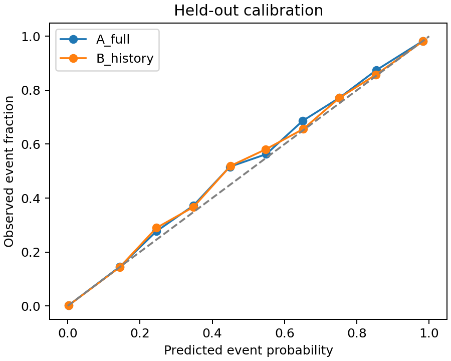
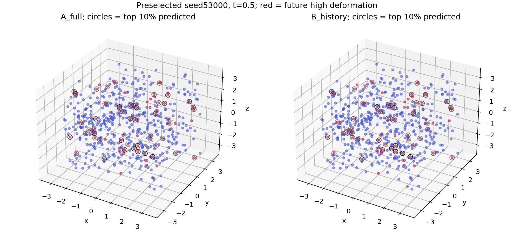

# Fresh independent marker-history test

**Primary conclusion: useful-size benefit ruled out for the predeclared comparison; small positive effect remains possible.** Numerical audit: True.

The fresh B-minus-A spatial AP gain is 0.0004380, paired whole-run 95% interval [-0.0036891721999396145, 0.0034998393482422183]. The useful threshold was fixed at .005 absolute before new simulations. Secondary mean relative RMSE reduction is 0.0258973, interval [0.02226784661697035, 0.029351408584073334]; its useful threshold is .01. Secondary conclusion: useful benefit supported for the predeclared comparison.

There are 64 independent untouched test initial conditions. All five anchors and markers from a run stay together in the bootstrap. These are distinct from the previously examined eight runs and the four numerical pilot fields. Train32 and validation16 are separate complete runs. Every selected model, threshold and scaler was frozen and published before test trajectories were generated. Validation selects regularization; no train+validation refit occurs. Event cutoff is train-only: 1.062768178. The primary measure ranks places within each anchor before averaging across anchors and independent runs. No-event anchors receive AP0 for both models and are counted in the detailed results.

| Model | RMSE | MAE | R² | Spatial AP | Pooled AP | Brier | ECE10 |
|---|---:|---:|---:|---:|---:|---:|---:|
|A_full|0.0428516|0.0332512|0.96407|0.938607|0.956148|0.013490|0.007613|
|B_history|0.0416872|0.0324211|0.96594|0.939045|0.959550|0.012923|0.007377|
|A_matched_current|0.0428448|0.0332498|0.96408|0.938091|0.956341|0.013452|0.007297|
|A_weak|0.0428274|0.0332262|0.96411|0.937932|0.956512|0.013427|0.007492|
|B_weak|0.0416977|0.0324282|0.96592|0.939823|0.960040|0.012833|0.007423|
|B_past_only|0.0426011|0.0330754|0.96447|0.939315|0.957363|0.013274|0.007514|
|B_no_past|0.0417808|0.0324854|0.96579|0.940082|0.959161|0.012991|0.007357|
|B_no_exchange|0.0416832|0.0324188|0.96594|0.938926|0.959563|0.012921|0.007347|
|B_reversed|0.0417973|0.0325027|0.96575|0.940485|0.959355|0.012954|0.007274|
|B_irrelevant|0.0428751|0.0332684|0.96403|0.937238|0.955683|0.013560|0.007436|
|B_shuffled_91|0.0428556|0.0332521|0.96406|0.938183|0.956062|0.013496|0.007585|
|B_shuffled_92|0.0428599|0.0332565|0.96405|0.937569|0.955945|0.013530|0.007526|
|B_shuffled_93|0.0428503|0.0332467|0.96407|0.937536|0.956051|0.013502|0.007623|
|B_permuted_labels|0.2120985|0.1702702|0.12136|0.346379|0.380586|0.064889|0.069107|
|B_mirrored_history|0.0420306|0.0326679|0.96540|0.939794|0.958358|0.013101|0.007437|
|B_mirrored_reversed|0.0421303|0.0327369|0.96523|0.939799|0.958149|0.013134|0.007345|
|tree_A_full|0.0430966|0.0334340|0.96367|0.938304|0.957011|0.013458|0.008123|
|tree_B_history|0.0421834|0.0327722|0.96517|0.939952|0.960065|0.012979|0.008278|
|tree_A_matched_current|0.0431083|0.0334436|0.96365|0.938649|0.956967|0.013462|0.008153|

## Exact scope and provenance

[Protocol](protocol.json), [model lock](test-lock.json), [results](results.json), [test numerical audit](test-numerical-audit.json), [execution inventory](execution.json), [independent verification](verification.json). Primary grid 112; protocol SHA256 `d3b41638d63ce790c30be7162194c6298fdcb39e13108ecbd051caa8fc6c6ecd`; model manifest SHA256 `53423886202f39d44bee91aab86db01d3731c33529f44124775b669345bd2dc8`. Raw archives and per-run JSON metadata record source hashes, starts, configurations, numerical diagnostics and archive hashes. Executed source, data, selected models and predictions are published with a file inventory. [Parent provenance](../README.md).

The Eulerian Navier–Stokes equations and joint Heun arithmetic match the parent smooth random low-mode flow family: side6, zero mean/force, primary viscosity.02. The separately documented 4-point tensor Lagrange tracer sampler and its exact piecewise Jacobian replace trilinear sampling only in this new phase. Derivatives can jump at cell faces and the interpolant is not exactly divergence-free; the pilot, grid, time and accumulated-volume screens are essential. The original sharp-field periodic-join and off-central-peak limitations remain a distinct earlier experiment.

A has current velocity, all nine local gradient entries, strain and rotation summaries and current neighbor geometry (31 inputs). B has exactly those plus23 causal historical descriptors. Inputs end at the anchor, with a .025 gap before the forward .2 deformation interval. Full feature names are in the parent features.py. Predictions concern future finite-time deformation at current material-marker locations. They do not identify the exact Eulerian global maximum or first onset time. Finite-time stretch is not an asymptotic Lyapunov exponent.

## Controls and limitations

Matched-current dimensions, equal tree complexity, past-only/no-past/no-exchange ablations, independently refitted reversed/shuffled/irrelevant/mirrored histories and shuffled training labels are separately reported. Consistent marker relabeling is tested without supplying IDs as predictors. Reversal and mirror input controls do not physically reverse the fluid. A refitted reversed representation can preserve information; its performance does not establish chronology's necessity.

The ten observation sensitivities were fitted and locked before test generation; their intervals are exploratory and cannot select the primary conclusion. The viscosity variants reuse four test groups with frozen primary models and are dependent comparisons. The saved numerical failures remain part of the evidence. A failed test accuracy screen prevents usefulness or exclusion claims even if a nominal confidence interval is narrow.

Any out-of-sample benefit applies to this flow distribution, model class, observation method and time window. It does not establish material memory, causation, leadership or a Navier–Stokes breakthrough. History cannot add fundamental information beyond a complete deterministic present state; it can add predictive information to these incomplete local observations. A null or small result cannot rule out all histories, fluids or predictors.
