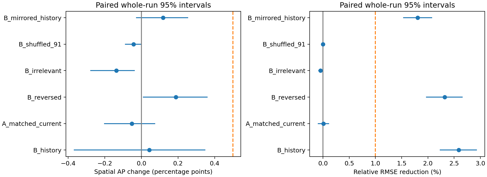

# Completed fresh independent marker-history study

The preregistered primary comparison excludes an absolute spatial average-precision gain of **0.005 or larger** for this fixed flow distribution, observation window and frozen model pair. The estimate is **0.00043803369639350753**, with paired whole-run 95% interval **[-0.0036891721999396145, 0.0034998393482422183]**. The interval includes zero and smaller positive effects. This is not evidence that every possible history or predictor is useless.

The separate continuous endpoint improves: mean per-run relative RMSE reduction **0.025897291769100057**, 95% interval **[0.022267846616970351, 0.029351408584073334]**. This exceeds its secondary 0.01 threshold but cannot substitute for the primary strong-event location endpoint.

## Independent verification and scope

All **146 archives** were validated for exact file/configuration/source identities, complete saved time grids, finite arrays, initial markers and initial tangent identity. The **76 new archives** exactly comprise 64 primary test runs, four numerical controls and eight viscosity variants; there are no added seeds or simulations. The test controller exited normally on October 15, 2026 at 15:15:59 UTC. Prior pilot/training recovery records remain preserved.

The [independent review](independent-review.json) and [log](independent-review.log) reconstruct all 39 frozen model pairs across 11 cases, every saved test row/prediction, all metrics, all paired 10,000-draw whole-run bootstrap intervals, both dependent viscosity comparisons, and every test numerical screen. Windows reconstruction maximum absolute difference is **0.0**. An independently coded AP summation agrees within **4.4408920985006262e-16**; this is arithmetic roundoff, not a changed statistical or scientific bound. The [particle-label check](particle-label-review.json) reproduces every checked feature and both primary model outputs exactly after consistent relabeling of all 512 particles and all five anchors in the first test run.

The primary AP is averaged within each of five anchors, then equally over 64 independent runs: A = **0.93860707785838327**, B = **0.93904511155477677**. All anchors and markers stay together when a run is resampled. **5 of 320 anchors** contain no positive event and contribute the preregistered AP zero for both models; none were removed. Mean per-run RMSE is A = **0.042851574603071742**, B = **0.041687172821940122**.

The [model publication](https://github.com/NousVolition/My-Sources-Project-ALL/commit/7bc2059a899552cc882b4cb81d27d0e2b6b115c5) and all its checks succeeded before [test launch](test-phase-launch.json) at 06:55:12 UTC. No fitting, threshold selection, reference export, seed expansion or test tuning occurred afterward. All scientific sources, models, scalers, cutoffs, thresholds and regularization selections remain frozen.



## All frozen primary comparisons

These intervals are descriptive controls; they do not select the primary model or conclusion. Reversed/mirrored representations are input controls and are not physical reversals of the fluid. Predictive gains do not establish chronology's necessity, material memory, causation or leadership.

| Frozen comparison | Spatial AP difference and paired 95% interval | Relative RMSE reduction and paired 95% interval |
|---|---:|---:|
|B_history_vs_A_full|0.00043803369639350753 [-0.0036891721999396145, 0.0034998393482422183]|0.025897291769100057 [0.022267846616970351, 0.029351408584073334]|
|A_matched_current_vs_A_full|-0.00051609071890988678 [-0.0020395199400355842, 0.00075205774630747479]|6.6433562317976327e-05 [-0.0010095595550404159, 0.0011677548062369615]|
|A_weak_vs_A_full|-0.00067549760710453217 [-0.0023305106905174089, 0.00065529722038493003]|0.00051696102014100673 [-0.00080466536294720482, 0.0018498069866711168]|
|B_weak_vs_A_full|0.0012156157816435825 [-0.0028700510909057089, 0.0041003173974267833]|0.025565559286019886 [0.021883152022373904, 0.029087867410247933]|
|B_past_only_vs_A_full|0.00070796295049421233 [-0.0010798538257258635, 0.0023454924686628939]|0.0056571562077393726 [0.004226507584051349, 0.0071085420554927196]|
|B_no_past_vs_A_full|0.0014751133497836171 [-0.0006516480698642072, 0.0034302280926643992]|0.023717984048909437 [0.020215317247124782, 0.027110598076619224]|
|B_no_exchange_vs_A_full|0.00031929937161343435 [-0.0038203171242698086, 0.0033454506163570043]|0.025983336102735809 [0.022349813018512465, 0.029440797755517299]|
|B_reversed_vs_A_full|0.001877560048737327 [8.8965048375962456e-05, 0.0036093690905135544]|0.023228449783849255 [0.019650180049543563, 0.026646608478167556]|
|B_irrelevant_vs_A_full|-0.0013693041869527415 [-0.0027846672126098115, -0.00035513531677760504]|-0.00047415366842281856 [-0.00092768711839849268, -1.2766224290820672e-05]|
|B_shuffled_91_vs_A_full|-0.000424136089393597 [-0.00089995427153045373, 2.4685265421003937e-05]|-2.7398012578134373e-05 [-0.00027535813121645379, 0.00022873465749426549]|
|B_shuffled_92_vs_A_full|-0.0010377629119608777 [-0.0029588984666110017, 0.00015947478142046531]|-0.00010997597197215901 [-0.00037204900700887704, 0.00016713522927649366]|
|B_shuffled_93_vs_A_full|-0.0010707918948925088 [-0.0028147982999032644, 5.0095952215421368e-05]|0.00011965094871515744 [-0.00011021754382948101, 0.0003811123767419218]|
|B_permuted_labels_vs_A_full|-0.59222820028405576 [-0.62462156003605129, -0.56011409047704608]|-4.1123117981019481 [-4.3129560969212353, -3.9141703142249993]|
|B_mirrored_history_vs_A_full|0.0011868990797923862 [-0.00028617592942264383, 0.0025563344086946037]|0.018052951929512437 [0.015273618584571482, 0.020807531214832219]|
|B_mirrored_reversed_vs_A_full|0.0011921202327038073 [-0.0005331170702257015, 0.0026762638058462854]|0.015621599124421136 [0.013053626867830598, 0.018217591511800319]|
|tree_A_full_vs_A_full|-0.00030339946636685246 [-0.0018297306846849083, 0.0012835495188583995]|-0.0049347711871032852 [-0.0079709779518668134, -0.0021800663860176185]|
|tree_B_history_vs_A_full|0.0013446450227400392 [-0.0027224696347634913, 0.0044465940989352028]|0.015642677079161789 [0.012442789433872154, 0.018684976856379421]|
|tree_A_matched_current_vs_A_full|4.1756087230270314e-05 [-0.0015648095534419909, 0.0016575162825392732]|-0.0051803736961274962 [-0.0083574368130134562, -0.0022698234563963563]|
|B_vs_matched_current|0.00095412441530339431 [-0.0034085617407269629, 0.0045451628705391947]|0.025808991049884385 [0.021967763163039646, 0.029484085624507803]|
|tree_B_vs_tree_A|0.0016480444891068917 [-0.0023531294406521058, 0.0045506733473131104]|0.020459843718122973 [0.018583207195992459, 0.022390854823249602]|
|B_weak_vs_A_weak|0.0018911133887481147 [-0.0023743185530753696, 0.005334988255011993]|0.025045203056502478 [0.021326858477681579, 0.02858369266257672]|

## All fixed observation sensitivities

Every setting was fitted and locked before test generation. These are exploratory comparisons. Numerical accuracy gates establish the fixed primary configuration, not every alternative sensitivity.

| Predeclared sensitivity | Spatial AP B-A and paired 95% interval | Relative RMSE reduction and paired 95% interval |
|---|---:|---:|
|short_history|-0.00025071390488428736 [-0.0045016798211274115, 0.0029056841078076508]|0.021041635296380985 [0.01772350144821034, 0.024236946302935287]|
|long_history|0.0032058933407933428 [0.0014486884893144193, 0.0049913064190542367]|0.032650507667255288 [0.02871961110150029, 0.036451848355906806]|
|short_forecast|0.0018958241013746491 [0.00047830505523801267, 0.00362740606333162]|0.02741581525459319 [0.02371316584009835, 0.030927153465922536]|
|long_forecast|0.0088107592609337326 [0.0043537502978201869, 0.013717855353201969]|0.023240310464704636 [0.01976791362791273, 0.026529053490639724]|
|sparse_markers|-0.00072329616343165884 [-0.0044622540957823869, 0.0024804268010431684]|0.019172139085262649 [0.014842414573824608, 0.02338076183919046]|
|neighbors4|0.00035216983489473217 [-0.0038661438425180144, 0.0038682799371221148]|0.016314140096366773 [0.013693775013487319, 0.018870853650215739]|
|neighbors16|0.002148677463643394 [-0.0020344848720647156, 0.0054071870938772314]|0.042071861360980456 [0.036968737556328811, 0.047084843137264458]|
|half_history_sampling|0.00019842771226385092 [-0.0039641759204872016, 0.0032412304066002564]|0.025954502599553203 [0.022329258977455593, 0.029410643056380747]|
|event_q80|0.0019872233035357692 [0.0012713959159768391, 0.0026910556599345431]|0.025897291769100057 [0.022267846616970351, 0.029351408584073334]|
|event_q95|0.001198510396209768 [-0.0053862393389370686, 0.0084272022406825711]|0.025897291769100057 [0.022267846616970351, 0.029351408584073334]|

## Viscosity controls

These reuse four test groups with fixed primary models. The eight trajectories are dependent variants, not eight additional independent test observations.

| Viscosity (four dependent test variants) | Spatial AP B-A and paired 95% interval | Relative RMSE reduction and paired 95% interval |
|---|---:|---:|
|0.01|0.0034385691852489297 [-0.0039009384481341891, 0.0074230257998527671]|0.024136845852284539 [0.017706970242776454, 0.036259873714657442]|
|0.04|0.00047796517192577603 [-0.0032222356832330434, 0.0059526260710571766]|0.030648036810771162 [0.022222970532655428, 0.039073103088886896]|

## Numerical evidence

All **108/108** frozen test screens pass and were independently reconstructed. Every bound below was checked against the unchanged [protocol](../protocol.json). These finite-grid checks establish neither formal convergence order nor Richardson extrapolation. The four-point tensor Lagrange tracer sampler is not exactly divergence-free and its derivative can jump at cell faces.

| Comparison | Metric | Scope | Worst value | Frozen bound |
|---|---|---|---:|---:|
|112→160|target_relative_RMS|per run|0.00015622061983415066|max 0.0025000000000000001|
|112→160|event_Jaccard|per run|1|min 0.97999999999999998|
|112→160|gradient_relative_RMS|per run|0.00040748774453253507|max 0.0050000000000000001|
|112→160|velocity_relative_RMS|per run|1.0950134724290235e-05|max 0.001|
|112→160|present_original_train_standardized_RMS|per run|0.00043958432406232881|max 0.0050000000000000001|
|112→160|history_original_train_standardized_RMS|per run|0.00020835908028390301|max 0.0050000000000000001|
|112→160|A_full_continuous_relative_RMS|per run|0.00018405555927797278|max 0.01|
|112→160|A_full_event_relative_RMS|per run|0.00086430674555733019|max 0.01|
|112→160|B_history_continuous_relative_RMS|per run|0.00018045559868328168|max 0.01|
|112→160|B_history_event_relative_RMS|per run|0.00078816788583144768|max 0.01|
|grid112|probe_volume_error|per run|0.0013875116992102532|max 0.0050000000000000001|
|grid160|probe_volume_error|per run|0.00051763903369483888|max 0.0050000000000000001|
|112 half-step|target_relative_RMS|per run|5.0497962947880056e-06|max 0.00025000000000000001|
|112 half-step|event_Jaccard|per run|1|min 0.97999999999999998|
|112 half-step|gradient_relative_RMS|per run|6.1049171931132362e-06|max 0.0050000000000000001|
|112 half-step|velocity_relative_RMS|per run|2.4870623584824008e-06|max 0.001|
|112 half-step|present_original_train_standardized_RMS|per run|6.8564778429775855e-06|max 0.0050000000000000001|
|112 half-step|history_original_train_standardized_RMS|per run|9.9364173643737365e-06|max 0.0050000000000000001|
|112 half-step|A_full_continuous_relative_RMS|per run|2.6842301032462178e-06|max 0.01|
|112 half-step|A_full_event_relative_RMS|per run|1.4726197676160625e-05|max 0.01|
|112 half-step|B_history_continuous_relative_RMS|per run|2.6393989323091323e-06|max 0.01|
|112 half-step|B_history_event_relative_RMS|per run|1.3309331155166659e-05|max 0.01|
|112 half-step|half_step_target_fraction_of_spatial|per run|0.066836366035358905|max 0.10000000000000001|
|fresh cutoff spatial|target_relative_RMS|per run|0.00015622061983415066|max 0.0025000000000000001|
|fresh cutoff spatial|event_Jaccard|per run|1|min 0.97999999999999998|
|fresh cutoff spatial|gradient_relative_RMS|per run|0.00040748774453253507|max 0.0050000000000000001|
|fresh cutoff spatial|velocity_relative_RMS|per run|1.0950134724290235e-05|max 0.001|
|fresh cutoff spatial|present_original_train_standardized_RMS|per run|0.00043958432406232881|max 0.0050000000000000001|
|fresh cutoff spatial|history_original_train_standardized_RMS|per run|0.00020835908028390301|max 0.0050000000000000001|
|fresh cutoff spatial|A_full_continuous_relative_RMS|per run|0.00018405555927797278|max 0.01|
|fresh cutoff spatial|A_full_event_relative_RMS|per run|0.00086430674555733019|max 0.01|
|fresh cutoff spatial|B_history_continuous_relative_RMS|per run|0.00018045559868328168|max 0.01|
|fresh cutoff spatial|B_history_event_relative_RMS|per run|0.00078816788583144768|max 0.01|
|fresh cutoff temporal|target_relative_RMS|per run|5.0497962947880056e-06|max 0.00025000000000000001|
|fresh cutoff temporal|event_Jaccard|per run|1|min 0.97999999999999998|
|fresh cutoff temporal|gradient_relative_RMS|per run|6.1049171931132362e-06|max 0.0050000000000000001|
|fresh cutoff temporal|velocity_relative_RMS|per run|2.4870623584824008e-06|max 0.001|
|fresh cutoff temporal|present_original_train_standardized_RMS|per run|6.8564778429775855e-06|max 0.0050000000000000001|
|fresh cutoff temporal|history_original_train_standardized_RMS|per run|9.9364173643737365e-06|max 0.0050000000000000001|
|fresh cutoff temporal|A_full_continuous_relative_RMS|per run|2.6842301032462178e-06|max 0.01|
|fresh cutoff temporal|A_full_event_relative_RMS|per run|1.4726197676160625e-05|max 0.01|
|fresh cutoff temporal|B_history_continuous_relative_RMS|per run|2.6393989323091323e-06|max 0.01|
|fresh cutoff temporal|B_history_event_relative_RMS|per run|1.3309331155166659e-05|max 0.01|
|fresh cutoff temporal|half_step_target_fraction_of_spatial|per run|0.066836366035358905|max 0.10000000000000001|
|fresh fitted spatial|A_full_new_probability_relative_RMS|per run|0.0008610295774800922|max 0.01|
|fresh fitted spatial|B_history_new_probability_relative_RMS|per run|0.00077311102999716018|max 0.01|
|fresh fitted spatial|spatial_AP_contrast_drift|per run|4.2625745950708449e-05|max 0.00125|
|fresh fitted spatial|RMSE_contrast_drift_relative_validation_A|per run|2.8435120524443203e-05|max 0.0025000000000000001|
|fresh fitted spatial|spatial_AP_contrast_drift|macro|4.9703612062246272e-06|max 0.00062500000000000001|
|fresh fitted temporal|A_full_new_probability_relative_RMS|per run|1.7504204799558335e-05|max 0.01|
|fresh fitted temporal|B_history_new_probability_relative_RMS|per run|1.811960057713618e-05|max 0.01|
|fresh fitted temporal|spatial_AP_contrast_drift|per run|2.5628149405099165e-05|max 0.00125|
|fresh fitted temporal|RMSE_contrast_drift_relative_validation_A|per run|1.6277960255734385e-06|max 0.0025000000000000001|
|fresh fitted temporal|spatial_AP_contrast_drift|macro|1.2814074702549583e-05|max 0.00062500000000000001|

Diagnostics over all 76 new archives: maximum CFL **0.14356191331752013**, absolute relative energy-budget residual **3.2749575989359727e-08**, spectral divergence **9.0758040636396099e-16**, accumulated probe determinant error **0.0023735602501677722**. The frozen spatial/temporal numerical gate uses the two preregistered control seeds; the broader diagnostic inventory does not add new convergence claims.

## Exact delivery and reproduction

[Manifest](manifest.json), [full results](../results.json), [test audit](../test-numerical-audit.json), [execution inventory](../execution.json), [original completion](../completion.json), [automatic verification](../verification.json), and [frozen report](../README.md) retain their original numerical values. The 11 original prediction NPZ files are delivered in **42 exact byte parts** with [checksums](prediction-parts.json). Restore them with:

```sh
python -B -u reports/matched-stretch/history-prediction/fresh-independent/final-complete/restore_arrays.py
python -B -u reports/matched-stretch/history-prediction/fresh-independent/final-complete/verify_evidence.py
python -B -u reports/matched-stretch/history-prediction/fresh-independent/final-complete/verify_particle_labels.py
```

The reporting verifier never simulates or fits. Exact Windows mode uses `--exact`; cross-platform reconstruction allows at most 1e-12 absolute arithmetic difference while every scientific threshold remains strict. Saved binary metrics are recomputed from the original saved probabilities and frozen thresholds; live predictions must independently reproduce those probabilities within the stated tolerance. No test threshold is reconciled or moved.

## Preserved history and limits

Candidate 80's pilot failure remains unchanged; candidate 112 passed its fixed pilot and fitted-model gates. The predecessor's 32 failed predictor-output drift screens remain failed and its eight examined groups remain exploratory. The initial model-publication Marker failure at commit 58df5b585a1ee2c84f279c307098498dd956d3da remains failed. Its assertion-only log did not prove the historical cause; the subsequent successful Linux verification needed no threshold-boundary reconciliation exceptions. The original sharp-field periodic-join and off-central-peak limitations remain a separate earlier experiment.

This bounded result concerns future finite-time material-marker deformation under the specified smooth unforced periodic Navier–Stokes flow distribution. It does not locate the exact Eulerian global maximum or first onset, prove material memory, establish causal leadership, or resolve Navier–Stokes regularity. A complete deterministic present state already determines the future; the comparison tests whether history helps these incomplete local observations.
