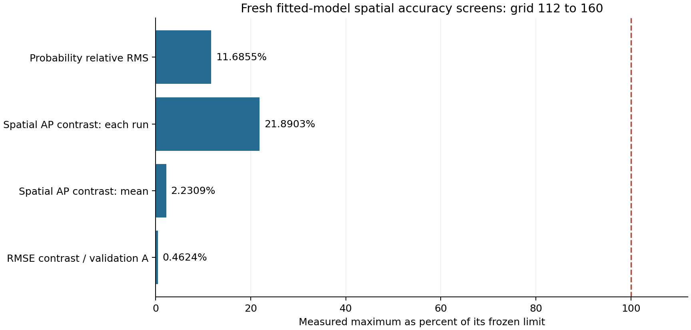

# Fresh fitted-model lock and numerical review

**All 48 train/validation histories and all 39 model pairs are frozen and independently verified. The fitted-model audit passes 160/160 preregistered screens.** This is model-lock evidence, not a fresh prediction-benefit result. The 64 independent test trajectories were absent at locking and independent review. Test launch additionally requires successful checks on this publication and a matching publication receipt.

The original preparation was interrupted by a machine reboot. After explicit authorization, a separate recovery controller continued three saved histories from step 440 to 480, preserving all 45 prior saved samples and diagnostics bit for bit, then generated only the remaining 39 unstarted training/validation histories. All 32 training and 16 validation histories finish at 1.2. The recovery controller exited normally at 2026-10-14T04:21:50.081983+00:00 and cannot launch tests. Original checkpoints, claims and logs remain preserved locally; bulk checkpoints and runtime locks are excluded from this publication.

## Models and independent reconstruction

The [fit manifest](../models-112/manifest.json) contains 19 primary model pairs and two model pairs (A and B) for each of ten fixed sensitivities: 39 pairs, 78 estimators. All scalers use training rows only; event cutoffs use training targets only; regularization and decision thresholds use validation only. There is no train-plus-validation refit. Shuffled, reversed, irrelevant, mirrored, mirrored-reversed and label controls retain their separate refits. Particle-ID invariance remains a separate predefined test control.

The [independent review](verification.json) reconstructed every dataset, training scaler, event cutoff, validation loss, decision threshold and reported validation metric. It independently repeated every regularization candidate fit in memory and reproduced all saved selected parameters, coefficients and validation predictions exactly on Windows. No saved model was overwritten. The unchanged numerical audit was rerun with only its output writer redirected into memory; all rows, all 160 screens and actual protocol bounds matched exactly. All 48 fitting archives were validated against configurations, source hashes, every saved time and initial markers/tangents. The prior pilot independently validated all 22 pilot histories.

## Fixed numerical gates

| Fresh fitted spatial screen | Maximum observed | Frozen maximum |
| --- | ---: | ---: |
| Probability relative RMS | 0.0011685528641242379 | 0.01 |
| Spatial AP contrast: each run | 0.00027362894352522815 | 0.00125 |
| Spatial AP contrast: mean | 1.3943227928997493e-05 | 0.000625 |
| RMSE contrast / validation A | 1.1560674119197221e-05 | 0.0025 |

The two half-step controls also pass all fitted screens; mean and individual AP-contrast drift are zero in those comparisons. The largest audited accumulated probe-volume error is 0.0007321701905930178 (0.0732170190593%), below the fixed 0.5% limit. All 160 screens, including old/fresh-cutoff target/event/feature checks and temporal controls, are preserved in the [model audit](../model-audit-112.json).

These finite-resolution checks do not establish an asymptotic order or license Richardson extrapolation. The separate four-point Lagrange tracer interpolant is not exactly divergence-free and its derivative can jump at cell faces. It does not alter the incompressible Eulerian equations or the frozen trilinear predecessor. The original sharp-field periodic-join/off-central-peak limitations remain separate.

Candidate 80's failed history screen, 0.011944842838966659 above 0.005, remains in the [initial pilot evidence](../pilot-initial/README.md). Candidate 112's 116/116 pilot pass is preserved in the [complete pilot report](../pilot-complete/README.md). No criterion, feature, seed, equation or scientific source was changed to obtain a pass.

## Publication portability verification

The first model publication, commit `58df5b585a1ee2c84f279c307098498dd956d3da`, retains its [failed Marker check](https://github.com/NousVolition/My-Sources-Project-ALL/actions/runs/38513016475). That job passed the analytic tests, predecessor reconstruction and complete pilot reconstruction, then stopped at primary `B_no_past` validation metrics. The [original failed log](first-publication-ci-failure.log) and [original exact Windows verifier](verify-evidence-windows-original.py.txt) are preserved. CodeQL and Project checks passed for that commit.

The reporting verifier now compares every validation probability against [original Windows reference bytes](validation-reference.json). The exporter requires exact reproduction of all original validation metrics and writes no fitted model or trajectory. Its first attempt imported NumPy before applying the frozen fitter's thread settings and failed at `A_full`; the [failed source](export-validation-reference-first-source.txt) and [log](export-reference-first-failure.log) are retained. Setting the same thread environment before NumPy corrects that reporting setup.

Portable verification retains the 1e-12 absolute probability bound. A classification can differ only when both probabilities lie within that bound of the unchanged decision threshold. For those rows alone, the verifier independently reconstructs precision and recall from both binary masks, records the host and reference values, and checks the original metrics using the reference probabilities. AP, continuous errors, losses, scalers, fitted parameters and all 160 scientific numerical screens retain their original checks. The exact Windows mode permits no probability or metric difference. The [repair review](portability-review.json) and [log](portability-review.log) recheck all 39 pairs and all 160 screens with maximum absolute difference zero; the [reference export log](reference-export.log) records exact metric reproduction for all 11 cases. The [reporting guard tests](test_reporting_roundoff.py) reject excessive probability drift, corrupted binary metrics and any boundary change in exact mode. No source defining the scientific study, saved model, threshold or criterion is modified. Hosted verification must establish any actual threshold-boundary differences before the publication gate can pass.

## Reproduce and continue

After restoring the repository's catalogued predecessor/pilot data, run `python -B model-lock/verify_evidence.py` from this study directory. Add `--refit` to repeat the independent in-memory fits; add `--pretest` only before test trajectories exist. `--exact` requires bitwise-equal scalar reconstruction on the original Windows environment; portable checking permits at most 1e-12 absolute roundoff and retains the exact preregistered bounds and pass decisions. No simulation is performed.

The [test lock](../test-lock.json) freezes the manifest, source/protocol hashes and numerical audit. Once this publication passes all triggered checks and its Git blobs/local mirrors are independently checked, the separate publication receipt permits one test-phase launch. Test generation must not precede that receipt. The primary endpoint remains within-time spatial AP B-A with useful absolute gain 0.005 and paired whole-run 95% uncertainty across 64 fresh independent runs. The secondary mean relative RMSE reduction threshold 0.01 cannot substitute. No fresh benefit estimate or confidence interval exists at this lock.

The [recovery validation](recovery-review.json), [software self-tests](recovery-self-test.json), [training validation](training-review.json), [verification log](verification.log), [fitting log](fitting.log), [audit log](numerical-audit.log) and [publication manifest](manifest.json) preserve provenance. The archived recovery wrapper is a source record, not an instruction to rerun it. Current unrelated repository files and numerical-data release references are retained.
