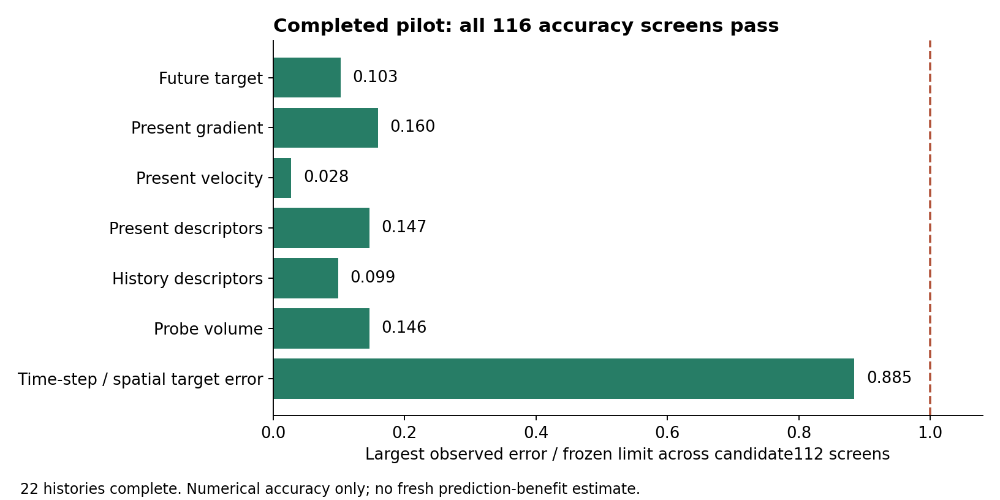

# Completed fresh-study pilot

All **22 pilot histories** are complete through time 1.2. The independent review reproduces **116/116 frozen candidate112 accuracy screens exactly; all pass**. Grid112 therefore meets the preregistered pilot gate for training and fitting. This is not a prediction-benefit result and does not yet authorize untouched test generation.

Candidate80 remains rejected: its preserved history-descriptor RMS of 0.011944842838966659 exceeds 0.005. The [initial report](../pilot-initial/README.md) explains the nearly tied eighth/ninth-neighbor change. No row, feature, tolerance, seed or equation was changed.



## Independently reproduced accuracy

| Comparison | Checks passed |
| --- | ---: |
| 80 to112, four pilot seeds | 40/40 |
| 112 to160, four pilot seeds | 40/40 |
| Grid112 half-step controls, two seeds | 22/22 |
| Probe-volume screens at112/160 | 10/10 |
| Adjacent target-error contraction | 4/4 |

For the finest112-to160 comparison:

| Metric | Largest error (or smallest agreement) | Frozen limit |
| --- | ---: | ---: |
| Target relative RMS | 8.0800186622107388e-05 | 0.0025 maximum |
| Event Jaccard | 1 | 0.98 minimum |
| Gradient relative RMS | 0.0002918826676328252 | 0.005 maximum |
| Velocity relative RMS | 7.3494258696595287e-06 | 0.001 maximum |
| Present descriptors, original training-scale RMS | 0.00027870894008900302 | 0.005 maximum |
| History descriptors, original training-scale RMS | 0.00015956607401379237 | 0.005 maximum |
| Grid112 half-step target relative RMS | 5.7484578490180172e-06 | 0.00025 maximum |
| Half-step target error / spatial target error | 0.088465735267423254 | 0.1 maximum |

The [saved audit](pilot-audit-112.json) includes every seed, old frozen predictor-output screen and contraction result. History descriptor RMS is dimensionless training-scale error, not a percentage of fluid energy. Maximum CFL across all22 histories is 0.1654564296910255; maximum absolute relative energy residual is 2.076670105013693e-08; maximum spectral divergence is 4.9063677629656815e-16.

The [independent verification](verification.json) records exact archive/configuration/source checks, finite arrays, all49 saved times, seeded initial markers and identity tangents. All9 executed source hashes,11 prepared implementation hashes and9 predecessor hashes match. The independent review rebuilt rows and screens from saved trajectories, checked every bound against the frozen protocol, and separately aggregated target/descriptor differences. It performed no simulation, model fitting or controller restart.

## Execution interruption after the successful pilot

Six of the48 train/validation histories at112 are complete. Training seeds51006,51007 and51008 each have a finite, checksum-valid checkpoint at time1.1, step440 of480, last saved October12 at03:53 UTC. Their archive/config/source identities are recorded in the verification. The owned tool session21814 is unavailable; an elevated process inventory confirms the controller34392 and recorded worker PIDs are absent. The system boot at October12 21:09:21.5 UTC postdates those checkpoints. The saved running labels are stale ownership records, not evidence of a live process.

All controller records, claims, checkpoints and logs are preserved. No controller or partial history was restarted. No numerical-stop record exists. This execution interruption is separate from numerical failure and cannot support a null predictive result. A reviewed checkpoint-continuation procedure is needed before training preparation can continue under the explicit no-restart instruction.

No fresh models, test lock, untouched test data or test claims exist at review. After training/validation and fitting finish, the fitted-model numerical audit must pass; all selected models, scalers, thresholds, sensitivity fits and the test lock must be independently published and checked before any of the64 test histories are generated. The primary useful effect remains within-time spatial AP B-A greater than0.005 with paired whole-run95% uncertainty; secondary mean per-run relative RMSE reduction0.01 cannot substitute. No effect estimate or confidence interval is available yet.

## Data and reproduction

This batch adds four160 main histories and two160 half-step controls, their metadata, completed logs and the final pilot audit. The earlier16 histories remain in the repository's [verified numerical release](https://github.com/NousVolition/My-Sources-Project-ALL/releases/tag/numerical-data-2026-10-11), which preserved their original bytes and paths. See the [storage guide](../../../../../DATA-RELEASES.md). The [prior storage review](prior-storage-review.json) maps previous publication/dependency identities to current Git blobs or exact entries in the release catalog. That catalog comparison does not claim a new download of every release ZIP. The earlier local60-file and238-predecessor-file mirrors were separately rechecked.

Restore the release's matched-stretch data into a current checkout, retaining these six new160 histories, then run from the repository root:

```text
python -B tools/restore_numerical_data.py --study reports/matched-stretch
python -B reports/matched-stretch/history-prediction/fresh-independent/pilot-complete/reproduce_evidence.py
```

The [reproduction helper](reproduce_evidence.py) only reads saved data and prints validation results. It verifies all22 archives, exact sources, every saved screen and frozen threshold; it never runs simulations or fits models. The [manifest](manifest.json) lists this batch's physical files and hashes; [source inventory](source-inventory.json) and [logs](logs) provide provenance. Bulk recovery checkpoints and runtime locks are excluded.

The flow remains the unchanged unforced incompressible3D Navier-Stokes system, joint Heun, periodic side6, viscosity0.02, zero mean/force and the same smooth low-mode polynomial family. The preregistered4-point Lagrange tracer sampler has an exact piecewise Jacobian; its interpolant is not exactly divergence-free and may have derivative joins. The original sharp-field periodic-join/off-central-peak limitations remain separate. Predictive correlations would not establish material memory, causation, leadership or Navier-Stokes regularity.
