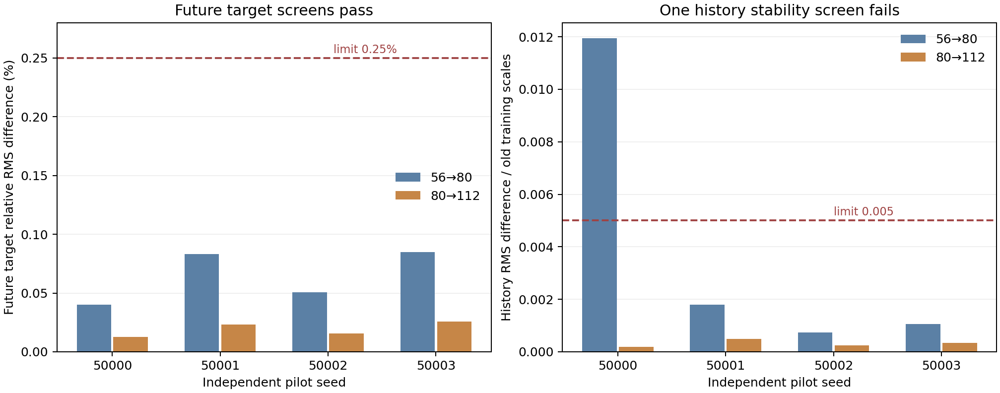

# Initial fresh-study accuracy pilot

All 16 initial histories are complete through time 1.2 and independently verified. **Candidate grid 80 fails 1 of 116 frozen accuracy screens; 115 pass.** The controller therefore started the preregistered conditional 160 stage to assess candidate 112. This snapshot contains no fitted predictors or fresh confirmation results. A failed accuracy gate is not evidence that marker histories lack predictive value.

## Frozen screen result

| Comparison | Metric | Saved and independently reproduced value | Maximum | Outcome |
| --- | --- | ---: | ---: | --- |
| Grid 56 to 80, seed 50000 | History RMS difference standardized by original training scales | 0.011944842838966659 | 0.005 | Fail |

All 80-to-112 spatial screens, volume screens, both 80 half-step controls, target contraction screens and the other 56-to-80 screens pass. The largest 80-to-112 target relative RMS difference is 0.000256869762 (0.02568698%; limit 0.25%); event Jaccard is at least 0.996904025 (minimum 0.98). These are numerical measurement comparisons, not A/B predictive-benefit estimates.



History differences use fixed original training standard deviations. They are dimensionless and are not a percentage error in fluid energy or power. The plotted 0.005 threshold was frozen before the pilot. The [audit](pilot-audit-80.json) preserves all 116 screens and the failed screen.

## Independent failure diagnosis

The failed history RMS was reconstructed exactly from the saved 56/80 trajectories using the parent causal feature descriptors and independent NumPy aggregation. One row—anchor 0.6, marker 109—accounts for 99.7642% of the squared history difference. Neighbor exchange descriptors account for 88.0157% of the squared difference across features.

For this marker, the eighth and ninth nearest neighbors are nearly tied. Grid 56 selects marker 494 as the eighth neighbor with a distance margin 1.32895e-5; grid 80 selects marker 19 with margin 5.95802e-6. Grid 112 also selects marker 19. This documents sensitivity of discrete neighbor selection to small trajectory differences. It does not justify dropping the row, relaxing the tolerance, changing the feature definition or claiming a history benefit. The [diagnosis](feature-diagnosis.json) preserves per-feature differences, selected neighbors and distance margins.

## Provenance and scope

Four new excluded pilot seeds 50000–50003 each supply 56/80/112 main histories; seeds 50000/50001 additionally supply 80/112 half-step controls. Each has 512 markers over 0–1.2, save interval 0.025, main step 0.0025 and half step 0.00125. The flow is the unchanged unforced incompressible 3D Navier–Stokes model with joint Heun updates, periodic side 6, viscosity 0.02, zero mean and force, and the same smooth random low-mode initial polynomial family.

The separate 4-point Lagrange tracer sampler and its exact piecewise Jacobian were preregistered; its interpolant is not exactly divergence-free and may have derivative joins. The original sharp-field periodic-join/off-central-peak limitations belong to the distinct original study.

No pilot seed enters fitting or confirmation. The 16 raw archives and metadata are in [recorded-data](../recorded-data); their exact hashes are below and in the [independent verification](verification.json). Maximum CFL: 0.1158233424; maximum absolute relative energy-budget residual: 2.076670105e-08; maximum spectral divergence: 4.481471409e-16. The [source inventory](source-inventory.json) records all executed and prepared sources and actual package versions, including joblib 1.6.0. Numerical, feature, fitting and model code was unchanged. The [completed-run logs](logs) and [pilot audit log](logs/numeric-audit-80.log) are preserved.

This snapshot excludes active 160 trajectories, recovery checkpoints and controller locks. The conditional stage is bounded to four 160 main histories and two 160 half-step controls. If candidate 112 also fails, the preregistered study stops numerically without a null-result claim. If it passes, train/validation fitting and a further frozen-model accuracy audit precede independent model-lock publication; only then can 64 untouched confirmation runs be generated.

The future target is forward logarithmic infinitesimal stretch over the strictly future interval [anchor+0.025, anchor+0.225], at current material-marker locations. The primary question concerns within-time ranking of future strong-deformation locations. Exact first-onset time and the exact Eulerian maximum are not tested here. The useful primary threshold remains an absolute spatial-AP gain 0.005 with paired whole-run uncertainty; the secondary 1% relative RMSE criterion cannot replace it. No predictive result exists in this pilot.

## Reproduce this numerical audit

From the fresh-independent directory after downloading the completed raw archives, metadata and unchanged parent dependencies:

```text
python -B -u numeric_audit.py --grid 80 --mode pilot
```

The read-only helper [reproduce_evidence.py](reproduce_evidence.py) verifies all 16 raw checksums, reconstructs the failed RMS and near-tied neighbors, and prints its checks. Run python -B pilot-initial/reproduce_evidence.py from fresh-independent; optionally pass --plot-directory with an output directory to regenerate both figures. It does not alter the snapshot or run simulations.

The audit command writes the root pilot-audit-80.json; this archived snapshot preserves the original audit. It does not generate simulations or fit models. Compare the regenerated file to the archived audit. Read-only diagnosis used the saved trajectories without rerunning the controller decision.

Preregistered protocol/code: commit 085598e20ea3ed8597681728cf7795bdd8df4368. Verified predecessor: commit 1e0354ae4d38e7ca5181d30ec43c80bf9accfcb1. See the frozen [preregistration](../PREREGISTRATION.md), [protocol](../protocol.json), [audit verification](verification.json) and [publication manifest](manifest.json). Publication base: bf1c120644c547e9718fcfda14660c178f8dd004.

| Archive stem | SHA-256 |
| --- | --- |
| s50000_n56_nu0.02_dt0.0025 | c0001e0421332b66b03c6a3e55dafe7e0edbfc7f6fb1f97749b2de737b6b4693 |
| s50001_n56_nu0.02_dt0.0025 | f096a55ccd7d159fad131a42e43c9a1712f9724961c9f540151f49b4dab3a2c1 |
| s50002_n56_nu0.02_dt0.0025 | 5872b62b2b8dabd7f605b54e0550096063ade974b6898192ecb72b2177fbc188 |
| s50003_n56_nu0.02_dt0.0025 | 6786b8656a50a19b0e4a62e0d4be331b1e24ece3c91b008463ff6b011634f43f |
| s50000_n80_nu0.02_dt0.0025 | b7b91c9062fe396c9594d6ecaf4bd70db4479b5355665d68f32a7be193a72ac5 |
| s50000_n80_nu0.02_dt0.00125 | 807ca4b9360a61027f2037411aba2d0ba40834e698d7196e1ed604070f179a0f |
| s50001_n80_nu0.02_dt0.0025 | f825eb115035d92be7474d7eba958152ba9ec7ced5731d8d297ff5310f4c5670 |
| s50001_n80_nu0.02_dt0.00125 | 16528ace5c5f123944f19db4709bb58c90869dee57d97468f180e3d79057771c |
| s50002_n80_nu0.02_dt0.0025 | 7690944e8b0d9192d1d84a589306e9c450564de495d385e58487ab563787506d |
| s50003_n80_nu0.02_dt0.0025 | 34aff249eef90e27fc959b3217fa25fde87db55d3fd85b38587e93abe15b0fd5 |
| s50000_n112_nu0.02_dt0.0025 | df1e663846102c74e14893846ee2b5dd1fabdb0165f3baa76d6b02deb16dc1d6 |
| s50000_n112_nu0.02_dt0.00125 | 79d0cc2e9c52212d528af196c09dc6ae04aceec6e4ceec1148275eb6cd5f20d6 |
| s50001_n112_nu0.02_dt0.0025 | 493247638384d64f7638642f28febe58a6617a44aa6410e1f515518236850c78 |
| s50001_n112_nu0.02_dt0.00125 | 68c0c3b4e68c216f993bb0134aceb2e4d907bc03db51e39e6ee1c5967e09df1c |
| s50002_n112_nu0.02_dt0.0025 | 77b18aec9a85c07a40a5edde02beb1ab5b658becdda31f78080fff560d094f99 |
| s50003_n112_nu0.02_dt0.0025 | d850b594ed727c67a97e3b54523b7688ddc03223b1616a380693da870918dcc7 |
