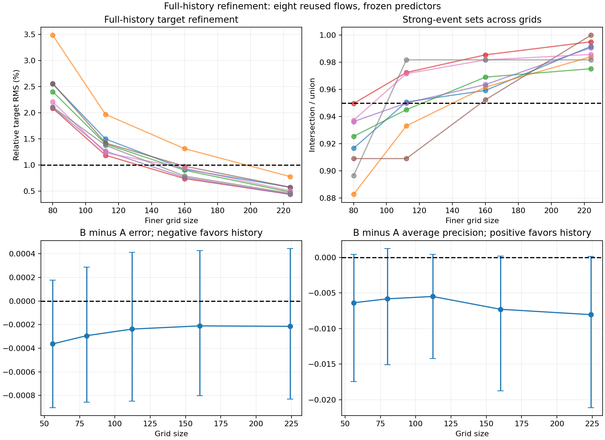

# Full-history refinement with frozen predictors

**Full-history numerical stability remains unestablished at the frozen tolerances.**

The paired stretch-error interval includes zero; a predictive advantage remains unresolved. These previously examined eight runs are exploratory numerical validation, not fresh statistical confirmation.

## What this tests

The earlier mirror/direction study refined short future branches from common saved states. This study instead integrates every marker history from the same original smooth initial velocity polynomial and initial marker positions, over the entire interval 0–1.2. Present features, past geometry and later target trajectories all change with resolution. No original source, predictor coefficient, training scaler, regularization, event threshold, or decision threshold was changed.

A uses 31 present features: velocity, the full 3×3 local velocity gradient, strain eigenvalues/norm, rotation norm, speed and present neighbor geometry. B uses exactly A plus the original 23 causal historical descriptors. Both are the original coarse-grid ridge/logistic fits, evaluated without refitting. This tests numerical robustness and transfer of those fitted predictors, not the best attainable fine-grid-trained predictor.

The unchanged parent incompressible Navier–Stokes solver uses joint Heun steps, periodic side-6 domain, viscosity 0.02, zero mean/force and the same trilinear velocity sampler and exact piecewise Jacobian. The smooth independent Fourier-mode seeds 1024–1031, all 512 initial markers and original labels are reused. They are distinct from the original unresolved sharp strain/tube field.

The main step is 0.0025, with two prechosen seeds checked at 0.00125 on the fine grids. Two existing grid-56/step-0.0025 histories are reused; the other six grid-56 main histories are new. The main ladder in this record is 56³, 80³, 112³, 160³, 224³. Conditional finer stages follow the [frozen protocol](protocol.json), with a maximum of 44 new simulations through 224³ and no automatic expansion beyond that limit. The grid-80/seed-1024 pilot appears once through cache reuse.

Prediction anchors are 0.3, 0.4, 0.5, 0.6 and 0.7; each history ends at its anchor and spans 0.2. The target starts strictly later, after a gap of 0.025, and accumulates logarithmic tangent stretch for 0.2. The fixed training-derived high-event cutoff is 1.0106081570657628. Locations are material marker start locations, not exact Eulerian peak location or first event onset.

## Frozen model results

| Main grid | A RMSE | B RMSE | B − A RMSE, paired 95% interval | A average precision | B average precision |
|---|---:|---:|---|---:|---:|
| 56 | 0.050843 | 0.050479 | -0.000364 [-0.000904, 0.000177] | 0.918842 | 0.912467 |
| 80 | 0.047042 | 0.046748 | -0.000294 [-0.000859, 0.000289] | 0.933636 | 0.927813 |
| 112 | 0.045312 | 0.045074 | -0.000238 [-0.000849, 0.000413] | 0.938752 | 0.933259 |
| 160 | 0.044319 | 0.044109 | -0.000211 [-0.000802, 0.000428] | 0.939644 | 0.932354 |
| 224 | 0.043812 | 0.043597 | -0.000215 [-0.000833, 0.000446] | 0.942306 | 0.934260 |

At the finest grid, the mean relative stretch-error reduction is **0.490%**. The event average-precision difference B−A is **-0.008046**, interval [-0.021101, 0.000151]. Continuous and binary targets are separate outcomes. A stretch-error reduction cannot substitute for evidence of strong-event prediction benefit.

Intervals use 2000 paired bootstraps of the eight entire independent seed groups. All anchors and markers within a run stay together. Grids and time-step controls add no independent test runs. Sign-flip values in results are exploratory and unadjusted; no result-based model selection or threshold recalibration was performed. MAE, R², precision, recall, Brier score, log loss and probability calibration bins are retained in the full results.

## Numerical differences and the prediction advantage

| Adjacent main grids | Per-run target relative RMS range | Minimum event Jaccard | Present standardized RMS range | History standardized RMS range | Change in mean B−A RMSE |
|---|---:|---:|---:|---:|---:|
| 56-80 | 2.0851–3.4858% | 0.88274 | 0.0610–0.1082 | 0.0678–0.1224 | 6.98166e-05 |
| 80-112 | 1.1854–1.9693% | 0.90909 | 0.0405–0.0754 | 0.0340–0.0795 | 5.58074e-05 |
| 112-160 | 0.7373–1.3113% | 0.95238 | 0.0321–0.0528 | 0.0325–0.0632 | 2.73017e-05 |
| 160-224 | 0.4354–0.7766% | 0.97531 | 0.0213–0.0391 | 0.0133–0.0615 | -3.86653e-06 |

Standardized descriptor changes use the original training scalers and include changes in neighborhood membership. They are descriptive measurements, not additional tuned pass/fail tests. Each descriptor’s change and each predictor’s continuous/probability output drift are saved per run.

The finest-pair target relative RMS must be at most 1% in every run, high-event Jaccard at least 0.95, and both predictors’ output relative RMS differences at most 1%. Successive target RMS differences must contract. Because the old mean A/B difference was only about 0.000364, a 1% target screen alone is inadequate: the absolute change in mean B−A RMSE must also be at most 0.00009 (approximately one quarter of that previously observed difference), and each run’s change at most 0.00018. Mean event-AP contrast drift must be at most 0.002 and each run’s at most 0.01.

The finest-grid half-step target difference must be at most one tenth of its same-run adjacent spatial difference. Its A/B RMSE contrast change must be at most 0.00001 and AP contrast change at most 0.001 for each checked run. These bounds were frozen before the pilot; they bound measured resolution sensitivity and do not provide a continuum error bound, significance test, or practical-benefit guarantee.

| Frozen screen | Passed / evaluated |
|---|---:|
| target_difference_contracts | 24 / 24 |
| target_relative_RMS | 8 / 8 |
| event_Jaccard | 8 / 8 |
| prediction_relative_RMS | 0 / 32 |
| paired_RMSE_macro_drift | 1 / 1 |
| paired_RMSE_per_run_drift | 8 / 8 |
| paired_AP_macro_drift | 1 / 1 |
| paired_AP_per_run_drift | 8 / 8 |
| time_target_fraction | 2 / 2 |
| time_paired_RMSE_drift | 2 / 2 |
| time_paired_AP_drift | 2 / 2 |

Every failed screen is preserved; none was relaxed.

| Screen and identifier | Value | Required |
|---|---:|---:|
| prediction_relative_RMS: s1024/160-224/A_full/prediction | 0.0161389 | <= 0.01 |
| prediction_relative_RMS: s1024/160-224/A_full/probability | 0.0798084 | <= 0.01 |
| prediction_relative_RMS: s1024/160-224/B_history/prediction | 0.0159241 | <= 0.01 |
| prediction_relative_RMS: s1024/160-224/B_history/probability | 0.0798126 | <= 0.01 |
| prediction_relative_RMS: s1025/160-224/A_full/prediction | 0.0186928 | <= 0.01 |
| prediction_relative_RMS: s1025/160-224/A_full/probability | 0.0731804 | <= 0.01 |
| prediction_relative_RMS: s1025/160-224/B_history/prediction | 0.018401 | <= 0.01 |
| prediction_relative_RMS: s1025/160-224/B_history/probability | 0.0717989 | <= 0.01 |
| prediction_relative_RMS: s1026/160-224/A_full/prediction | 0.013003 | <= 0.01 |
| prediction_relative_RMS: s1026/160-224/A_full/probability | 0.0712303 | <= 0.01 |
| prediction_relative_RMS: s1026/160-224/B_history/prediction | 0.0127837 | <= 0.01 |
| prediction_relative_RMS: s1026/160-224/B_history/probability | 0.069873 | <= 0.01 |
| prediction_relative_RMS: s1027/160-224/A_full/prediction | 0.0131551 | <= 0.01 |
| prediction_relative_RMS: s1027/160-224/A_full/probability | 0.0565471 | <= 0.01 |
| prediction_relative_RMS: s1027/160-224/B_history/prediction | 0.0129491 | <= 0.01 |
| prediction_relative_RMS: s1027/160-224/B_history/probability | 0.0543688 | <= 0.01 |
| prediction_relative_RMS: s1028/160-224/A_full/prediction | 0.012518 | <= 0.01 |
| prediction_relative_RMS: s1028/160-224/A_full/probability | 0.0540805 | <= 0.01 |
| prediction_relative_RMS: s1028/160-224/B_history/prediction | 0.0123177 | <= 0.01 |
| prediction_relative_RMS: s1028/160-224/B_history/probability | 0.0559943 | <= 0.01 |
| prediction_relative_RMS: s1029/160-224/A_full/prediction | 0.0126763 | <= 0.01 |
| prediction_relative_RMS: s1029/160-224/A_full/probability | 0.0777158 | <= 0.01 |
| prediction_relative_RMS: s1029/160-224/B_history/prediction | 0.0124625 | <= 0.01 |
| prediction_relative_RMS: s1029/160-224/B_history/probability | 0.0764995 | <= 0.01 |
| prediction_relative_RMS: s1030/160-224/A_full/prediction | 0.0138016 | <= 0.01 |
| prediction_relative_RMS: s1030/160-224/A_full/probability | 0.0492116 | <= 0.01 |
| prediction_relative_RMS: s1030/160-224/B_history/prediction | 0.0136306 | <= 0.01 |
| prediction_relative_RMS: s1030/160-224/B_history/probability | 0.0497211 | <= 0.01 |
| prediction_relative_RMS: s1031/160-224/A_full/prediction | 0.0111901 | <= 0.01 |
| prediction_relative_RMS: s1031/160-224/A_full/probability | 0.0394713 | <= 0.01 |
| prediction_relative_RMS: s1031/160-224/B_history/prediction | 0.011024 | <= 0.01 |
| prediction_relative_RMS: s1031/160-224/B_history/probability | 0.0389626 | <= 0.01 |

## Time-step and interpolation diagnostics

| Half-step grid | Maximum target RMS difference | Maximum absolute per-run B−A RMSE change | Maximum absolute per-run B−A AP change |
|---|---:|---:|---:|
| 112 | 0.000290591 | 6.05665e-06 | 3.61603e-06 |
| 160 | 0.000252121 | 4.00855e-06 | 4.29662e-06 |
| 224 | 0.000197125 | 1.49563e-06 | 5.97828e-06 |

| Main grid | Maximum CFL | Maximum absolute relative energy residual | Mean interpolated divergence RMS | Maximum accumulated probe volume error |
|---|---:|---:|---:|---:|
| 56 | 0.05976 | 2.224e-08 | 0.0455408 | 17.012% |
| 80 | 0.08541 | 2.224e-08 | 0.0319303 | 7.645% |
| 112 | 0.11954 | 2.224e-08 | 0.0229881 | 8.218% |
| 160 | 0.17085 | 2.224e-08 | 0.0160708 | 3.660% |
| 224 | 0.23925 | 2.224e-08 | 0.0115209 | 2.508% |

The spectral field remains divergence-free within the saved numerical checks, while its trilinear interpolant is not exactly divergence-free and its Jacobian jumps at cell faces. Accumulated probe-volume error and history-feature changes remain visible. Shrinking grid differences do not justify an unsupported Richardson extrapolation or formal order.

## Frozen historical-input sensitivity controls

| Input supplied to the existing B predictor | Mean RMSE | Mean average precision |
|---|---:|---:|
| reversed | 0.049174 | 0.913645 |
| irrelevant | 0.046999 | 0.922564 |
| row_permuted | 0.047109 | 0.920229 |

These controls keep present inputs fixed and change only historical descriptors: reverse the past sequence, use the spatially farthest marker’s history, or permute rows within each run/anchor. The original B coefficients are reused without adapting to these inputs. This measures sensitivity of an already fitted representation; it is not an equally refitted negative-control comparison and cannot establish chronology’s necessity or causality. The parent consistent-label, causality and fitting-leakage tests remain applicable.

## Provenance and reproduction

[input-verification.json](input-verification.json) records 63 source/model/archive/metadata files matched to GitHub before the pilot. [launch-verification.json](launch-verification.json) records frozen local source hashes. Per-run metadata records executed sources, initial-condition seed, configuration, array checksum and numerical diagnostics. The recorder’s complete outputs match the original parent simulation bit-for-bit in an independent small-run test; a separate analytic transfer test verifies the same initial polynomial across non-nested grids. All 34 parent and new analytic/regression tests passed, recorded in [tests.xml](tests.xml).

The [execution record](execution-224.json), [results](results-224.json), [per-run comparisons](per-run-comparisons-224.csv), [saved predictors’ outputs and feature arrays](array-parts/README.md), [raw histories](recorded-data), stage decisions and logs preserve completed and failed screens. [publication-manifest.json](publication-manifest-224.json) lists published checksums. Recovery checkpoints are local continuation evidence, excluded from bulk publication. Numerical sources and fitted models were not edited while active.

From the repository root, first restore the exact final arrays with the command below; no simulations or models are rerun. Then use the parent requirements for saved-data analysis:

```text
python -B reports/matched-stretch/history-prediction/full-history-refinement/restore_prediction_arrays.py
python -B reports/matched-stretch/history-prediction/full-history-refinement/verify_completion.py --stage 224
python -B reports/matched-stretch/history-prediction/full-history-refinement/diagnose_feature_drift.py --stage 224
```

Analysis reuses saved histories; it does not launch simulations or train models. Simulation caches require exact executed study-source hashes. Parent analysis accepts only LF/CRLF-equivalent source bytes; actual source edits are rejected. Preserve partial checkpoints and inspect process ownership before any restart. Stage snapshots and their failures are historical evidence, not extra independent observations.

## What remains necessary

A numerically stable frozen-model score does not establish predictive usefulness. The eight test seeds have already been examined. A new confirmation would need independently prepared training/validation/test runs at resolved accuracy, fixed comparison and practical-benefit criteria, matched model families and negative controls, and run-level uncertainty on untouched test results. No such fresh study was silently substituted here. If the interval includes zero, that is unresolved evidence; ruling out a useful benefit requires an upper confidence bound below a predeclared useful-effect size.

History may help an incomplete observation by summarizing omitted spatial information. It adds no fundamental information beyond a complete deterministic present fluid state. Passive marker records do not change fluid stress or establish material memory, leadership, or a Navier–Stokes breakthrough. The original nonsmooth periodic strain and off-central initial maxima remain separate limitations of the untouched original matrix.



## Completed bounded stage review

All46 archives (44 new and2 reused) are independently verified in [verification-224.json](verification-224.json). The controller exited normally at its predeclared224 limit. Both224 half-step controls pass;64/96 frozen screens pass, with all32 failures in individual continuous/probability prediction drift. Target and A/B contrast stability screens pass. These are operational tolerances, not a continuum proof.

The [fitted-score decomposition](feature-drift-224.json) attributes most grid drift to current gradient terms in these fitted linear models. Its group RMS parts have covariance and do not add. Event contributions are log odds, not probabilities. This is not causal attribution.

The separate [fresh-independent preregistration](../fresh-independent/PREREGISTRATION.md) remains unstarted until final publication verification and GitHub checks pass. Its accuracy pilot and model-lock gates remain mandatory. [Final independent review](FINAL-REVIEW.md) preserves the final report checksum and historical CI failure.
