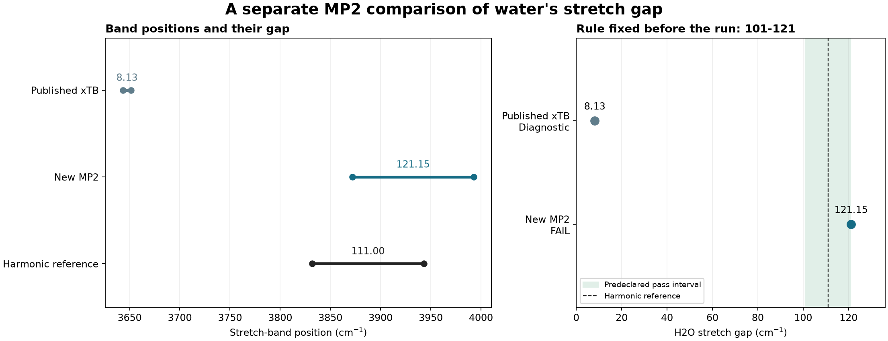

# A separate MP2 comparison of molecular vibration spacing

Here, **stretch-band gap** means the frequency difference between two molecular vibrations, measured in cm^-1. Empty layers in a lattice projection are a separate geometric question; this study does not test them.

**FAIL:** MP2/cc-pVTZ gives an H2O harmonic stretch gap of **121.152 cm^-1**. Before any molecular calculation, we chose a pass rule of **101-121 cm^-1**: within 10 cm^-1 of the same 111 cm^-1 harmonic reference used in the earlier xTB diagnostic. The error here is 10.152 cm^-1. This is a chosen project rule, not an established accuracy standard.

| H2O harmonic quantity (cm^-1) | Published GFN2-xTB | New MP2/cc-pVTZ | Harmonic reference |
|---|---:|---:|---:|
| Symmetric stretch | 3643.306 | 3871.827 | 3832 |
| Antisymmetric stretch | 3651.436 | 3992.979 | 3943 |
| Gap | 8.130 | 121.152 | 111 |

Each method uses its own optimized gas-phase geometry and unscaled harmonic frequencies. The reference comes from the [NIST CCCBDB H2O table](https://cccbdb.nist.gov/exp2x.asp?casno=7732185&charge=0). The measured fundamental gap of about 99 belongs to a different comparison; it was not used to grade this harmonic prediction.

MP2 is a different electronic-structure method that adds a correlation correction to a Hartree-Fock calculation. We used the fixed cc-pVTZ basis, all electrons and no density fitting. No coefficient or frequency scale was fitted. [PySCF method documentation](https://pyscf.org/user/mp.html).

The [protocol](data/protocol.json) was recorded at 2026-11-20T08:59:51.083024+00:00. The first calculation began at 2026-11-20T09:04:50.331399+00:00. An initial preflight caught a Windows line-ending mismatch in the receipt's checksum before any molecular calculation. The original receipt and log are retained; the corrected receipt hashes the unchanged saved protocol. No method, reference or pass criterion changed.

We completed 91 energy-and-gradient evaluations, optimizing from two starting geometries and forming Hessians at displacements of 0.005, 0.0025 and 0.00125 bohr. The finest step was designated for reporting before running. **36 of 36 numerical controls passed.** Halving the final displacement changed the H2O gap by 0.000227 cm^-1 and the D2O gap by 0.000003 cm^-1. The controls also cover geometry agreement, stationarity, Hessian symmetry, positive internal frequencies, mode identification and agreement with PySCF's separate harmonic-analysis routine. Full values and optimizer statuses are in [the results](data/comparison-results.json).

The original gradient-response solver emitted 91 warnings: its largest reported residual was 1.024e-8 against its requested 1e-9 tolerance. We then [registered a separate numerical check](data/response-check/protocol.json), keeping the physical method, saved geometry and gap rule fixed. It used a different linear solver for the same response equation and checked that equation's residual directly. All six follow-up controls passed across 19 additional gradient evaluations, with a maximum response residual of 7.286e-13. The [follow-up result](data/response-check/verification-results.json) was H2O **121.152469 cm^-1**, a change of **0.000381 cm^-1**; D2O changed by 0.000281 cm^-1. These changes do not alter the original FAIL. The original 91 evaluations, their warnings and the primary result remain intact.

The second geometry optimization reported precision loss. Its final maximum Cartesian gradient was 8.85e-8 Eh/bohr, within the predeclared 5e-7 limit, and its geometry and energy agreed with the first start within the recorded limits. The primary result uses the first start, as registered.

For D2O, the new harmonic prediction gives stretches of 2791.309 and 2924.670 cm^-1, a gap of **133.361 cm^-1**, compared with the saved xTB gap of 54.668. This remains diagnostic: the checked [NIST D2O table](https://cccbdb.nist.gov/exp2x.asp?casno=7789200&charge=0) lists fundamental values but no harmonic values. We did not grade a harmonic prediction against its approximately 117 cm^-1 fundamental gap.

The finding applies to this gas-phase molecule and fixed basis. The specific source of xTB's physical error and the effect of increasing MP2's basis size remain untested.

The original xTB position PASS under the 5% rule and its gap diagnostics (8 against 99 for H2O, 55 against 117 for D2O, and H2O harmonic 8 against 111) are unchanged. The new gap rule was not applied retrospectively to rename the published xTB outcome. No Lean check was run. This publication is a separate addition to the xTB study.

Reproduction: use the [locked packages](data/requirements-lock.txt), [runner](data/run_comparison.py) and [analyzer](data/analyze_comparison.py). Both accept --packages pointing to the isolated package directory. The runner refuses to overwrite an existing run. The [execution receipt](data/execution-receipt.json) hashes every saved energy/gradient record; the analyzer reconstructs each Hessian from those records and verifies the protocol, runner and implementation hashes before computing the result.

The data directory preserves the original run files and local review receipts without changing their bytes. Local-status fields in those archived receipts describe the time they were made. The archived finalize_report.py belongs to that original workspace; use the publication verifier below to check this package.

Run python reports/quantum-water-pilot/stretch-gap-mp2/verify_recorded_results.py from the repository root to check the saved hashes, gradients, Hessian construction, thresholds and outcome arithmetic. The same check runs in GitHub Actions. It checks the recorded package; it does not rerun MP2 or Lean.

Generated by Codex under the user's direction.
