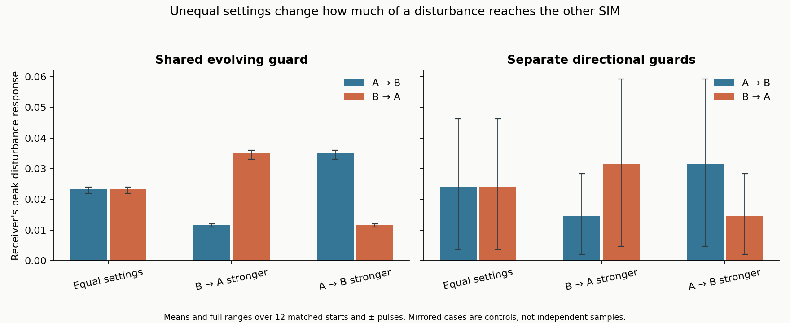
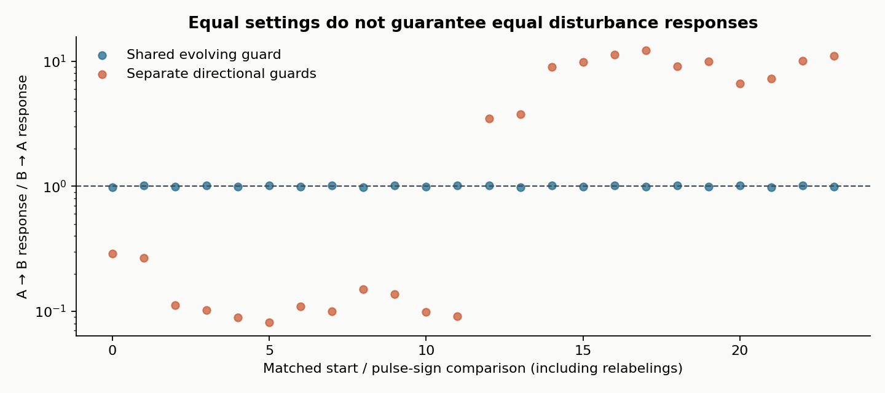

# Sources and details for the active guard comparison

[Read the finished test](README.md)

## Connection to the framework

This test implements the explicit two-participant example in the [working equation as published before the runs](https://github.com/NousVolition/My-Sources-Project-ALL/blob/36edc2e4c9c0ee49d5b99272dfcd8bed55054557/reports/interaction-equation.md). The connection is the continuous reciprocal dependence between participant states and relationship guards, with distinct influence in each direction. It does not implement an autonomy optimizer, the full original framework, or the optional fluid stress closure.

The original user-supplied PDF remains an unchanged local source. Its SHA-256 is `9a923cd9d8ad6798d125424e8c3adc9ec7af74dd459089b277620e7843333d77`. The [framework audit](https://github.com/NousVolition/My-Sources-Project-ALL/blob/36edc2e4c9c0ee49d5b99272dfcd8bed55054557/reports/framework-audit.md) distinguishes its provisional definitions from later assistant modeling choices.

## The implemented equations

The state is `(x_A, x_B, g_AB, g_BA)`. Subscript AB means **A receives from B**. The x values are abstract scalar responses; the g values are transmitted fractions of influence.

$$
\dot x_A=(b_A-x_A)+k_{AB}g_{AB}(x_B-x_A)+s_A(t),
\qquad
\dot x_B=(b_B-x_B)+k_{BA}g_{BA}(x_A-x_B)+s_B(t).
$$

For the draft's directional guards, with d = x_B − x_A:

$$
0.6\dot g_{AB}=\sigma(-0.4+2d)-g_{AB},
\qquad
0.6\dot g_{BA}=\sigma(-0.4-2d)-g_{BA},
\qquad \sigma(z)=\frac{1}{1+e^{-z}}.
$$

The current guard multiplies the interaction at every integration stage, and the current participant states determine the guard derivatives. Guards start at 0.5 and are never clipped. A smaller guard value means greater restriction. Both directions follow the same equation template; their targets can differ because their signed state differences differ. Equal settings therefore do not imply equal realized gains `k_AB*g_AB` and `k_BA*g_BA`.

The individual baselines b_A and b_B are assumed tendencies, not measured personality or autonomy. The sigmoid, its sign, the return rate, and the response time are provisional choices supplied with the draft and this test protocol.

### Shared evolving guard control

For this explicitly modified response rule, both guard equations use the same target:

$$
q(d)=\tfrac12[\sigma(-0.4+2d)+\sigma(-0.4-2d)],
\qquad 0.6\dot g_{AB}=q(d)-g_{AB},\quad 0.6\dot g_{BA}=q(d)-g_{BA}.
$$

Equal initial guards remain equal while evolving with the participants. This supplies an exactly equal-gain control when k_AB = k_BA. The nonzero bias matters: at zero bias the average of the two sigmoids would be the constant 0.5, eliminating adaptation from this control.

The shared and directional rules are different models. Comparisons between them include that rule change; only comparisons within each rule isolate the imposed weight change.

### Frozen diagnostic

Both guards remain 0.5. These 180 trajectories isolate the effect of adaptation and check the solver. They are not included in the 360 active-guard trajectories.

## Fixed comparison matrix

| Item | Choice frozen before integration |
| --- | --- |
| Starts | Six synthetic pairs, seed 20261020, plus their exact A/B relabelings |
| Baselines | A uniform on [−0.8, −0.25]; B uniform on [0.25, 0.8] before relabeling |
| Initial states | Each baseline plus an independent uniform offset in [−0.2, 0.2] |
| Influence weights | (1, 1), (1.5, 0.5), (0.5, 1.5), ordered A receives B, B receives A |
| Guard rules | Shared evolving, directional evolving, frozen diagnostic |
| Disturbances | None, positive on A, positive on B, negative on A, negative on B |
| Pulse | ±0.8 sin²(π(t−2)/0.5) for 2 ≤ t ≤ 2.5; zero otherwise; signed area ±0.2 |
| Interval and saved times | 0–12 model units; output every 0.02 |
| Numerical refinement | RK4 steps 0.01, 0.005, 0.0025 on all 540 trajectories |
| Independent solver | DOP853 on 90 cases, all rule/weight/pulse combinations for the first pair and its relabeling |

The configured weights sum to 2 in every comparison. The realized sum `k_AB*g_AB + k_BA*g_BA` need not be fixed. Relabelings are exact verification controls, not additional independent population samples. The three step sizes repeat the same 540 trajectories for accuracy; they are not 1,620 independent experiments.

## Measurement and full comparison

For each pulse, subtract the undisturbed trajectory with the same initial pair, guard rule and weights. The primary response is the maximum saved absolute deviation of the unperturbed receiver. Sampling is every 0.02 model units; this is not a continuous-time maximum. Positive and negative pulses are retained separately in the measurements and summary.

The bars pool both pulse signs and the original and relabeled pairs. The whiskers are the full observed range, not confidence intervals.

| Guard rule | Settings | Mean A → B response | Mean B → A response |
| --- | --- | ---: | ---: |
| Shared evolving | Equal | 0.02330927 | 0.02330927 |
| Shared evolving | B → A stronger | 0.01165464 | 0.03496391 |
| Shared evolving | A → B stronger | 0.03496391 | 0.01165464 |
| Directional evolving | Equal | 0.02413560 | 0.02413560 |
| Directional evolving | B → A stronger | 0.01446346 | 0.03141581 |
| Directional evolving | A → B stronger | 0.03141581 | 0.01446346 |

Within the directional rule, the paired increases in the favored direction range from 21.27% to 48.25% (mean 29.62%). The weakened direction falls 38.19% to 49.72% (mean fall 42.16%). These means average per-case ratios; they are not ratios of the pooled means above.

### Equal averages can conceal unequal interactions

Compare equal-sign pulses on A and B within the same starting pair. The ratio of A → B to B → A responses ranges from 0.98504 to 1.01519 with the shared guard, and from 0.08186 to 12.21599 with the draft's directional guards. Exact relabelings invert these ratios. Thus the equal pooled bars do not establish equality within an individual pair.

The difference arises under an assumed rule sensitive to the signed state difference. It is not spontaneous selection between initially identical participants: the participants start with different states and baselines.

### Why the shared control gives exactly fifty percent

When both guards equal g and both return rates are 1,

$$
\dot d=(b_B-b_A)-[1+(k_{AB}+k_{BA})g]d+s_B-s_A.
$$

Keeping the weight sum fixed makes d(t) and g(t) independent of the division of those weights. After subtracting the matched undisturbed path, the unforced receiver's response is proportional to its incoming weight. Changing that weight from 1 to 1.5 or 0.5 therefore produces +50% or −50%. This is a check of the specific equations, not a newly established universal relation.

### Adaptation and retained differences

With equal weights, the shared evolving guard reduces receiver response by 3.29–11.24% relative to its matched frozen control. The directional guard can either reduce or increase it: the corresponding range is −85.03% to +86.46%. The guard's contribution depends on the relationship state and direction.

Across all 288 disturbed active cases, the maximum guard departure from its undisturbed path ranges from 0.003502 to 0.036156. All 288 departures are nonzero. In the undisturbed active cases, the final participant-state gap ranges from 0.32689 to 0.85266. The largest receiver disturbance remaining at model time 12 is 0.00002526 across all disturbed cases. This finite interval does not establish permanent change or an asymptotic result.

## Numerical verification

All eight recorded checks passed. No failed run or failed scientific screen was removed.

| Check | Largest absolute difference or observation |
| --- | ---: |
| Step 0.01 versus 0.005, all saved states | 3.537 × 10⁻⁹ |
| Step 0.005 versus 0.0025, all saved states | 2.209 × 10⁻¹⁰ |
| Independent scalar RHS with DOP853 | 7.929 × 10⁻¹⁰ |
| Exact A/B relabeling and weight reversal | 0 |
| Shared guards remain equal | 0 |
| Equal realized gains with shared guard and equal weights | 0 |
| Frozen undisturbed solution versus matrix exponential | 1.299 × 10⁻¹² |
| Pulse area | 0.2 in magnitude |

All checked RK4 stages and updates were finite. Guard values remained between 0.099934 and 0.804350 to the shown precision, without clipping. Source and protocol hashes matched the pre-run freeze. Both standard-error logs were empty. The full runner took approximately 7.985 seconds with a 300-second budget and one numerical-library thread.

DOP853 used relative tolerance 10⁻¹¹, absolute tolerance 10⁻¹³ and maximum step 0.025 with a separately handwritten scalar derivative. These checks establish agreement for the chosen equations and interval, not validity of their interpretation as real populations.

## Files and reproduction

| Contents | File |
| --- | --- |
| Frozen choices and numerical limits | [protocol.json](protocol.json) |
| Equations and both derivative implementations | [model.py](model.py) |
| Bounded runner and verification | [run.py](run.py) |
| Pre-run source hashes and derivative preflight | [freeze.json](freeze.json) |
| Saved states at all three step sizes | [trajectories.npz](results/trajectories.npz) |
| Exact starts and case ordering | [cases.json](results/cases.json) |
| Every pulse measurement | [measurements.csv](results/measurements.csv) |
| Every matched contrast | [contrasts.csv](results/contrasts.csv) |
| Grouped results | [summary.json](results/summary.json) |
| Checks including per-case errors | [verification.json](results/verification.json) |
| Reporting and chart generation | [analyze.py](analyze.py) |
| Python and library versions | [environment.json](environment.json) |
| Execution logs | [run.log](run.log), [run.err](run.err), [analysis.log](analysis.log), [analysis.err](analysis.err) |
| SHA-256 of the delivered study files | [manifest.json](manifest.json) |

In the NPZ file, `time` contains 601 samples. `state`, `half` and `coarse` have shape `(601, 540, 4)` and correspond to steps 0.0025, 0.005 and 0.01. The last axis is `(x_A, x_B, g_AB, g_BA)`; the middle axis follows `cases.json`.

Reproduction requires Python 3.12, NumPy, SciPy and Matplotlib; exact installed versions are recorded above. In a **fresh directory**, copy the frozen protocol, model, runner and freeze record, plus the analysis source. Run `python -B run.py`, then `python -B analyze.py`. The runner refuses to overwrite an existing results directory. Preserve the delivered results and any failed reproduction separately.

The three charts also have vector SVG versions: [comparison](figures/comparison.svg), [timeline](figures/timeline.svg), [within-pair ratios](figures/within-case.svg).
