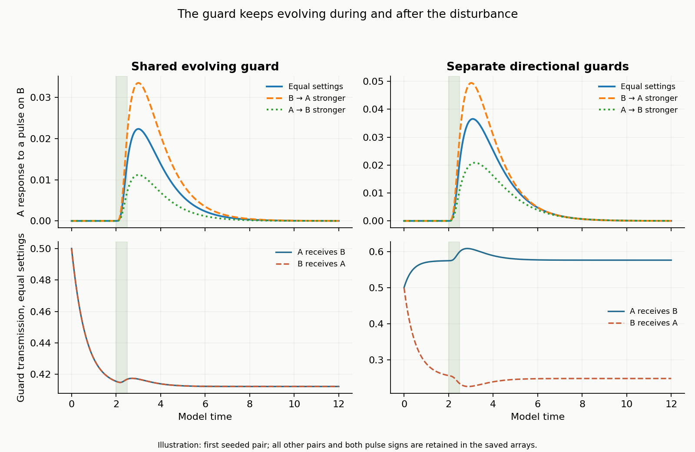

# Equal and unequal influence with an active guard

**Finished abstract SIMS test · 20 October 2026**

The guard stayed inside the interaction throughout the test. Each participant changed the relationship, and the current relationship changed how the participants affected one another.

**The main finding:** equal influence settings did not guarantee equal responses. With the draft's directional guards, the participants' different states changed how much influence passed in each direction.

## What we compared

Two SIMS retained different individual baselines. We applied the same brief disturbance to each in turn, compared equal strengths of **1 and 1** with unequal strengths of **1.5 and 0.5**, then reversed the imbalance. Every disturbed run was compared with its own undisturbed counterpart.

| Guard in the interaction | Equal strength settings | Unequal strength settings |
| --- | --- | --- |
| **One shared evolving guard**, a comparison rule that keeps transmission equal | The realized influence gains stayed equal. Responses to matched disturbances differed by at most about **1.5%** between directions. | The favored direction's response rose **50%** and the weakened direction's fell **50%**. This exact proportionality follows from this control's equations. |
| **Separate directional guards**, the draft equation | Within a matched pair, one direction's response could be up to **12.2 times** the other's, despite equal settings. | The favored direction's response rose **21–48%** and the weakened direction's fell **38–50%**, compared with that same case under equal settings. |

Here, response means the largest saved change in the *other* SIM caused by the disturbance. These ranges describe this fixed set of synthetic starts. Reversing the participants reversed the results correctly. Pooling those reversed pairs gives equal averages and hides the differences within each pair.

## The guard remained involved

The shaded interval is the disturbance. The lower plots show the guard continuing to evolve before, during and afterward. This illustration uses one starting pair; the findings above use all tested pairs and both disturbance signs.

In **every disturbed active-guard run**, the guard departed from its own undisturbed path. That departure ranged from **0.0035 to 0.0362** on the guard's 0–1 transmission scale. Freezing the guard changed the responses, confirming that its adaptation mattered in these runs.

The SIMS also retained different states. A shared interaction rule did not erase their distinct baselines.

## What this establishes

The completed comparison contains **360 active-guard trajectories and 180 frozen-guard controls**, each through 12 units of model time. All numerical checks passed, including smaller steps, an independently implemented solver, participant reversal and an exact fixed-guard check. The largest difference from the independent solver was below **0.000000001** in the saved states.

This tests the draft's proposed local interaction equations. The response law and parameters are assumptions; the result does not validate the whole original framework, simulate a room of materials, or solve the proposed Navier–Stokes extension. Model time is uncalibrated. This example contains no irreversible memory or physical rupture.

[Sources, equations, all results and verification](METHODS.md)
