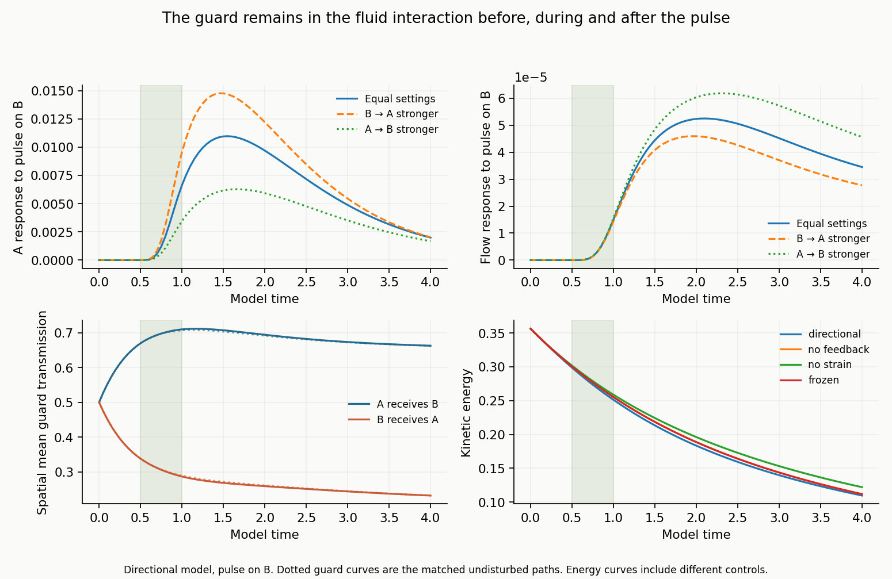
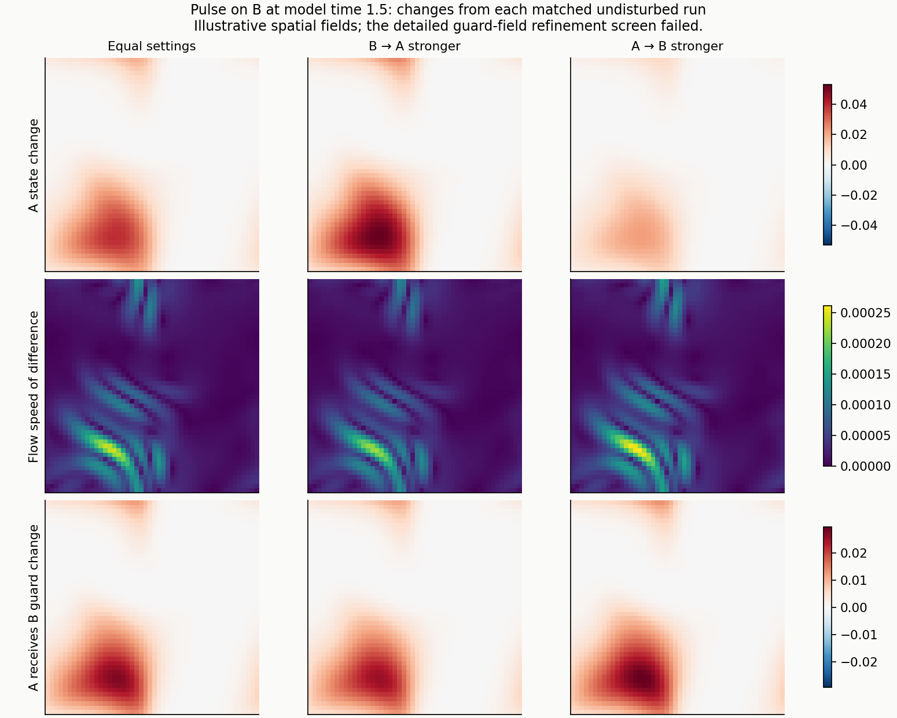

# Sources and details for the Navier–Stokes SIMS test

[Read the finished comparison](README.md)

## Connection and scope

This is the first bounded fluid realization of the [proposed active-guard equation](https://github.com/NousVolition/My-Sources-Project-ALL/blob/75dfdd5cf200ca56a8725e50e5db23d234f79789/reports/interaction-equation.md). The guard regulates the SIMS interaction continuously, responds to the participants and fluid strain, and changes the fluid's viscous stress. A guard is a state of the relationship; it is not a third SIM.

The two SIMS are abstract internal state fields carried by one incompressible fluid. The spatial domain is a two-dimensional periodic square of side 2π. There are no physical walls or identified materials. State, position and time are nondimensional. Four model time units are not four calibrated seconds.

The [previous local SIMS test](https://github.com/NousVolition/My-Sources-Project-ALL/blob/75dfdd5cf200ca56a8725e50e5db23d234f79789/reports/sims-active-guard/README.md) had no fluid. This test adds spatial starting fields, transport, diffusion and a proposed stress closure. A difference between those two studies cannot be attributed uniquely to one added mechanism. The matched controls within this study support the comparisons reported here.

## Coupled equations

Let u = (u,v) be fluid velocity, p pressure, and D = (∇u + ∇uᵀ)/2. Density is 1. Momentum and incompressibility are

$$
\partial_t u+u\cdot\nabla u=-\nabla p+\nabla\cdot[2\nu_g D],
\qquad \nabla\cdot u=0,
\qquad \nu_g=0.02+0.04(g_{AB}+g_{BA}).
$$

The solver retains the **full stress divergence**, including gradients of the changing viscosity. The standard momentum and incompressibility structure follows the [fluid conservation equations](https://www.comsol.com/multiphysics/fluid-flow-conservation-of-momentum-mass-and-energy). The guard-dependent viscosity is an explicit modeling assumption from the draft.

With the material derivative L = ∂t + u·∇, the SIMS obey

$$
Lx_A=0.02\Delta x_A+(b_A-x_A)+k_{AB}g_{AB}(x_B-x_A)+s_A,
$$

$$
Lx_B=0.02\Delta x_B+(b_B-x_B)+k_{BA}g_{BA}(x_A-x_B)+s_B,
\qquad (b_A,b_B)=(-0.55,0.35).
$$

Here AB means **A receives B**. The draft's directional guards evolve as

$$
Lg_{AB}=0.015\Delta g_{AB}+\frac{\sigma(-0.4+2(x_B-x_A)+0.5D:D)-g_{AB}}{0.6},
$$

$$
Lg_{BA}=0.015\Delta g_{BA}+\frac{\sigma(-0.4+2(x_A-x_B)+0.5D:D)-g_{BA}}{0.6},
\qquad \sigma(z)=\frac{1}{1+e^{-z}}.
$$

All six fields advance together at every Runge–Kutta stage. Guards start at 0.5. The code never clips their values or switches them on only at an event.

The explicit feedback paths are: **fluid transport and strain → SIMS and guards → interaction and viscous stress → later fluid transport and strain**. In this chosen closure, more guard transmission increases viscosity. That assignment, the sigmoid, the response time, and the return to individual baselines are provisional assumptions; they are not empirical claims about people or substances.

## Equal and unequal settings

The configured weights are (k_AB,k_BA) = (1,1), (1.5,0.5), and (0.5,1.5). Their sum remains 2. Their current realized gains k_AB g_AB and k_BA g_BA need not sum to a fixed number or be equal. Only these weights change within each matched influence comparison.

Five guard or coupling choices are included:

| Choice | What evolves and what is changed |
| --- | --- |
| Shared evolving guard | Both guard targets equal the average of the two directional targets. Both guards evolve and remain equal. Equal weights therefore give equal realized gains. This explicitly changes the draft response rule. |
| Draft directional guards | Both guards evolve separately, using the equations above, with full fluid coupling. |
| Frozen guard control | Guards stay at 0.5. This diagnoses adaptation; it is excluded from the primary active-guard comparisons. |
| Guard-to-flow feedback disabled | Guards evolve with strain and transport, but viscosity stays at its common initial value 0.06. This removes the guard's stress feedback. |
| Direct strain response disabled | The coefficient 0.5 multiplying D:D is set to zero. The guards still evolve and change viscosity. Transport still couples the flow and internal fields. |

Shared versus directional guards change a rule as well as the resulting behavior. The two versions are reported separately.

### A useful exact null in the shared control

When the shared guards equal g, their sum and the difference d = x_B − x_A close a subsystem with the fluid:

$$
Ld=0.02\Delta d+(b_B-b_A)-[1+(k_{AB}+k_{BA})g]d+s_B-s_A.
$$

Since the total weight is fixed, redistributing it leaves this subsystem, and hence the fluid path, unchanged for a fixed disturbance. This is an algebraic property of this particular closure. The receiver responses change by approximately +50% and −50% in the results. That proportionality is not exact here: the pulse also changes the fluid, which transports the participants' initially nonuniform fields differently. The exact claim applies to the fluid's independence of the weight split, not to exact proportionality of the receiver response.

## Starting fields and disturbance

One smooth spatial starting pattern is used throughout. The streamfunction is

$$
\psi=\sin x\sin y+0.25\cos(2x+y)+0.15\sin(x-2y),
\qquad (u,v)=(\psi_y,-\psi_x).
$$

The internal fields start at

$$
x_A=-0.55+0.15\cos x+0.1\sin y,
\qquad x_B=0.35+0.1\sin x-0.15\cos y.
$$

The same finite trigonometric fields are represented exactly on every study grid. A positive pulse is applied either to A or to B, with a third run receiving no pulse. Its spatial profile is

$$
P(x,y)=\left[\frac{1+\cos(x-\pi/2)}2\right]^2
\left[\frac{1+\cos(y-\pi/3)}2\right]^2.
$$

The pulse is 0.8 P sin²(π(t−0.5)/0.5) from t = 0.5 to 1 and zero otherwise. At the maximum of P, its time integral is 0.2. It perturbs an internal SIMS state, not the fluid momentum directly. Negative disturbances and additional starting geometries are outside this bounded comparison.

There are **45 conditions**: five choices × three weight pairs × three pulse choices. Eighteen are the primary shared/directional active comparisons, and 27 are diagnostic controls. The same conditions run on 24², 32² and 48² grids with step 0.01, and again on 48² with step 0.005. Those 180 numerical trajectories are repeated accuracy evaluations of 45 conditions, not independent population samples.

Nine directional trajectories are also repeated with participants, baselines, weights and pulse recipients exchanged. Three directional pulse-on-B cases are checked independently on the 24² grid. These controls bring the integration count to 192 without adding new scientific conditions.

## Measurements

Every disturbed trajectory is compared with its own undisturbed counterpart with the same grid, guard rule and influence weights. Responses are spatial root-mean-square differences. The fluid response uses the magnitude of the velocity-vector difference, not the difference between speed magnitudes. The reported peak is the largest of the saved measurements, spaced 0.05 model units apart, through t = 4.

Full fields are saved at t = 0, 1, 1.5, 2.5 and 4. Full-band field comparisons embed the coarser Fourier representation onto the finer grid and retain the finer grid's additional modes in the difference. Grid comparisons therefore do not discard an unresolved fine-grid tail. There is no claim about an exact maximum between saved times.

For a weight contrast, compare its size with the observed changes in that same response measurement under grid and time-step refinement. These sensitivities are finite comparisons, not rigorous error bounds or statistical confidence intervals. Exact A/B relabelings check indexing and covariance; they do not add an independent starting sample.

## Conservation and solver checks

With periodic boundaries and no mechanical force, the chosen closure satisfies

$$
\frac{d}{dt}\left\langle\frac{|u|^2}{2}\right\rangle
=-\langle2\nu_g D:D\rangle\le0.
$$

The mean velocity is conserved. The evolving guard alters dissipation but supplies no kinetic energy in this model. Internal SIMS states have reaction and disturbance terms; their sum is not a conserved mass or momentum.

The solver uses Fourier collocation, a strict two-thirds mode truncation for quadratic products, and a pressure projection enforcing incompressibility. Nonpolynomial sigmoid reactions are evaluated on the grid; their resolution is assessed by grid refinement. RK4 advances velocity, internal states and guards together. Dissipation is integrated with the same four stages for the energy-balance check.

Before the comparison, checks covered an exact shear-decay solution, full variable-viscosity gradient terms, the spatially discrete energy identity, mean momentum, equal initial fields across grids, and agreement with a separate curl-form momentum/conservative scalar implementation. The latter implementation is also evolved with adaptive DOP853 for three complete trajectories, using relative tolerance 10⁻⁹, absolute tolerance 10⁻¹¹ and maximum step 0.025.

Frozen limits include guard bounds without clipping, CFL below 0.5, divergence below 10⁻¹⁰, mean-velocity drift below 10⁻¹¹, and relative energy-balance residual below 10⁻⁵. Grid and time response screens are 5% and 1%, with an absolute denominator floor of 10⁻⁷ for near-zero responses. Every pass or failure is retained in the verification data.

## Verification outcome

**29 of 31 comparison screens passed; both detailed-field grid screens failed.** All seven preflight checks and 62 separate saved-field and resource checks passed. No integration failed or was retried. The comparison is finished, with the spatial-resolution limitation retained.

| Check | Observed maximum | Preset limit | Result |
| --- | ---: | ---: | --- |
| Full-field RMS, 24² → 32² | 0.0075409 | 0.002 | **Failed** |
| Full-field RMS, 32² → 48² | 0.0025379 | 0.002 | **Failed** |
| Full-field RMS, step 0.01 → 0.005 | 4.34 × 10⁻¹⁰ | 10⁻⁵ | Passed |
| Normalized component response curve, 24² → 32² | 1.039% | 5% | Passed |
| Normalized component response curve, 32² → 48² | 0.1282% | 5% | Passed |
| Normalized component response curve, half step | 0.00000385% | 1% | Passed |
| Independent curl-form DOP853 maximum field error | 2.39 × 10⁻⁹ | 2 × 10⁻⁷ | Passed |
| Participant relabeling maximum difference | 0 | 10⁻¹¹ | Passed |
| Energy balance relative residual | 3.24 × 10⁻¹¹ | 10⁻⁵ | Passed |
| Divergence at checked stages | 8.88 × 10⁻¹⁶ | 10⁻¹⁰ | Passed |
| Mean velocity drift | 3.61 × 10⁻¹⁷ | 10⁻¹¹ | Passed |
| CFL | 0.1452 | 0.5 | Passed |

Across all checked stages and grid points, guards stayed between 0.17336 and 0.88381. Total integration time was 686.6 seconds, within the 5,400-second budget. The maximum detailed-field difference arose in g_BA in both grid comparisons. For 32² → 48², maximum component RMS differences in order (u,v,x_A,x_B,g_AB,g_BA) were (0.0000736, 0.0001693, 0.0004568, 0.0015428, 0.0009918, 0.0025379). This is why spatial images are illustrative rather than certified as resolved.

For the primary active comparisons, the largest receiver-peak change under 32² → 48² refinement was 9.55 × 10⁻⁹; the largest fluid-peak change was 3.12 × 10⁻⁹. The directional weight contrasts were 0.00134–0.00469 for the receiver and 6.56 × 10⁻⁶–9.45 × 10⁻⁶ for the fluid. These comparisons support the reported ordering and rounded percentages for sampled RMS responses. They do not remove the detailed-field failure or provide a continuum error bound.

At equal settings with a pulse on B, the mean directional guards finished at approximately 0.663 and 0.232, from a common start of 0.5. The guard response to the pulse itself was measured by subtracting the undisturbed evolving guard, rather than by attributing its entire evolution to that pulse. Across primary disturbed cases, the largest directional-component guard response ranged from 0.000826 to 0.008302 RMS.

Disabling the direct strain term retained guard evolution and guard-to-fluid feedback. It changed both receiver and fluid responses: for equal weights and a pulse on B, the full model's receiver peak exceeded that control by 0.0000893, while its fluid peak was lower by 0.0000612. These are conditional contrasts under different coupling rules, not additive portions of a total causal effect.

### Additional charts

## Sources and saved evidence

| Contents | File |
| --- | --- |
| Frozen choices and numerical screens | [protocol.json](protocol.json) |
| Coupled equations and independent curl formulation | [model.py](model.py) |
| Preflight checks and their results | [preflight.py](preflight.py), [preflight.json](preflight.json) |
| Bounded integrations | [run.py](run.py) |
| Pre-run source hashes | [freeze.json](freeze.json) |
| Environment versions | [environment.json](environment.json) |
| Execution resource deviation | [execution-resource-note.json](execution-resource-note.json) |
| Analysis and charts | [analyze.py](analyze.py) |
| Independent checks of the saved fields | [audit_saved.py](audit_saved.py), [saved-field-audit.json](results/saved-field-audit.json) |
| Numerical checks and all failures | [verification.json](results/verification.json) |
| Measurements | [measurements.csv](results/measurements.csv) |
| Comparisons and interpreted quantities | [analysis.json](results/analysis.json) |
| Integration status and cases | [summary.json](results/summary.json), [cases.json](results/cases.json) |
| All field arrays and diagnostic time series | [Saved results](results/) |
| Delivery hashes | [manifest.json](manifest.json) |
| Execution and reporting history | [handoff.json](handoff.json), [retained reporting error](analysis-reporting-error.err) |

Each batch's NPZ contains `fields` with axes `(saved time, case, component, x, y)` and its `time` array. Components are `(u, v, x_A, x_B, g_AB, g_BA)`. The companion JSON contains all 81 diagnostic observations and stage checks. Case order is in `cases.json`. The relabeling and independent-solver data use the subsets recorded in the runner and protocol.

The FFT calculations used one worker. The runner imported its numerical libraries before setting thread environment variables, so their BLAS pools initialized with 24 threads instead of the intended one. After detection during the final refinement batch, the existing worker was restricted to one logical CPU before the independent integrations. This execution-setting deviation is retained separately from the numerical screens; no integration was restarted to hide it.

The first detached analysis launch disappeared before producing output. After confirming no live analyzer, reporting was restarted in a retained execution session. A console-serialization error occurred after the analysis data and charts were written; this reporting error is preserved. The serializer and overlapping spatial-chart colorbars were corrected, and reporting completed successfully. No numerical integration or frozen source changed. The initial draft description of exact ±50% receiver scaling was also corrected to approximate scaling because the changed flow transports nonuniform starting fields.

Reproduce in a fresh directory containing the source files, protocol and freeze record. Set `OMP_NUM_THREADS`, `OPENBLAS_NUM_THREADS` and `MKL_NUM_THREADS` to `1` **before starting Python**. Run `python -B run.py`, then `python -B analyze.py` and `python -B audit_saved.py`. The runner refuses to overwrite an existing results directory. Preserve failures separately and do not edit the frozen numerical files to make a screen pass.

## Limits of the result

This is a two-dimensional test of one proposed coupled law and one smooth starting pattern. It does not validate three-dimensional turbulence, material chemistry, a populated room, a singularity, the original framework as a whole, or any specific human behavior. The model has relaxing guard memory and no programmed rupture or irreversible transition.
