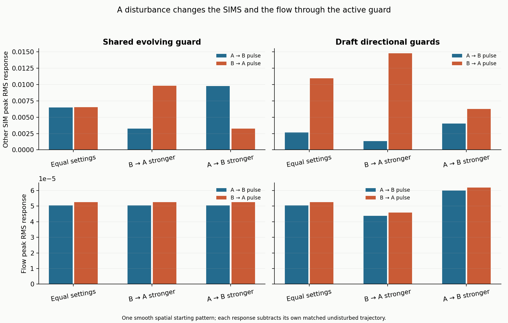

# SIMS in a Navier–Stokes flow: equal and unequal influence

**Completed with limits.** The guard remained part of the interaction throughout the primary comparisons. Unequal influence changed both the SIMS responses and the fluid response. Averaged response comparisons were stable under refinement, but **two checks of detailed spatial fields failed their preset tolerance**.

## What changed

Two abstract SIMS, A and B, were represented as fields carried by a two-dimensional fluid. Each directional guard responded to the SIMS and the fluid's strain, regulated influence, and changed viscous resistance. All fields evolved together through model time 4.

We applied the same positive disturbance to A or B and compared each run with its own undisturbed counterpart. The table shows the largest sampled, spatially averaged response of the **other** SIM. Larger values mean a larger response, not a better outcome.

| Configured influence | B's response to a disturbance on A | A's response to a disturbance on B |
| --- | ---: | ---: |
| Equal: 1 each way | 0.00266 | 0.01097 |
| B → A favored: 1.5 versus 0.5 | 0.00132 (**−50.4%**) | 0.01476 (**+34.6%**) |
| A → B favored: 1.5 versus 0.5 | 0.00404 (**+51.7%**) | 0.00628 (**−42.8%**) |

Percentages compare with the equal-settings run for that same disturbance. Total configured influence stayed fixed.

**Equal settings did not give equal responses.** In this directional model, B's disturbance produced about **4.1 times** the response in A that A's disturbance produced in B. The participants began with different states and baselines; the evolving guards admitted their influence differently. This ratio belongs to those chosen rules and starts.

**The fluid also responded.** For a disturbance on B, favoring B → A reduced the peak velocity response by **12.5%**, while favoring A → B increased it by **17.8%**. The absolute responses were small: 0.0000459, 0.0000525 and 0.0000618 in model velocity units. A stronger SIMS response therefore did not automatically mean a stronger fluid response.

## What keeping the guard active contributed

The guards changed in every disturbed primary case. At equal settings, the directional version's receiver response was about **60% lower for A → B** and **65% higher for B → A** than with the guards frozen at their initial value. Freezing the guards or disabling their stress feedback removed the pulse-induced fluid response in these controls.

The shared evolving-guard control gave roughly ±50% receiver changes when weights were redistributed, while its fluid path stayed unchanged. That fluid independence follows algebraically from this particular shared rule. It is a useful comparison, not a general law of influence.

## How much to trust this result

The study completed 45 conditions, repeated across three grids and two time steps, plus relabeling and independent-solver checks. Conservation, guard bounds, independent evolution and saved-field checks passed. From the 32² to 48² grid, the largest normalized change in a component response curve was **0.128%**; halving the time step changed it by less than **0.000004%**. The directional influence contrasts above were much larger than their measured numerical sensitivities.

**The detailed-field screen failed:** maximum spatial RMS differences were **0.00754** for 24² → 32² and **0.00254** for 32² → 48², against a fixed **0.002** tolerance. The largest discrepancy was in a guard field. Thus the averaged comparisons have stronger numerical support than the fine spatial patterns. The report retains both failures; the model has not passed every accuracy screen.

This is a bounded test of one proposed, two-dimensional coupling and one smooth starting pattern. The guard-to-viscosity rule remains an assumption. Time is uncalibrated; no rupture threshold, irreversible change, material chemistry or validation of the whole original framework is established here.

[Sources, equations, full results and checks](METHODS.md)
