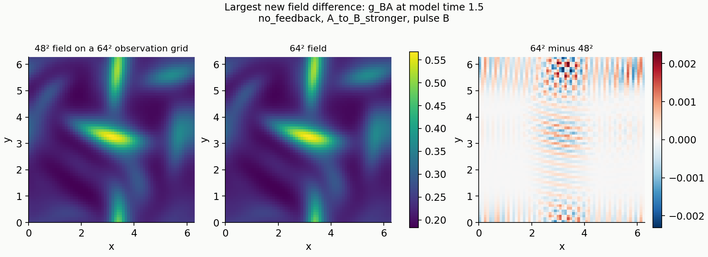

# Sources and details: the 64 × 64 refinement

[Read the refinement result](README.md)

## What this comparison changes

This adds a 64 × 64 grid to the [original completed fluid comparison](https://github.com/NousVolition/My-Sources-Project-ALL/blob/2d99c8c4fe36f4ca1e8b25339ab0358211bffbd3/reports/sims-navier-stokes-guard/README.md). The numerical model is a byte-for-byte copy of its frozen source. The equations, coefficients, initial fields, pulse, influence weights, guard rules and model-time interval 0–4 are unchanged. The original equations and their connection to the framework are documented in the [original methods](https://github.com/NousVolition/My-Sources-Project-ALL/blob/2d99c8c4fe36f4ca1e8b25339ab0358211bffbd3/reports/sims-navier-stokes-guard/METHODS.md).

The primary comparisons keep the guard inside the interaction at every integration stage: the participants and strain change the guard, and the guard changes both influence and viscous stress. Equal configured weights are (1,1); unequal weights are (1.5,0.5) and (0.5,1.5). Their total stays fixed. The current effective influences also depend on the changing directional guards, so equal settings need not produce equal responses.

The original shared-guard, frozen-guard, feedback-disabled and strain-disabled controls are repeated unchanged. The frozen controls diagnose adaptation; they are not counted as continuously evolving-guard results. The two primary active rules are reported separately.

## Bounded matrix

| Comparison | What is held fixed | What it checks |
| --- | --- | --- |
| Original 48² at step 0.005 → new 64² at step 0.005 | Equation, start, disturbance, conditions and time step | Spatial resolution |
| New 64² at step 0.005 → new 64² at step 0.0025 | Equation, start, disturbance, conditions and grid | Time-step sensitivity |

There are 45 conditions per batch: five guard/coupling choices, three influence pairs and three pulse choices (none, A or B). The two new batches contain 90 integrations of those same conditions. These are numerical repeats, not independent population samples. No additional starts, grids, disturbances or longer horizons are included.

The old 24² → 32² and 32² → 48² failures remain unchanged. Their time step was 0.01. The new spatial pair uses step 0.005 on both grids. The old 48² time-step comparison and new 64² time-step comparison quantify temporal sensitivity separately. A reduction between successive spatial-pair maxima is an empirical comparison, not a fitted convergence order or rigorous error bound.

## Measurements and unchanged tolerances

All six fields—two velocity components, two participant states and two directional guards—are compared at model times 0, 1, 1.5, 2.5 and 4 across all 45 conditions. The coarser Fourier field is evaluated on the finer observation grid. The difference includes the finer representation's additional modes. The spatial screen takes the largest component RMS difference over every saved time and condition, with the **original tolerance of 0.002**. The temporal field tolerance remains 0.00001.

Responses subtract each disturbed trajectory's own undisturbed counterpart with the same rule and weights. A receiver response measures the other participant. A fluid response measures the RMS magnitude of the vector velocity difference. Peaks are maxima of measurements saved every 0.05 model units; they are not continuous-time extrema.

Whole response curves are checked against the same 5% spatial and 1% temporal limits, with the original absolute denominator floor of 0.0000001. The measurements table also records the change in each sampled receiver and fluid peak under spatial and temporal refinement. These finite sensitivities are not confidence intervals.

The solver still uses strict two-thirds Fourier truncation, pressure projection, the full divergence of variable viscous stress and four-stage RK4. All six fields advance together at every stage, without clipping the guards. The sigmoid is not a polynomial, so its spatial resolution is assessed by these grid comparisons.

## Verification and provenance

The preflight checks compare the exact finite starting fields and pulse across grids, verify the discrete energy identity on the new grid, and check initial divergence and step scales. Source, protocol and parent-result hashes are verified before and after integration. The original independent curl-form/DOP853 and participant-relabeling checks are reused explicitly; they are not new independent checks at 64².

The analyzer remeasures every saved new field directly: starting values, kinetic energy, means, guards, participant separation, responses, strain dissipation, enstrophy, viscosity and divergence. It checks the energy budget integrated during evolution, stage guard bounds, CFL, mean drift and all original hard limits. It also repeats the shared-rule fluid null and the disabled-feedback fluid null on the new saved fields. Failed historical screens remain separate from new checks in the verification file.

Execution is limited to one FFT worker and one BLAS thread, 3,600 seconds per batch, 7,200 seconds overall and 1 GiB of study storage. Free memory is checked before each batch. The thread limits are set before importing numerical libraries and recorded in the environment file. A failure is preserved; the runner does not automatically retry it or add another grid.

## Saved evidence

| Contents | Link |
| --- | --- |
| Fixed matrix, equation parameters, tolerances and parent input hashes | [Protocol](protocol.json) |
| Byte-identical numerical model | [Model source](model.py) |
| Frozen file hashes and original-manifest check | [Freeze](freeze.json), [setup audit](setup-audit.json) |
| New-grid preflight and outcomes | [Preflight source](preflight_refinement.py), [preflight results](preflight.json) |
| Bounded runner | [Run source](run_refinement.py) |
| Analysis, verification and chart source | [Analyzer](analyze_refinement.py) |
| New and preserved historical screens | [Verification](results/verification.json) |
| All interpreted comparisons | [Analysis data](results/analysis.json) |
| Every disturbed case and its numerical sensitivities | [Measurements](results/measurements.csv) |
| Raw fields, time series, case definitions and completion record | [Saved results](results/) |
| Runtime environment and process history | [Environment](environment.json), [handoff](handoff.json) |
| Delivery file hashes | [Manifest](manifest.json) |
| Original completed comparison, unchanged at its publication commit | [Original evidence](https://github.com/NousVolition/My-Sources-Project-ALL/tree/2d99c8c4fe36f4ca1e8b25339ab0358211bffbd3/reports/sims-navier-stokes-guard) |

Each NPZ contains `fields` with axes `(saved time, case, component, x, y)` and a `time` array. Components are `(u, v, x_A, x_B, g_AB, g_BA)`; case indices follow `cases.json`. The matching JSON contains the 81 diagnostic records and stage-bound summaries.

The colour scale shows differences at individual grid points. The 0.002 accuracy screen applies to the RMS over the whole domain. This worst case is the diagnostic with guard-to-flow feedback disabled, with A → B favored and a disturbance on B.

### Reproduction

Preserve the published evidence. Use a separate fresh study copy with the original parent files available, and install the versions recorded in `environment.json`. The saved runner uses a Windows memory check. The frozen protocol records the original machine's absolute parent directory. On another Windows machine, update only that reference in a reproduction copy, record the relocation and its new protocol hash, then rebuild that copy's freeze. Do not alter the published freeze or claim the relocated protocol is byte-identical to it. Its referenced parent-file hashes must still match.

Set `OMP_NUM_THREADS`, `OPENBLAS_NUM_THREADS` and `MKL_NUM_THREADS` to 1 before starting Python. The driver also sets these before imports. In the fresh copy, run `python -B run_refinement.py`; after it exits successfully, run `python -B analyze_refinement.py`. The driver refuses an existing controller lock or results directory. Preserve any failure and its partial results. A reproduction needs its own clean output location.

## Limits

This is one two-dimensional, periodic, abstract model with one smooth spatial start and one positive pulse shape. The guard-to-viscosity assignment is still a proposed assumption. Time is not calibrated to physical seconds. The model has no physical walls, material chemistry, programmed rupture or irreversible transition. Improved numerical agreement supports this particular finite comparison; it does not prove continuum convergence, the whole original framework, or any specific behavior of people or substances.

## Numerical outcome

49 of 49 new checks passed; the two historical failures are retained separately.

| New check | Maximum | Fixed tolerance | Result |
| --- | ---: | ---: | --- |
| spatial full band fields | 0.00036245929 | 0.002 | Passed |
| temporal full band fields | 2.688071e-11 | 1e-05 | Passed |
| spatial response rms curves | 2.8725821e-05 | 0.05 | Passed |
| spatial flow response rms curves | 1.2215766e-05 | 0.05 | Passed |
| temporal response rms curves | 2.385438e-09 | 0.01 | Passed |
| temporal flow response rms curves | 1.9416842e-09 | 0.01 | Passed |

The largest new spatial difference is in g_BA, at time 1.5, in case {'id': 35, 'mode': 'no_feedback', 'weight': 'A_to_B_stronger', 'k': [0.5, 1.5], 'pulse': 'B'}. Component maxima in order (u, v, x_A, x_B, g_AB, g_BA) are [5.125161641845448e-06, 1.0333154261544027e-05, 6.082187943714968e-05, 0.00017514381270649244, 0.0001031000419250126, 0.00036245928522145575].

Among primary active cases, the largest receiver-peak sensitivity is 1.78646e-11 under spatial refinement and 3.21556e-12 under time-step refinement. For fluid peaks these are 1.5565e-10 and 1.12416e-14. These are measured finite sensitivities, not error bounds.

Across both new batches, the stage guard range is 0.17341492 to 0.88428409. Maximum CFL is 0.096766205, maximum divergence 6.6613381e-16, maximum mean-velocity drift 1.5229652e-17, and maximum relative energy-balance residual 2.031825e-12.
