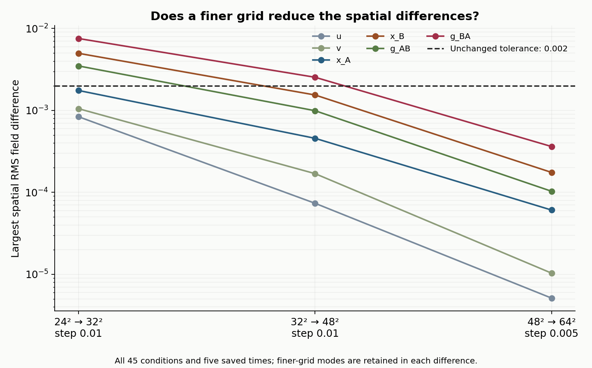

# Finer grid: SIMS with a continuously active guard

**The finer grid passes the unchanged spatial tolerance.** The largest field difference fell by **85.7%** compared with the previous grid pair. The equation, starting fields, equal and unequal influence settings, and continuously participating guard are unchanged.

## Did the spatial checks improve?

| Grids compared | Largest spatial RMS difference | Original tolerance: 0.002 |
| --- | ---: | --- |
| 24 × 24 → 32 × 32 | 0.0075409 | Failed; original result preserved |
| 32 × 32 → 48 × 48 | 0.0025379 | Failed; original result preserved |
| **48 × 48 → 64 × 64** | **0.0003625** | **Passed** |

The new row compares both grids at the same time step. It measures all six fields, across all 45 conditions and five saved times, including the finer grid's additional spatial detail. It adds evidence without changing the two older failures.

## Did equal and unequal influence change?

These are the receiver's largest sampled RMS responses on the 64 × 64 grid with the smaller time step. Each disturbed run is compared with its own undisturbed counterpart.

| Configured influence | B responds to A's disturbance | A responds to B's disturbance |
| --- | ---: | ---: |
| Equal: 1 each way | 0.00266 | 0.01097 |
| B → A favored | 0.00132 (-50.4%) | 0.01476 (+34.6%) |
| A → B favored | 0.00404 (+51.7%) | 0.00628 (-42.8%) |

Percentages compare with equal settings for the same disturbance. Unequal settings remain 1.5 versus 0.5, with the total fixed at 2.

At equal settings, the directional model's B → A response is **4.1 times** its A → B response. The participants have different starting states and baselines, and their guards evolve differently. For a disturbance on B, favoring B → A changes the fluid response by **-12.5%**; reversing the preference changes it by **+17.8%**. These comparisons retain the original rounded findings.

The guard stays inside both the interaction and the fluid stress throughout the primary runs. Its response to the disturbance is nonzero in every primary disturbed case. Frozen guards remain a separate diagnostic control.

## Confidence and limits

The refinement completed **90 new integrations of the same 45 conditions**. **49 of 49 new checks passed.** Halving the time step also passed the unchanged accuracy check. The original source hashes and saved results are preserved.

This supports the finite numerical comparison for this chosen two-dimensional model. It does not prove continuum convergence or validate the entire original framework. The guard-to-viscosity rule remains an assumption; model time is uncalibrated, and no rupture or irreversible transition is established.

[Sources, equations, full results and checks](METHODS.md)
