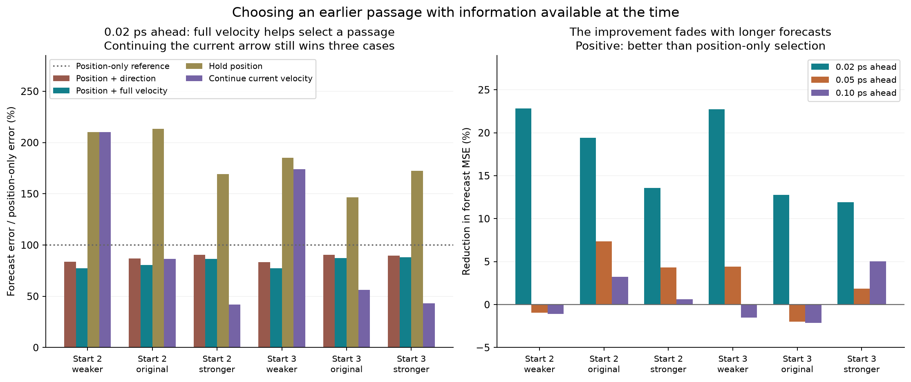

# Choosing a gas return using its full velocity

**Question:** when the collective orientation path returns near an earlier passage, does matching its speed and direction help predict what happens next?

**Result:** at **0.02 ps ahead**, position-plus-velocity selection reduces forecast error by **11.9–22.8%** relative to position-only selection in all six comparisons on the two evaluation starts. But continuing the current velocity in a straight line beats it in **three of six**. At **0.10 ps**, the velocity-based selection improves on position-only selection in three cases and worsens it in three.



## Read the results

- [Illustrated report](report.html): methods, all comparisons, failed controls, and recording-resolution checks. GitHub displays HTML source; download the files and open the report in a browser to read its formatted version.
- [Complete measurements](data/results.json), [protocol](data/protocol.json), and [frozen training settings](data/locked_training.json).
- [Analysis](analyze_selection.py), [figure/report builder](build_report.py), and [portable verification](verify_publication.py).
- [Local experiment validation](data/delivery_validation.json) and [publication audit](publication_audit.json).

The model is 96 rigid TIP3P water-vapor molecules under a turning and strength-regulating field, with damping rates of 0.2, 1, and 10 per ps. The plotted position is the mean unit-dipole direction projected onto x/y; its velocity is **not molecular translational velocity**.

## What makes this a harder check?

Each rule chooses among older passages within distance 0.02 and 0.10–1.00 ps in the past. Position alone, position plus direction, and position plus full velocity are compared at identical eligible anchor times. After selection, the older passage is fixed. Its subsequent displacement is translated onto the current point to produce a forecast.

Both velocity estimates use past frames only. The selected older continuation is already recorded at the prediction time. Changing future observations leaves the selection and prediction unchanged, as checked by a dedicated mutation test.

Start 1 selects one shared weight per method; starts 2 and 3 evaluate those frozen settings at each damping level. These starts were inspected in earlier exploratory work, so this is a separate-start check of the new rule, **not untouched confirmatory evidence**. Overlapping observations are not independent events. The longer horizons and simple baselines are retained even when they outperform the more detailed rule.

## Reproduce without rerunning molecular dynamics

Use Python 3.12. From this directory:

```sh
python -m pip install -r requirements.txt
python verify_publication.py --numeric
python analyze_selection.py
python build_report.py
```

The [supporting trajectory directory](../gas-damping-extension/README.md) contains all **12 original input files**: nine coarse trajectories and three finer recordings of start 2. Their original hashes are recorded in `data/results.json`. The published inputs and numerical outputs are byte-for-byte copies of the local experiment.

`data/predictions_r*_gamma*.npz` contains per-anchor forecasts and errors at 0.02, 0.05, and 0.10 ps. The three passage selectors also record their chosen earlier times, initial comparisons, and unshifted paired-path distances and angles. The fine-data comparison uses common eligible anchors and keeps the training weights fixed.

The verification command checks publication hashes, input hashes, frozen training settings, equal method denominators, past-only availability of the selected continuation, and an independent reconstruction of all saved forecasts and errors. No new molecular dynamics was run. Rerunning the analysis may change compressed-file byte hashes while preserving the numerical results; verify the delivered snapshot before regenerating it.

## Previous check

The preceding fixed-pair experiment followed the weaker-damping passage at 12.950 ps and its earlier match at 12.3949944585 ps. They started close with similar directions and speeds, but the first saved sample outside the near boundary was only 0.013 ps later. That motivated this test of whether a better rule could select more useful earlier passages.

This publication contains the return-selection experiment and its exact source trajectories. The earlier experiment's full report is outside this package. Two HTML navigation links were changed to this context section; the scientific results and analysis scripts were not changed. `original_manifest_sha256.json` retains the original artifact hashes, and `manifest_sha256.json` covers the published package. `publication_audit.json` identifies those two navigation-only changes.

## Limits

Matching this projection does not establish recurrence of the full molecular state or a persistent memory mechanism. Different damping runs have different temperatures and stochastic forcing. Finer recording preserves the short-horizon selection improvement but changes the errors and strengthens the simple straight-line baseline. This is not an integration-step convergence test, and no universal optimal selector or statistical significance is claimed.
